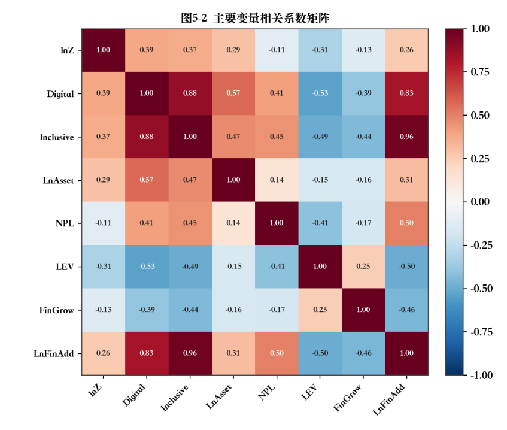
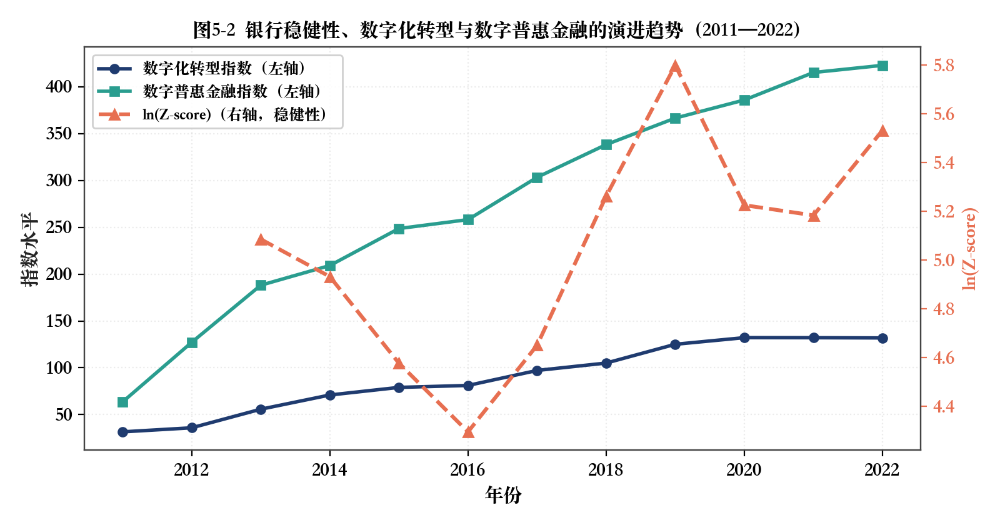
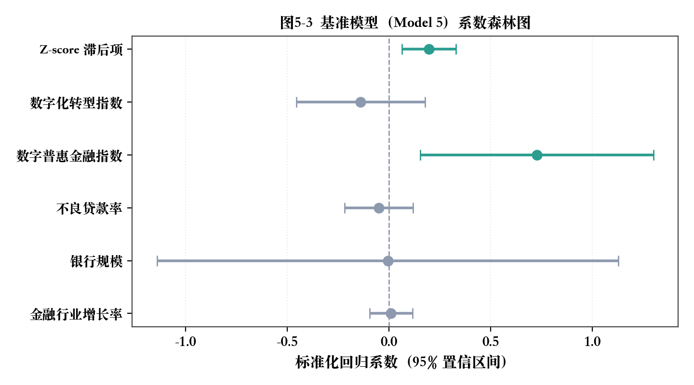
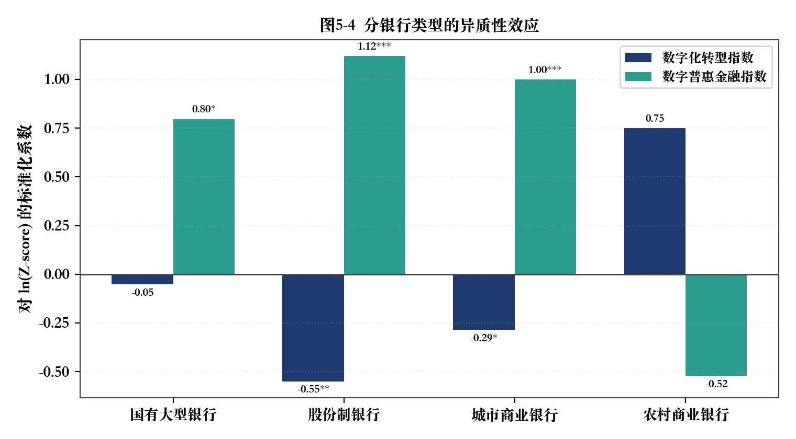
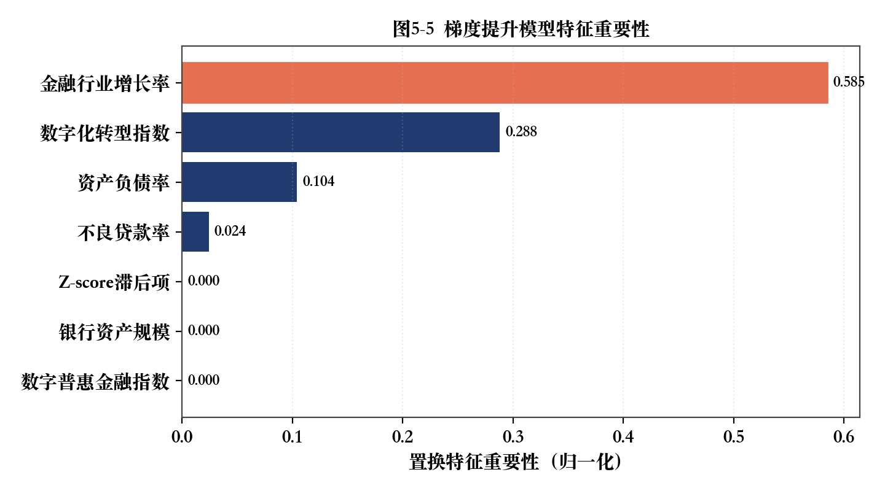
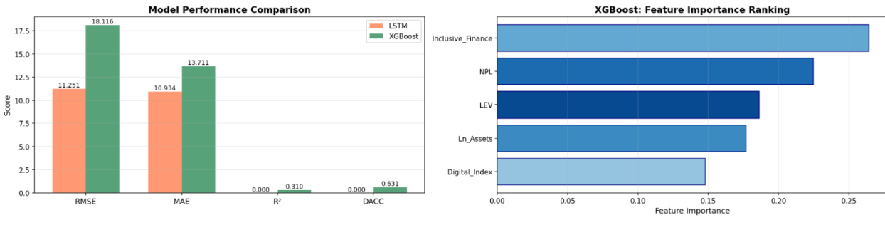

# 金融科技对商业银行风险承担的影响：基于Z-score的实证研究

**原文完整对照·有限修订版 v3.0.0｜2026年11月16日**

本版直接依据本次上传Word生成，与此前较大幅度修订稿分开保存。正文仍按原六章、原小节、参考文献和致谢组织，不新增理论或实证模块，不迁移预测部分，不新增文献、数据、模型或检验。

仅有17处非实证段落提出局部修词建议。每处按“完整原文—完整修改稿—修改说明”展示，供逐项选择；其余内容照录。原文对照不是摘要或摘句，未以省略号代替未显示的句子。P号为原Word主文档直接段落顺序，包含空段，不计表格单元格；定位以原章节和P号为准。

**保留边界：**研究设计、实证分析和结论部分的原段落、公式、表格、图题、显著性、预测结果及判断全部保留；现存5处严重问题仅另列“编者核对旁注”。旁注不是修改稿、实证分析或原结论的替代，不代表相关问题已被修正。

处理优先级为：先审查第1章和第5章，第1章仅局部修词，第5章按保留边界只加旁注；随后处理第2、3章少量概念及措辞问题；最后核对第4、6章、摘要、参考文献和图表完整性。交付仍按原文章节先后排列。

原始Word：[长期归档文件](source/金融科技对商业银行风险承担的影响：基于Z-score的实证研究.docx)；SHA-256：`7fbd9148eb97c9ebcc7221e55b7308bb30413e12e2e8ad39820524398cffd7a2`。35个原始公式对象另有[OMML原式存档](source/formulas/7fbd9148eb97-原始OMML.xml)；Markdown只作排版转换，不修补原式、改变量名或增删项。

## 目录

- 摘要
- Abstract
- 1 引言
- 2 文献综述
- 3 金融科技对银行风险承担的影响机制分析与研究假设
- 4 研究设计
- 5 实证结果分析
- 6 结论与政策建议
- 参考文献
- 致谢

> 排版说明：Word目录域和自动标题编号转换为Markdown层级；图像以原文件引用。编号和排版容器的转换不属于正文改写。

## 原文前置资料

<!-- SOURCE:P0001 -->

<!-- END:P0001 -->

<!-- SOURCE:T001 -->

|  | 学校代码： 10246 |
| --- | --- |
|  | 学   号： 24210680071 |

<!-- END:T001 -->

<!-- SOURCE:P0002 -->

<!-- END:P0002 -->

<!-- SOURCE:P0003 -->

<!-- END:P0003 -->

<!-- SOURCE:P0004 -->

<!-- END:P0004 -->

<!-- SOURCE:P0005 -->

<!-- END:P0005 -->

<!-- SOURCE:P0006 -->

<!-- END:P0006 -->

<!-- SOURCE:P0007 -->

<!-- END:P0007 -->

<!-- SOURCE:T002 -->

| 硕士学位论文 (专业学位) |
| --- |

<!-- END:T002 -->

<!-- SOURCE:P0008 -->

<!-- END:P0008 -->

<!-- SOURCE:P0009 -->

<!-- END:P0009 -->

<!-- SOURCE:T003 -->

| 金融科技对商业银行风险承担的影响：基于Z-score的实证研究 |
| --- |

<!-- END:T003 -->

<!-- SOURCE:P0010 -->

<!-- END:P0010 -->

<!-- SOURCE:T004 -->

| The Impact of FinTech on Commercial Banks' Risk-Taking: An Empirical Study Based on the Z-score |
| --- |

<!-- END:T004 -->

<!-- SOURCE:P0011 -->

<!-- END:P0011 -->

<!-- SOURCE:P0012 -->

院 系：经济学院

<!-- END:P0012 -->

<!-- SOURCE:P0013 -->

专业学位类别(领域)：金融

<!-- END:P0013 -->

<!-- SOURCE:P0014 -->

姓 名：李俊龙

<!-- END:P0014 -->

<!-- SOURCE:P0015 -->

指 导 教 师：张徐乐

<!-- END:P0015 -->

<!-- SOURCE:P0016 -->

完 成 日 期：2026年9月17日

<!-- END:P0016 -->

<!-- SOURCE:P0017 -->

<!-- END:P0017 -->

<!-- SOURCE:P0018 -->

**指导小组成员名单**

<!-- END:P0018 -->

<!-- SOURCE:P0019 -->

<!-- END:P0019 -->

<!-- SOURCE:P0020 -->

何光辉 教授 复旦大学经济学院

<!-- END:P0020 -->

<!-- SOURCE:P0021 -->

<!-- END:P0021 -->

<!-- SOURCE:P0022 -->

陆前进 教授 复旦大学经济学院

<!-- END:P0022 -->

<!-- SOURCE:P0023 -->

<!-- END:P0023 -->

<!-- SOURCE:P0024 -->

朱宏飞 副教授 复旦大学经济学院

<!-- END:P0024 -->

<!-- SOURCE:P0025 -->

<!-- END:P0025 -->

<!-- SOURCE:P0026 -->

张徐乐 副教授 复旦大学经济学院

<!-- END:P0026 -->

<!-- SOURCE:P0027 -->

<!-- END:P0027 -->

<!-- SOURCE:P0028 -->

## 摘要

<!-- END:P0028 -->

<!-- SOURCE:P0029 -->

<!-- END:P0029 -->

<!-- SOURCE:P0030 -->

金融科技的迅猛发展正在深刻重塑全球银行业态与银行风险管理模式。本研究以2011—2022年中国A股上市商业银行为样本，以Z-score的对数值度量银行稳健性，构建个体固定效应面板模型，从区域外部数字普惠金融生态与银行内部数字化转型两个维度衡量金融科技发展，实证检验了金融科技对银行风险承担的影响及其在不同银行群体间的差异特征，并进一步采用梯度提升与神经网络两类机器学习模型对风险承担演变趋势进行前瞻性预测。

<!-- END:P0030 -->

<!-- SOURCE:P0031 -->

研究发现：第一，区域数字普惠金融能够显著提升商业银行稳健性，降低银行风险承担，该结论经过多种模型设定、样本调整与变量替换后依旧稳健。第二，银行自身数字化转型对稳健性的净直接效应未获得稳健的统计支持：基准回归中数字化转型指数的正向关联在控制银行规模后不再显著，表明稳健性收益可能与外部生态及自身能力的匹配程度密切相关。第三，异质性分析表明金融科技对商业银行风险承担的影响在不同类型与规模的银行间存在显著差异，相较于国有大型银行，股份制银行与城市商业银行在数字化转型初期呈现较明显的风险承担上升倾向。第四，工具变量敏感性检验未改变核心结论的方向性特征；机器学习趋势预测显示，若当前趋势延续，银行业整体稳健性有望保持大体平稳、温和改善的态势，为前瞻性风险管理提供了数据参考。

<!-- END:P0031 -->

<!-- SOURCE:P0032 -->

本研究通过整合“宏观金融生态—微观银行实践”的分析框架，厘清金融科技影响银行风险承担的差异化路径，为监管机构实施差异化、前瞻性政策，以及商业银行在数字化转型中平衡创新与风险承担提供了实证依据与决策参考。

<!-- END:P0032 -->

<!-- SOURCE:P0033 -->

<!-- END:P0033 -->

<!-- SOURCE:P0034 -->

关键词： 金融科技 商业银行风险承担 Z-score 数字化转型 数字普惠金融

<!-- END:P0034 -->

<!-- SOURCE:P0035 -->

<!-- END:P0035 -->

<!-- SOURCE:P0036 -->

## Abstract

<!-- END:P0036 -->

<!-- SOURCE:P0037 -->

<!-- END:P0037 -->

<!-- SOURCE:P0038 -->

The rapid development of FinTech is profoundly reshaping the global banking landscape and bank risk management practices. Using a sample of Chinese A-share listed commercial banks from 2011 to 2022, this study measures bank soundness using the natural logarithm of the Z-score and constructs an individual fixed-effects panel model. FinTech development is measured from two dimensions: the external regional digital financial inclusion ecosystem and banks’ internal digital transformation. The study empirically examines the impact of FinTech on bank risk-taking and its heterogeneous patterns across bank groups, and further employs gradient boosting and neural network models to forecast the evolution of bank risk-taking.

<!-- END:P0038 -->

<!-- SOURCE:P0039 -->

The findings are as follows. First, regional digital financial inclusion significantly enhances the soundness of commercial banks and reduces bank risk-taking. This conclusion remains robust across various model specifications, sample adjustments, and variable substitutions. Second, the net direct effect of a bank’s own digital transformation on soundness is not statistically significant. The positive association between the digital transformation index and soundness in the baseline regression becomes statistically insignificant once bank size is controlled for, suggesting that the soundness effects of technological investment may depend on the alignment between the external ecosystem and the bank’s own capabilities. Third, heterogeneity analysis shows that the impact of FinTech on bank risk-taking differ significantly across banks of different types and sizes. Compared with large state-owned banks, joint-stock commercial banks and city commercial banks exhibit a more pronounced tendency toward increased risk-taking during the early stage of digital transformation. Fourth, instrumental-variable sensitivity analyses do not alter the direction of the core findings. Machine-learning trend forecasts suggest that, if current trends continue, the overall soundness of the banking sector is likely to remain broadly stable with a modest improvement, providing a data-based reference for forward-looking risk management.

<!-- END:P0039 -->

<!-- SOURCE:P0040 -->

By integrating macro-level financial ecosystems with micro-level banking practices into a unified analytical framework, this study clarifies the differentiated channels through which FinTech affects bank risk-taking. It provides empirical evidence and decision-making support for regulatory authorities in formulating differentiated and forward-looking policies, and for commercial banks seeking to balance innovation and risk-taking during digital transformation.

<!-- END:P0040 -->

<!-- SOURCE:P0041 -->

<!-- END:P0041 -->

<!-- SOURCE:P0042 -->

Keywords: FinTech; Commercial Banks’ Risk-Taking; Z-score; Digital Transformation; Digital Financial Inclusion

<!-- END:P0042 -->

<!-- SOURCE:P0043 -->

<!-- END:P0043 -->

<!-- SOURCE:P0044 -->

<!-- END:P0044 -->

<!-- SOURCE:P0045 -->

#

<!-- END:P0045 -->

<!-- SOURCE:P0046 -->

## 1 引言

<!-- END:P0046 -->

<!-- SOURCE:P0047 -->

### 1.1 研究背景

<!-- END:P0047 -->

<!-- SOURCE:P0048 -->

<!-- END:P0048 -->

<!-- SOURCE:P0049 -->

数字技术在金融服务中的应用改变了信息处理、客户触达与业务组织方式，也对商业银行的经营模式和风险管理提出了新的要求。金融科技与银行业的关系既涉及效率改善，也涉及竞争格局、监管边界与技术依赖的变化（Thakor, 2020；Boot et al., 2021）。本文关注这些变化与银行稳健性及风险承担之间的经验联系。

<!-- END:P0049 -->

<!-- SOURCE:P0050 -->

国际研究对金融科技的风险后果并未形成单一结论。Berg等（2020）发现数字足迹具有信用风险预测价值；Erel和Liebersohn（2022）讨论了金融科技改善融资可得性的作用；Di Maggio和Yao（2021）则揭示了金融科技借款人特征与贷款表现中的风险问题。这些贷款或客户层面的证据不能直接等同于银行整体破产风险的变化。Philippon（2016）从金融中介成本与监管适应性讨论金融科技的机会；金融稳定理事会（FSB, 2019）和巴塞尔银行监管委员会（BCBS, 2018）则强调其潜在金融稳定影响及监管挑战。

<!-- END:P0050 -->

<!-- SOURCE:P0051 -->

在中国，银行数字化转型与区域数字普惠金融同步发展。技术应用可能改善信息处理与风险识别，也可能带来模型、数据安全和第三方依赖风险。相关研究分别从互联网金融竞争、银行管理成本和数字化转型等角度展开讨论（郭品和沈悦, 2015；刘孟飞和王琦, 2022；蒋海等, 2023）。不同样本、技术指标和风险度量可能导致经验结论差异，需要在清晰的指标定义下进行比较。

<!-- END:P0051 -->

<!-- SOURCE:P0052 -->

值得注意的是，中国商业银行的风险治理呈现独特路径，这一独特性根植于区域数字金融生态的差异化发展。数字普惠金融指数提升显著，本研究测算显示，省级数字普惠金融指数均值由2011年的40.00升至2022年的379.44，累计增长约849%，区域间的数字金融基础设施建设为商业银行拓展长尾客群、优化风险管理提供了外部支撑。然而，外部生态的改善能否转化为银行自身的风险管理能力，仍取决于技术投入与组织适配的匹配程度。

<!-- END:P0052 -->

<!-- SOURCE:P0053 -->

本文区分金融科技、银行数字化转型与数字普惠金融：金融科技是技术驱动的金融创新，银行数字化转型是微观机构层面的业务与管理改造，数字普惠金融则描述区域数字金融服务的发展状况。风险度量也需区分行为与结果：主动风险承担指银行通过资产配置、业务扩张等决策形成风险暴露；破产风险反映损失超过盈利与资本缓冲的可能性。本文的会计型Z-score衡量稳健性，数值越高通常意味着破产风险越低，而非直接反映管理层风险偏好。将其作为风险承担的反向代理变量，是基于风险决策可能最终影响盈利波动及资本缓冲这一联系；由于该联系也受外部冲击和经营能力影响，本文主要据此解释稳健性，并以RWA/TA作有限的补充检验。

<!-- END:P0053 -->

<!-- SOURCE:P0054 -->

这一研究空白激发了本文的核心研究问题：在数字经济时代，金融科技究竟如何影响商业银行的风险承担？其影响机制、边界条件与动态趋势如何？ 回答这一问题，既需要在理论上厘清金融科技作用于银行风险承担的具体渠道，也需要在实证上区分外部数字金融生态与银行自身技术投入各自的作用，并进一步识别其影响在不同类型银行间的差异。这构成了本文研究设计的基本出发点。

<!-- END:P0054 -->

<!-- SOURCE:P0055 -->

<!-- END:P0055 -->

<!-- SOURCE:P0056 -->

### 1.2 研究意义

<!-- END:P0056 -->

<!-- SOURCE:P0057 -->

#### 1.2.1 理论意义

<!-- END:P0057 -->

<!-- SOURCE:P0058 -->

<!-- END:P0058 -->

<!-- SOURCE:P0059 -->

第一，本文尝试丰富金融科技与银行风险承担关系的研究视角。传统风险管理研究多从资本、资产质量与盈利波动等维度解释银行稳健性，数字技术的应用则可能通过信息处理、竞争压力、经营效率、业务创新与监管适配等多条路径改变上述关系。本文将这些渠道作为理论解释而非已经识别的传导机制，并把宏观数字金融环境与微观银行数字化转型纳入同一经验框架。实证结果显示，银行数字化转型在控制规模后的总体净直接效应未获得稳健统计支持，部分分组结果呈现差异性特征，因而不宜据此作出“技术赋能必然降低风险”或“技术应用必然提高风险”的单向判断。

<!-- END:P0059 -->

<!-- SOURCE:P0060 -->

第二，本文将区域数字普惠金融同时作为外部生态变量和潜在调节因素。结果显示，数字普惠金融与银行稳健性显著正相关，但其与银行数字化转型的交互项未达到统计显著水平，现有样本因而尚不能确认稳定的调节效应。这一结果提示，技术投入与外部生态之间是否存在协同或替代关系仍需更大样本和更严格识别加以检验；本文提供的是对技术—生态—风险关系的探索性证据，而非对特定治理机制的直接验证。

<!-- END:P0060 -->

<!-- SOURCE:P0061 -->

> **【M01｜高优先级｜原第1章 1.2.1｜P0061】**

**原文（完整段落）**

> 第三，本文的研究推动了银行风险承担度量方法论的发展。理论上，研究突破了传统技术决定论的线性思维，揭示了金融科技对风险承担的影响的条件性与复杂性，为技术治理理论提供了来自转型经济体的新证据。方法上，研究整合了计量经济学与机器学习方法，展示了混合方法在金融风险研究中的互补优势。本文选用Z-score作为银行风险承担的核心度量指标，该指标通过整合资产收益率、权益资产比及其波动率，能够较为综合地反映银行破产风险与稳健性。相较于单一的传统会计指标，Z-score整合盈利、资本缓冲与盈利波动，刻画口径更为综合，但其基于历史会计数据，不包含股价所反映的市场预期，也不具有市场指标意义上的前瞻性；RWA/TA更接近资产配置形成的监管风险暴露，亦受风险权重和计量方法影响。两类指标的对照有助于避免将稳健性变化直接等同于主动风险偏好的变化。本文的研究设计与实证分析为Z-score在中国商业银行风险承担管理研究中的应用提供了方法论参考，推动了银行风险承担度量方法的多元化发展。

**修改稿（完整段落）**

第三，本文通过不同风险指标的比较，明确银行风险承担度量的适用范围。理论上，研究讨论了金融科技对风险承担影响的条件性与复杂性，为理解技术应用与银行风险之间的关系提供了经验参考。方法上，研究整合了计量经济学与机器学习方法，展示了混合方法在金融风险研究中的互补优势。本文选用Z-score作为银行风险承担的核心度量指标，该指标通过整合资产收益率、权益资产比及其波动率，能够较为综合地反映银行破产风险与稳健性。相较于单一的传统会计指标，Z-score整合盈利、资本缓冲与盈利波动，刻画口径更为综合，但其基于历史会计数据，不包含股价所反映的市场预期，也不具有市场指标意义上的前瞻性；RWA/TA更接近资产配置形成的监管风险暴露，亦受风险权重和计量方法影响。两类指标的对照有助于避免将稳健性变化直接等同于主动风险偏好的变化。本文的研究设计与实证分析为Z-score在中国商业银行风险承担研究中的应用及其局限提供了参考。

**修改说明：**仅收敛开头、理论贡献及结尾的度量创新宣称；中间对Z-score和RWA/TA的原有解释及研究结果不变。

<!-- END:P0061 -->

<!-- SOURCE:P0062 -->

<!-- END:P0062 -->

<!-- SOURCE:P0063 -->

#### 1.2.2 实际意义

<!-- END:P0063 -->

<!-- SOURCE:P0064 -->

<!-- END:P0064 -->

<!-- SOURCE:P0065 -->

理论与实践衔接方面，本文梳理金融科技可能通过信息、竞争、效率、创新与监管等渠道影响银行风险承担，并在实证中区分银行个体数字化转型的直接关联与区域数字普惠金融的生态关联，同时通过二次项考察可能的非线性。由于本文未对上述渠道设置可观测中介变量，这些渠道应理解为结果解释的理论背景，而非已经完成识别的经验机制。

<!-- END:P0065 -->

<!-- SOURCE:P0066 -->

第一，本文为差异化审慎监管提供了方向性参考。分组估计提示，股份制银行与城市商业银行的数字化转型系数为负，而国有大型银行的相关系数不显著；但分组内显著性差异并不等同于组间系数差异显著，因此相关结果仅表明可能存在类型差异。监管实践仍应结合机构业务模式、资本缓冲、模型风险和第三方依赖开展分类评估。与此同时，区域数字普惠金融与银行稳健性的正向关联较为稳定，政策部门可继续完善数字基础设施与信息共享环境，并关注其在不同机构间的实际效果。

<!-- END:P0066 -->

<!-- SOURCE:P0067 -->

第二，本文为商业银行制定审慎的数字化转型战略提供了决策参考。研究表明，数字化转型并不自动带来稳健性收益——其表面上的正向关联在控制银行规模后即不再显著，说明技术投入的成效取决于银行自身的资源禀赋与治理能力。这一发现具有重要的警示意义：商业银行在积极拥抱金融科技的同时，应充分认识到技术应用可能带来的新型风险敞口，包括操作风险、模型风险与技术依赖风险等。特别是在转型加速期，银行应建立与数字化进程相匹配的风险治理体系，强化对算法模型、数据安全与系统稳定性的管理，避免盲目追求技术先进性而忽视风险管控的同步跟进。同时，鉴于区域数字金融生态的稳健性效应显著，商业银行应积极参与区域数字金融生态建设，将技术投入与生态协同有机结合，实现风险可控的数字化转型。

<!-- END:P0067 -->

<!-- SOURCE:P0068 -->

第三，本文为政策制定者优化金融科技政策框架提供了经验参考。异质性分析表明，金融科技对商业银行风险承担的影响在不同类型、不同规模银行间存在显著差异，反映出不同机构在资源禀赋、治理结构及区域市场环境上的分化。这提示政策制定者在出台金融科技支持政策时应充分考虑政策的差异化影响，避免大水漫灌式的一揽子政策：对股份制银行与城市商业银行，应重点关注其转型期的风险累积；对中小银行与农村金融机构，应着重完善数字基础设施建设，为其技术追赶提供政策支持。此外，基于梯度提升与神经网络模型的趋势预测显示，若当前趋势延续，银行业整体稳健性大体平稳、温和改善，这为政策制定者提前研判风险承担走势、实施逆周期调节提供了前瞻性参考。

<!-- END:P0068 -->

<!-- SOURCE:P0069 -->

<!-- END:P0069 -->

<!-- SOURCE:P0070 -->

### 1.3 研究内容与研究方法

<!-- END:P0070 -->

<!-- SOURCE:P0071 -->

#### 1.3.1 研究内容

<!-- END:P0071 -->

<!-- SOURCE:P0072 -->

<!-- END:P0072 -->

<!-- SOURCE:P0073 -->

在数字经济时代，金融科技正深刻重塑商业银行的风险治理体系。本文以2011—2022年中国A股上市的36家主要商业银行为研究样本，涵盖国有大型银行、股份制银行及代表性城市商业银行与农村商业银行，构建了“宏观数字金融环境—微观银行数字转型”的双层分析框架，旨在实证检验金融科技对银行风险承担的影响及其作用边界。研究发现：（1）区域数字普惠金融发展水平（Inclusive_Finance）显著提升了银行基于Z-score度量的稳健性，该效应在多种稳健性检验与工具变量估计下保持一致；（2）银行自身数字化转型水平（Digital_Index）对稳健性的净直接效应在控制资产规模后并不显著，二者的交互效应亦未达到统计显著水平，表明外部生态而非个体技术投入构成当前阶段的主导因素；（3）异质性分析表明，该效应在不同规模与不同产权类型的银行间存在显著差异。本研究不仅关注银行自身数字化转型的直接效应，更深入探讨了区域数字金融生态对这一关系的调节作用，力求在宏观环境与微观主体的互动中揭示金融科技影响银行风险承担的内在机制。本研究通过打通宏观区域金融生态与微观银行数字化实践的数据通道，揭示了金融科技影响银行风险承担的作用机制与边界条件，为政策制定者优化制度环境、为银行管理者精准部署风控技术提供了量化决策依据。本文各章节内容安排如下：

<!-- END:P0073 -->

<!-- SOURCE:P0074 -->

第一章为研究背景与意义。本章系统阐述数字经济时代金融科技发展对商业银行风险治理的深刻影响，明确研究问题与理论意义。从宏观层面分析金融科技已成为全球金融业发展的重要驱动力，我国在政策红利与市场需求的共同推动下，金融科技发展速度已位居世界前列；从微观层面论证商业银行作为金融体系的核心组成部分，其风险治理能力的提升对于维护金融稳定、服务实体经济具有重要的现实意义。在此基础上，明确本文的研究目的、研究内容与研究方法。

<!-- END:P0074 -->

<!-- SOURCE:P0075 -->

第二章为文献综述。本章依次梳理金融科技的概念与演进、可能影响银行风险承担的信息、竞争、效率、创新与监管渠道，以及国内外相关经验证据；再次，系统回顾国内外实证研究成果，评述现有研究的贡献与不足，包括研究视角整合不够深入、风险度量方法有待升级、异质性与动态趋势研究有待深化等；重点比较Z-score、RWA/TA及其他风险指标的理论含义、适用范围和局限，并在尊重既有研究贡献的基础上说明本文可能的增量。

<!-- END:P0075 -->

<!-- SOURCE:P0076 -->

第三章为理论分析与研究假设。本章基于信息不对称理论、金融创新理论、长尾理论与金融脆弱性理论，并结合银行业竞争与稳定性关系的经典理论谱系，构建金融科技影响银行风险承担的分析框架。提出以下研究假设：银行数字化转型对自身风险承担具有显著影响；区域数字普惠金融发展对银行稳健性具有直接提升作用，并在银行数字化转型与风险承担的关系中发挥调节作用；上述影响在不同类型、不同规模银行间存在异质性差异。

<!-- END:P0076 -->

<!-- SOURCE:P0077 -->

第四章为研究设计。本章详细阐述实证研究的模型设定、变量选取与数据来源。ln(Z-score)用于衡量银行稳健性和破产风险，并作为风险承担结果的反向代理；RWA/TA用于补充刻画资产配置层面的监管风险暴露。核心解释变量包括商业银行数字化转型指数与地区数字普惠金融指数，并引入两者交互项检验调节效应。控制变量涵盖银行规模、不良贷款率、资产负债率及宏观金融环境变量。基准模型控制银行个体固定效应，并纳入金融行业增长率等年度宏观变量；标准误在银行层面聚类。进一步，基于梯度提升与神经网络等机器学习方法，对银行风险承担演变趋势进行时间序列预测。

<!-- END:P0077 -->

<!-- SOURCE:P0078 -->

第五章为实证结果分析。本章首先进行描述性统计与相关性分析，初步揭示变量基本特征与关联关系。其次，基准回归结果表明，区域数字普惠金融发展水平对银行稳健性具有正向提升作用，而银行自身数字化转型的净直接效应在控制银行规模后并不显著。再次，交互效应分析发现二者的协同效应在本样本中尚不显著，银行风险承担则表现出持续性。稳健性检验与内生性敏感性检验未发现上述结论随变量度量、模型设定与内生性处理方式发生方向性变化。探索性异质性估计提示，数字化转型对风险承担的影响在股份制银行与城市商业银行中更为明显。最后，梯度提升与神经网络两类机器学习模型的预测一致显示，若当前趋势延续，银行业整体稳健性有望保持大体平稳、温和改善的态势。

<!-- END:P0078 -->

<!-- SOURCE:P0079 -->

第六章为结论与政策建议。本章系统总结全文主要研究结论，阐明其理论意涵与实践价值。研究发现表明，金融科技的风险治理是一个涉及技术能力、组织适配、监管框架与市场生态的系统工程。在此基础上，本文从商业银行审慎经营、监管机构有效监督、宏观政策精准制定三个维度提出政策建议。最后，客观分析本文的研究局限，并对未来研究方向进行展望。

<!-- END:P0079 -->

<!-- SOURCE:P0080 -->

<!-- END:P0080 -->

<!-- SOURCE:P0081 -->

#### 1.3.2 研究方法

<!-- END:P0081 -->

<!-- SOURCE:P0082 -->

<!-- END:P0082 -->

<!-- SOURCE:P0083 -->

1.  文献研究法。本研究采用混合研究方法，将文献研究、理论分析与实证检验有机结合。首先通过系统性文献检索与批判性整合构建理论根基，覆盖近十年国内外关于金融科技、银行风险承担管理和数字普惠金融的核心成果。重点梳理了三大研究脉络：一是技术应用的具体路径，如人工智能、大数据、区块链等技术在银行风控中的实际应用案例与效果；二是区域分化现象，特别是我国东部与中西部地区在数字金融基础设施、技术渗透率等方面的显著差异；三是政策监管框架的演变及其对金融科技发展的影响。本文发现传统研究多侧重宏观金融政策分析，而对微观银行行为与技术演变的探讨相对不足。

<!-- END:P0083 -->

<!-- SOURCE:P0084 -->

2.  理论分析法。在理论分析层面，本研究以金融科技、微观银行数字化转型与宏观数字普惠金融三者关系的辨析为逻辑起点，并基于信息不对称理论、金融创新理论、长尾理论与金融脆弱性理论，构建金融科技影响银行风险承担的理论分析框架。在变量操作化上，本研究直接采用北京大学数字普惠金融指数与商业银行数字化转型指数两个权威外部指数，对核心变量进行内涵解析与操作化界定，而非由作者自行构建综合指数。

<!-- END:P0084 -->

<!-- SOURCE:P0085 -->

> **【M02｜高优先级｜原第1章 1.3.2｜P0085】**

**原文（完整段落）**

> 3.  实证检验法。实证检验是本研究的核心环节，采用严谨的计量经济学方法确保研究结论的可靠性。构建严谨的面板数据计量模型与机器学习预测模型，并通过替换度量、调整样本、分组估计与工具变量法评估结果的敏感性；机器学习模型用于补充考察非线性预测关系，系统检验了金融科技对商业银行风险承担的影响机制、边界条件与动态趋势，为相关理论提供了全面的经验证据。

**修改稿（完整段落）**

3.  实证检验法。实证检验是本研究的核心环节，采用计量经济学方法评估研究结果的可靠性。构建面板数据计量模型与机器学习预测模型，并通过替换度量、调整样本、分组估计与工具变量法评估结果的敏感性；机器学习模型用于补充考察非线性预测关系，考察金融科技与商业银行风险承担的关系、边界条件与动态趋势，为相关理论提供经验证据。

**修改说明：**只改研究方法对“确保可靠”“已识别机制”和“全面证据”的概括，保留已有面板、机器学习和敏感性方法的叙述，不增加分析。

<!-- END:P0085 -->

<!-- SOURCE:P0086 -->

<!-- END:P0086 -->

<!-- SOURCE:P0087 -->

### 1.4 创新点与不足之处

<!-- END:P0087 -->

<!-- SOURCE:P0088 -->

<!-- END:P0088 -->

<!-- SOURCE:P0089 -->

> **【M03｜高优先级｜原第1章 1.4｜P0089】**

**原文（完整段落）**

> 本研究的创新之处在于打通了宏观区域数字金融生态与微观银行数字化实践的数据通道。通过整合银行财务数据、数字化转型指数、区域数字普惠金融指数以及宏观经济变量，构建了一个层次清晰的观测体系，能够在同一模型中分离外部生态效应与个体技术效应，从而更精准地捕捉金融科技在银行风险承担治理中的作用路径。这一框架的实证结果表明外部数字金融生态是当前阶段的主导因素，为政策制定者优化数字金融制度环境、为银行管理者审慎部署风控技术提供了依据。

**修改稿（完整段落）**

本研究的可能增量在于将宏观区域数字金融生态与微观银行数字化实践置于同一分析框架。通过整合银行财务数据、数字化转型指数、区域数字普惠金融指数以及宏观经济变量，构建了一个层次清晰的观测体系，能够在同一模型中分别考察外部生态与个体技术指标的系数表现，从而讨论金融科技与银行风险承担治理之间的关系。这一框架的实证结果表明外部数字金融生态是当前阶段的主导因素，为政策制定者优化数字金融制度环境、为银行管理者审慎部署风控技术提供了依据。

**修改说明：**仅将创新总论和“分离效应、捕捉路径”改为同一框架下考察指标；原段末尾实证结果及政策意义原句保留。

<!-- END:P0089 -->

<!-- SOURCE:P0090 -->

> **【M04｜高优先级｜原第1章 1.4｜P0090】**

**原文（完整段落）**

> 第一，研究框架的创新。现有文献多聚焦于宏观层面的区域数字金融生态或微观层面的银行技术应用，缺乏将二者置于统一框架下的系统性考察。本文尝试将宏观区域数字金融生态与微观银行数字化实践置于同一经验框架。该框架有助于分别观察外部生态变量与银行内部技术投入的系数表现。现有结果显示数字普惠金融的直接关联较为稳定，而内部数字化转型和交互项的证据有限，因此本文将贡献表述为对不同维度证据边界的辨析，而非对某一主导机制的最终确认。

**修改稿（完整段落）**

第一，研究视角的补充。现有文献多聚焦于宏观层面的区域数字金融生态或微观层面的银行技术应用，缺乏将二者置于统一框架下的系统性考察。本文尝试将宏观区域数字金融生态与微观银行数字化实践置于同一经验框架。该框架有助于分别观察外部生态变量与银行内部技术投入的系数表现。现有结果显示数字普惠金融的直接关联较为稳定，而内部数字化转型和交互项的证据有限，因此本文将贡献表述为对不同维度证据边界的辨析，而非对某一主导机制的最终确认。

**修改说明：**只改首句贡献定位，其余原段全部保留，避免把并置既有指标直接认作方法创新。

<!-- END:P0090 -->

<!-- SOURCE:P0091 -->

> **【M05｜高优先级｜原第1章 1.4｜P0091】**

**原文（完整段落）**

> 第二，风险度量的创新。多数研究依赖不良贷款率、资本充足率等传统会计指标，此类指标虽直观但存在滞后性且易受监管与会计操纵影响。本文选用Z-score作为核心风险指标，综合反映盈利、资本缓冲与盈利波动所对应的银行稳健性和破产风险，并将其作为风险承担结果的反向代理；同时以RWA/TA补充刻画资产配置形成的监管风险暴露。Z-score依赖历史会计数据，不包含市场预期；RWA/TA受监管权重与计量方法影响。

**修改稿（完整段落）**

第二，风险指标的互补比较。已有研究采用不良贷款率、资本充足率等传统会计指标，此类指标虽直观但存在滞后性且易受监管与会计操纵影响。本文选用Z-score作为核心风险指标，综合反映盈利、资本缓冲与盈利波动所对应的银行稳健性和破产风险，并将其作为风险承担结果的反向代理；同时以RWA/TA补充刻画资产配置形成的监管风险暴露。Z-score依赖历史会计数据，不包含市场预期；RWA/TA受监管权重与计量方法影响。

**修改说明：**撤回Z-score本身构成度量创新的表述，并收敛无系统证据的“多数研究依赖”；指标选择、含义及局限的其余原句完整保留。

<!-- END:P0091 -->

<!-- SOURCE:P0092 -->

> **【M06｜高优先级｜原第1章 1.4｜P0092】**

**原文（完整段落）**

> 第三，调节机制的揭示。本文系统检验了区域数字普惠金融发展水平的直接效应及其对银行数字化转型对风险承担的影响的调节作用。研究发现，良好的外部数字金融生态能够显著提升银行稳健性；其与数字化转型的交互项在本样本中未达到统计显著水平，调节效应尚缺乏稳健的实证支持。这一结果提示技术—生态匹配的重要性仍需更大样本的进一步检验，为理解金融科技风险承担影响的边界条件提供了探索性证据。

**修改稿（完整段落）**

第三，调节关系的考察。本文检验了区域数字普惠金融发展水平的直接效应及其在银行数字化转型与风险承担关系中的调节作用。研究发现，良好的外部数字金融生态能够显著提升银行稳健性；其与数字化转型的交互项在本样本中未达到统计显著水平，调节效应尚缺乏稳健的实证支持。这一结果提示技术—生态匹配的重要性仍需更大样本的进一步检验，为理解金融科技风险承担影响的边界条件提供了探索性证据。

**修改说明：**将“揭示机制”改为“考察关系”，修正嵌套的“对……对……”语病；所有原研究发现及交互项结论保持不变。

<!-- END:P0092 -->

<!-- SOURCE:P0093 -->

> **【M07｜高优先级｜原第1章 1.4｜P0093】**

**原文（完整段落）**

> 第四，异质性与动态趋势的刻画。本文从银行资产规模与产权类型两个维度系统考察了金融科技对风险承担的影响的异质性特征，发现股份制银行与城市商业银行的数字化转型对风险承担的影响更为明显，而数字普惠金融的稳健性效应对大型银行更强，揭示了不同机构在资源禀赋、治理结构上的差异如何影响其技术吸收与风险转化的效率。同时，基于梯度提升与神经网络两类机器学习方法的样本外预测，刻画了银行稳健性演变的短期动态趋势，为前瞻性风险预警提供了技术支撑。

**修改稿（完整段落）**

第四，作为扩展分析的异质性与动态趋势刻画。本文从银行资产规模与产权类型两个维度系统考察了金融科技对风险承担的影响的异质性特征，发现股份制银行与城市商业银行的数字化转型对风险承担的影响更为明显，而数字普惠金融的稳健性效应对大型银行更强，为讨论不同机构在资源禀赋、治理结构上的差异及其技术吸收与风险转化提供了线索。同时，基于梯度提升与神经网络两类机器学习方法的样本外预测，刻画了银行稳健性演变的短期动态趋势，为前瞻性风险预警提供了技术支撑。

**修改说明：**将常规分组定位为扩展分析，并把未直接测量的资源禀赋、治理机制改为讨论线索；分组结果、预测方法与趋势原句不变。

<!-- END:P0093 -->

<!-- SOURCE:P0094 -->

> **【M08｜高优先级｜原第1章 1.4｜P0094】**

**原文（完整段落）**

> 在本文的理论贡献与研究价值方面，可归纳为以下三点。第一，在分析框架方面，本文系统辨析了金融科技、银行数字化转型与数字普惠金融三者之间的逻辑关系，构建了涵盖宏观数字金融环境与微观银行数字化实践的整合分析框架，明确三者分别对应金融科技的统领概念、微观实践维度与宏观生态维度，为变量操作化提供了清晰的概念依据。第二，在方法运用方面，本文以Z-score的对数值作为银行风险承担的综合度量，在个体固定效应面板模型的基础上辅以工具变量两阶段最小二乘法处理内生性，并进一步引入梯度提升决策树与神经网络两类机器学习模型对风险承担的短期演变趋势进行样本外预测与驱动因素识别，形成“计量解释—稳健性验证—趋势预测”的方法论链条；同时，本文设计了基于中介效应的机制检验框架，但受机制变量数据可得性限制，其实证检验留待后续研究（详见第四章相应小节与第六章未来展望）。第三，在实践价值方面，异质性分析表明金融科技对商业银行风险承担的影响在股份制银行与城市商业银行中更为明显，而在国有大型银行中并不显著，这一群体分化特征为监管机构实施差异化审慎监管提供了经验依据；基准回归所揭示的“外部生态主导、个体效应分化”格局，也对既有关于“技术投入与外部生态协同放大”的推断构成一项审慎修正。

**修改稿（完整段落）**

在本文的理论贡献与研究价值方面，可归纳为以下三点。第一，在分析框架方面，本文系统辨析了金融科技、银行数字化转型与数字普惠金融三者之间的逻辑关系，构建了涵盖宏观数字金融环境与微观银行数字化实践的整合分析框架，明确三者分别对应金融科技的统领概念、微观实践维度与宏观生态维度，为变量操作化提供了清晰的概念依据。第二，在方法运用方面，本文以Z-score的对数值作为银行风险承担的综合度量，在个体固定效应面板模型的基础上辅以工具变量两阶段最小二乘法开展内生性敏感性分析，并进一步引入梯度提升决策树与神经网络两类机器学习模型对风险承担的短期演变趋势进行样本外预测与预测因素比较，形成“计量解释—稳健性验证—趋势预测”的方法论链条；同时，受机制变量数据可得性限制，本文的渠道讨论主要提供理论解释，分渠道的定量识别留待后续研究。第三，在实践价值方面，异质性分析表明金融科技对商业银行风险承担的影响在股份制银行与城市商业银行中更为明显，而在国有大型银行中并不显著，这一群体分化特征为监管机构实施差异化审慎监管提供了经验依据；基准回归所揭示的“外部生态主导、个体效应分化”格局，也对既有关于“技术投入与外部生态协同放大”的推断构成一项审慎修正。

**修改说明：**局部修正工具变量与预测解释边界，删除指向未实施中介检验框架的失效交叉引用；其余贡献描述及实证结论原句保留。

<!-- END:P0094 -->

<!-- SOURCE:P0095 -->

在研究内容与方法上，仍有进一步深化的空间。首先，本研究虽在理论层面梳理了信息、竞争、效率、创新与监管五类传导机制，但受中介变量数据可得性限制，尚未对各条路径进行分渠道的定量识别；其中监管机制因缺乏合适的量化代理变量，仅在理论层面加以阐述。未来可在信息披露质量、Lerner指数、成本收入比与非利息收入占比等数据逐步可得的基础上，对信息、竞争、效率与创新等机制加以检验。其次，非线性检验未发现U型或倒U型关系，但金融科技与银行风险承担之间是否存在更长期的非线性动态，仍有待更长时间序列数据加以验证。再次，在内生性处理方面，虽已采用滞后变量、个体固定效应与工具变量法，但寻找更严格的外生工具变量或设计更为精巧的准自然实验，仍是未来研究可以突破的方向。最后，农村商业银行等分组样本容量偏小，相关异质性推断宜作为方向性参考。

<!-- END:P0095 -->

<!-- SOURCE:P0096 -->

<!-- END:P0096 -->

<!-- SOURCE:P0097 -->

## 2 文献综述

<!-- END:P0097 -->

<!-- SOURCE:P0098 -->

<!-- END:P0098 -->

<!-- SOURCE:P0099 -->

金融科技作为技术驱动的金融创新，已深刻重塑全球银行业态与风险管理逻辑。本章旨在系统梳理金融科技影响商业银行风险承担的相关研究，从概念演进、理论机制与实证证据三个层面进行述评，以明确本研究在现有学术脉络中的定位与可能贡献。

<!-- END:P0099 -->

<!-- SOURCE:P0100 -->

<!-- END:P0100 -->

<!-- SOURCE:P0101 -->

### 2.1 金融科技的概念界定

<!-- END:P0101 -->

<!-- SOURCE:P0102 -->

<!-- END:P0102 -->

<!-- SOURCE:P0103 -->

金融科技（FinTech）作为本文最上位的统领性概念，学术界尚未形成统一定义。早期研究多从技术工具视角出发，将其视为金融业务的电子化与自动化（Berger, 2003）；随着互联网与移动技术的普及，其内涵扩展至以平台为核心、重塑金融渠道的互联网金融阶段（谢平和邹传伟, 2012）。当前被广泛接受的定义来自金融稳定理事会（FSB, 2019）：金融科技是指由技术驱动的金融创新，能够产生新的商业模式、应用、过程或产品，从而对金融市场、金融机构或金融服务的提供方式产生重大影响。这一界定凸显了金融科技金融本质与技术驱动的双重属性，以及其影响结果导向的本质特征（李文红和蒋则沈, 2017）。

<!-- END:P0103 -->

<!-- SOURCE:P0104 -->

> **【M09｜中优先级｜原第2章 2.1｜P0104】**

**原文（完整段落）**

> 在本文的分析框架中，金融科技被进一步分解为微观与宏观两个相互关联的维度。微观维度聚焦于商业银行的数字化转型（Digital Transformation），将其界定为商业银行主动运用人工智能、大数据、云计算、区块链等数字技术，对战略规划、业务流程、产品服务与组织管理进行系统性重构的过程（吴非等, 2021；李春涛等, 2020）。该维度的核心特征在于主体是商业银行自身，强调转型是银行的主动行为与内生驱动；操作化层面，本文采用商业银行数字化转型指数作为核心解释变量。宏观维度则关注数字普惠金融（Digital Inclusive Finance），将其界定为利用数字技术扩大金融服务覆盖面、提升使用深度并增强数字化程度，从而使更广泛社会群体获得便捷、低成本金融服务的金融生态状态（郭峰等, 2020）。该维度从覆盖广度、使用深度与数字化程度三个维度，刻画了区域层面数字金融服务生态的成熟度与包容性，在本文中既作为刻画区域数字金融生态的核心解释变量直接进入模型，也用于检验其对银行数字化转型的调节作用。

**修改稿（完整段落）**

在本文的分析框架中，从微观与宏观两个相互关联的维度考察金融科技。微观维度聚焦于商业银行的数字化转型（Digital Transformation），将其界定为商业银行主动运用人工智能、大数据、云计算、区块链等数字技术，对战略规划、业务流程、产品服务与组织管理进行系统性重构的过程（吴非等, 2021；李春涛等, 2020）。该维度的核心特征在于主体是商业银行自身，强调转型是银行的主动行为与内生驱动；操作化层面，本文采用商业银行数字化转型指数作为核心解释变量。宏观维度则关注数字普惠金融（Digital Inclusive Finance），将其界定为利用数字技术扩大金融服务覆盖面、提升使用深度并增强数字化程度，从而使更广泛社会群体获得便捷、低成本金融服务的金融生态状态（郭峰等, 2020）。该维度从覆盖广度、使用深度与数字化程度三个维度，刻画了区域层面数字金融服务生态的成熟度与包容性，在本文中既作为刻画区域数字金融生态的核心解释变量直接进入模型，也用于检验其对银行数字化转型的调节作用。

**修改说明：**仅将金融科技被完整分解的强概念关系改为研究观察视角；保留原有微观、宏观两维度及全部定义。

<!-- END:P0104 -->

<!-- SOURCE:P0105 -->

> **【M10｜中优先级｜原第2章 2.1｜P0105】**

**原文（完整段落）**

> 二者的关系可概括为"统领—微观实践—宏观生态"的层次结构：金融科技作为统领概念，在实证层面被分解为银行数字化转型（微观主体维度）与数字普惠金融（宏观环境维度）两个维度；前者衡量的是银行个体"做了什么"，后者衡量的是区域环境"提供了什么条件"。正是基于这一逻辑，本文将数字普惠金融发展水平纳入模型，既检验其对银行稳健性的直接效应，也检验其对银行数字化转型与商业银行风险承担关系的调节作用。

**修改稿（完整段落）**

二者的关系可概括为"统领—微观实践—宏观生态"的分析视角：金融科技作为统领概念，在实证层面可从银行数字化转型（微观主体维度）与数字普惠金融（宏观环境维度）两个相关维度加以考察；前者衡量的是银行个体"做了什么"，后者衡量的是区域环境"提供了什么条件"。正是基于这一逻辑，本文将数字普惠金融发展水平纳入模型，既检验其对银行稳健性的直接效应，也检验其对银行数字化转型与商业银行风险承担关系的调节作用。

**修改说明：**将层次结构改为分析视角，将被分解改为从两个相关维度考察；保留原直接效应与调节效应的研究安排。

<!-- END:P0105 -->

<!-- SOURCE:P0106 -->

<!-- END:P0106 -->

<!-- SOURCE:P0107 -->

### 2.2 金融科技演进阶段

<!-- END:P0107 -->

<!-- SOURCE:P0108 -->

<!-- END:P0108 -->

<!-- SOURCE:P0109 -->

纵观金融科技的发展历程，根据技术介入金融业务的深度与广度，可将其划分为三个特征鲜明的演进阶段（郭峰等, 2020）。第一阶段为金融科技1.0阶段（金融信息化阶段），大致始于二十世纪末，核心特征在于金融业通过集成传统算力与软硬件架构，驱动办公与业务链条的数字化、自动化转型；典型应用包括银行核心业务系统、信贷管理系统与资金清算系统，金融业务的核心逻辑与风险管理模式并未发生根本改变。第二阶段为金融科技2.0阶段（互联网金融阶段），随着互联网与移动互联网的普及，科技公司通过平台汇集用户与信息，实现资产端、交易端、支付端与资金端的互联互通；P2P网络借贷、网络众筹、第三方支付等业态迅速发展，对传统金融机构构成直接冲击（Berger & Gleisner, 2009）。第三阶段为金融科技3.0阶段（金融与科技深度融合阶段），智能投顾、大数据征信、供应链金融、区块链跨境支付等应用标志着科技对金融逻辑与生态的系统性重塑（郭品和沈悦, 2015；Gomber et al., 2018）。

<!-- END:P0109 -->

<!-- SOURCE:P0110 -->

当前中国金融科技行业正处在从2.0阶段向3.0阶段过渡的关键时期。在政策层面，2019年中国人民银行发布《金融科技（FinTech）发展规划（2019—2021年）》，标志着金融科技上升为国家战略（中国人民银行, 2019）；2021年"十四五"规划进一步强调稳妥发展金融科技、加快金融机构数字化转型。在技术层面，人工智能、区块链、隐私计算等核心技术已深度渗透至金融业务全流程，展现出巨大生产力（Boot et al., 2021）。

<!-- END:P0110 -->

<!-- SOURCE:P0111 -->

<!-- END:P0111 -->

<!-- SOURCE:P0112 -->

### 2.3 金融科技对银行风险承担影响的研究进展

<!-- END:P0112 -->

<!-- SOURCE:P0113 -->

#### 2.3.1 金融科技影响银行风险承担的理论机制

<!-- END:P0113 -->

<!-- SOURCE:P0114 -->

<!-- END:P0114 -->

<!-- SOURCE:P0115 -->

现有文献从多个角度讨论金融科技可能影响银行风险承担的路径。综合而言，可将其概括为信息、竞争、效率与成本、创新以及监管与合规五类理论渠道。信息渠道认为，大数据和算法可能扩展可用信息并改善风险识别（Berger & Gleisner, 2009；Begenau et al., 2018），但模型黑箱、数据偏差与隐私约束也可能带来新的风险。

<!-- END:P0115 -->

<!-- SOURCE:P0116 -->

竞争渠道强调，金融科技企业进入银行传统业务可能压缩利差并改变风险选择，也可能促使银行改善效率与风控（Boot et al., 2021；Wagner, 2010）。效率与成本渠道认为，自动化与数字基础设施可能降低部分运营成本和人工错误，但前期投入、系统迁移和技术依赖亦会增加成本与操作风险。上述方向取决于市场结构、治理能力与实施方式，不能在理论上预先确定。

<!-- END:P0116 -->

<!-- SOURCE:P0117 -->

创新渠道关注数字技术扩展服务边界和产品形态的同时可能引入新的客户、平台和关联风险；监管与合规渠道则指出，技术创新可能产生监管滞后与套利空间，也可能提高持续监测和穿透式监管能力（李文红和蒋则沈, 2017；Danielsson et al., 2022）。本文将这些渠道作为解释经验结果的理论背景，不将其称为已经得到本文数据识别的机制。

<!-- END:P0117 -->

<!-- SOURCE:P0118 -->

<!-- END:P0118 -->

<!-- SOURCE:P0119 -->

#### 2.3.2 国外研究进展

<!-- END:P0119 -->

<!-- SOURCE:P0120 -->

<!-- END:P0120 -->

<!-- SOURCE:P0121 -->

国外研究较早关注金融科技对银行风险承担的影响。Begenau等（2018）发现金融科技通过降低运营成本提升了美国银行业的效率，但并未显著改变其风险承担。Philippon（2016）则警示技术渗透超过临界值后可能加剧系统性风险。Boot等（2021）的理论模型指出，金融科技公司的竞争会改变银行的信贷组合风险。Fuster等（2019）利用美国房贷数据发现，算法审批模型加快了流程但也可能忽略某些软信息。Thakor（2020）则从理论层面系统阐述了金融科技与银行功能的互动机制。Arner等（2015）从监管视角探讨了金融科技对金融稳定性的潜在影响。Buchak等（2018）发现金融科技平台通过监管套利推升了影子银行的相对优势。

<!-- END:P0121 -->

<!-- SOURCE:P0122 -->

在数字普惠金融维度，Hong等（2026）基于家庭微观数据的实证研究发现，金融科技采纳显著提高了家庭的风险资产配置比例，进而通过资产负债表渠道影响银行风险承担。Danielsson等（2022）则从系统性风险视角指出，人工智能与机器学习模型在金融领域的广泛使用可能放大风险传染的隐式通道。Gomber等（2018）系统梳理了金融科技对金融服务业创新、颠覆与转型的多重影响。

<!-- END:P0122 -->

<!-- SOURCE:P0123 -->

> **【M11｜中优先级｜原第2章 2.3.2｜P0123】**

**原文（完整段落）**

> 追溯而言，金融科技对银行风险承担的影响之所以在方向上存在争议，其理论根源可上溯至银行业竞争与稳定性关系的经典论辩。Boyd和De Nicoló（2005）通过重构银行资产配置决策模型指出，贷款市场竞争加剧会降低企业借款成本与违约概率，从而降低而非提高银行的风险承担水平，这一“竞争—稳定”结论对传统的特许权价值假说构成直接挑战。Martinez-Miera和Repullo（2010）进一步引入借款人违约相关性，证明竞争与银行破产风险之间呈U型关系：在竞争程度较低时，竞争加剧通过降低违约概率抑制风险承担；当竞争超过临界点后，利润边际的持续压缩又会使风险承担重新上升。Akins等（2016）利用金融危机期间的美国银行数据提供了经验支持，发现竞争更为充分地区的银行在危机中的失败概率显著更低。这一非线性关系对本文具有直接启示：金融科技作为外生的竞争冲击，其对银行风险承担的净效应可能因银行所处的初始竞争位置与市场结构而异，未必表现为单调的线性关系。

**修改稿（完整段落）**

追溯而言，金融科技对银行风险承担的影响之所以在方向上存在争议，其理论根源可上溯至银行业竞争与稳定性关系的经典论辩。Boyd和De Nicoló（2005）通过重构银行资产配置决策模型指出，贷款市场竞争加剧会降低企业借款成本与违约概率，从而降低而非提高银行的风险承担水平，这一“竞争—稳定”结论对传统的特许权价值假说构成直接挑战。Martinez-Miera和Repullo（2010）进一步引入借款人违约相关性，证明竞争与银行破产风险之间呈U型关系：在竞争程度较低时，竞争加剧通过降低违约概率抑制风险承担；当竞争超过临界点后，利润边际的持续压缩又会使风险承担重新上升。Akins等（2016）利用金融危机期间的美国银行数据提供了经验支持，发现竞争更为充分地区的银行在危机中的失败概率显著更低。这一非线性关系对本文具有直接启示：金融科技作为可能的竞争冲击，其对银行风险承担的净效应可能因银行所处的初始竞争位置与市场结构而异，未必表现为单调的线性关系。

**修改说明：**仅将“外生的”改为“可能的”，不把理论竞争解释当作已识别外生冲击；其他原句保留。

<!-- END:P0123 -->

<!-- SOURCE:P0124 -->

另一支文献从信息环境、治理结构与融资策略切入，识别了银行风险承担的关键决定因素。Houston等（2010）基于跨国样本发现，信用信息共享机制的完善显著降低了银行的风险承担水平，而更强的债权人保护则会提高银行的风险偏好，说明信息基础设施是塑造风险承担行为的基础性制度变量。Demirgüç-Kunt和Huizinga（2010）指出，非利息收入占比与非存款融资依赖度的提高在一定区间内可改善银行的风险—收益权衡，但过度依赖批发性融资会显著放大破产风险。Ellul和Yerramilli（2013）构造银行风险承担管理强度指数，证明危机前风险管理职能更为独立、强势的银行控股公司在危机期间的尾部风险显著更低。Delis和Kouretas（2011）则发现，低利率环境会系统性提高银行的风险承担水平。上述研究共同表明，银行风险承担并非单纯由外部技术冲击决定，而是外部环境、信息基础设施与内部治理能力共同作用的结果，这为本文强调“外部数字金融生态与银行自身能力相匹配”的分析逻辑提供了理论支撑。

<!-- END:P0124 -->

<!-- SOURCE:P0125 -->

近年来，国际顶级期刊围绕金融科技信贷技术的风险后果积累了大量微观证据，且结论呈现明显的情境依赖性。在技术改善风险识别方面，Fuster等（2019）发现算法化的抵押贷款审批显著缩短了处理时间，且在贷款表现上并不劣于传统渠道；Berg等（2020）证明数字足迹变量对违约的预测能力可与信用评分相媲美甚至更优，说明替代数据能够实质性扩展可被审慎评估的客户边界；Chen等（2019）通过专利文本识别金融科技创新的价值，发现并非所有创新均被市场正面定价，其私人价值与社会价值存在分化。在风险累积方面，Di Maggio和Yao（2021）发现金融科技放贷机构在进入初期倾向于服务信用资质较弱、负债水平较高的借款人，其贷款违约率显著更高，呈现“筛选放松”特征；Vallée和Zeng（2019）指出，平台向投资者披露信息的精细程度决定了逆向选择的严重程度，信息设计不当会使风险向资金端转移。Tang（2019）表明，P2P信贷在小额借款人群体上与银行构成替代、在银行信贷收缩时又与银行形成互补；Gopal和Schnabl（2022）进一步发现，在银行小微信贷收缩之后，金融科技与财务公司填补了大部分缺口，实质上改变了信贷风险在金融体系中的分布；Erel和Liebersohn（2022）则以美国薪资保护计划为准自然实验，证明金融科技显著缓解了传统银行服务不足地区的融资可得性差异。综合而言，国际证据既支持“技术改善风险识别”的机制，也揭示了“技术放松筛选、转移风险”的路径，二者的相对强弱取决于制度环境、竞争结构与技术应用方式，这与本文关于金融科技对风险承担的影响具有条件性的判断相互印证。

<!-- END:P0125 -->

<!-- SOURCE:P0126 -->

> **【M12｜中优先级｜原第2章 2.3.2｜P0126】**

**原文（完整段落）**

> 值得注意的是，会计学领域的研究为银行风险承担的度量与识别提供了重要补充。Bushman和Williams（2012）发现，前瞻性的贷款损失准备计提虽提升了盈余平滑程度，却削弱了市场对银行风险承担的外部约束，说明会计自由裁量权会干扰以会计指标度量风险的可靠性。Beatty和Liao（2014）在系统综述中指出，不良贷款率、贷款损失准备等会计指标普遍存在滞后性与可操纵性，主张采用综合性、前瞻性指标刻画银行风险承担。Bushman等（2016）强调，银行竞争与风险承担的度量高度依赖所选指标，不同度量方式可能导致相反的经验结论。Kanagaretnam等（2014）基于跨国样本进一步发现，会计稳健性程度更高的制度环境显著抑制了银行的风险承担。上述文献从度量方法论层面印证了本文以Z-score作为核心被解释变量的合理性：Z-score同时纳入盈利水平、资本缓冲与盈利波动，相较单一会计比率更不易受计提政策的人为调节影响。

**修改稿（完整段落）**

值得注意的是，会计学领域的研究为银行风险承担的度量与识别提供了重要补充。Bushman和Williams（2012）发现，前瞻性的贷款损失准备计提虽提升了盈余平滑程度，却削弱了市场对银行风险承担的外部约束，说明会计自由裁量权会干扰以会计指标度量风险的可靠性。Beatty和Liao（2014）在系统综述中指出，不良贷款率、贷款损失准备等会计指标普遍存在滞后性与可操纵性，主张采用综合性、前瞻性指标刻画银行风险承担。Bushman等（2016）强调，银行竞争与风险承担的度量高度依赖所选指标，不同度量方式可能导致相反的经验结论。Kanagaretnam等（2014）基于跨国样本进一步发现，会计稳健性程度更高的制度环境显著抑制了银行的风险承担。上述文献从度量方法论层面印证了本文以Z-score作为核心被解释变量的合理性：Z-score同时纳入盈利水平、资本缓冲与盈利波动，但仍可能受到会计确认和计提政策的影响。

**修改说明：**仅修正Z-score更不易受计提政策影响的无充分依据比较表述；保留原文会计文献及选择Z-score的分析脉络。

<!-- END:P0126 -->

<!-- SOURCE:P0127 -->

<!-- END:P0127 -->

<!-- SOURCE:P0128 -->

#### 2.3.3 国内研究进展

<!-- END:P0128 -->

<!-- SOURCE:P0129 -->

<!-- END:P0129 -->

<!-- SOURCE:P0130 -->

国内研究近年来呈现爆发式增长，更多聚焦于中国特定情境。在风险承担下降方面，众多研究证实了数字技术的积极作用。郭品和沈悦（2015）较早实证发现互联网金融加剧了商业银行的风险承担，但其后部分研究修正了这一结论。刘孟飞和蒋维（2021）基于中国商业银行数据发现金融科技整体上显著降低了银行风险承担水平。任碧云和郑宗杰（2021）从信贷结构视角证实金融科技通过优化信贷结构缓释了银行风险承担水平。龚强等（2021）论证了区块链技术在供应链金融中降低信息不对称和坏账率的效果。李春涛等（2020）发现银行引入人工智能技术有助于提升信用评估准确性。吴非等（2021）则从企业数字化转型视角，证实其能提升风险应对能力。

<!-- END:P0130 -->

<!-- SOURCE:P0131 -->

在风险承担上升方面，学者们同样提出了重要警示。刘孟飞（2021）的研究表明金融科技整体上提高了银行业系统性风险。赵清波等（2023）发现银行金融科技发展加剧了风险承担水平。邱晗等（2018）基于互联网理财视角的研究发现，金融科技改变了传统银行的负债结构与风险偏好。在影响机制方面，刘孟飞和王琦（2022）揭示了数字金融通过抬高管理成本加剧银行风险承担的传导路径。蒋海等（2023）则发现了金融科技通过特许权价值渠道影响银行风险承担的新机制，为理解金融科技对风险承担的影响提供了新的理论视角。

<!-- END:P0131 -->

<!-- SOURCE:P0132 -->

在研究方法上，国内研究正逐步从传统的面板回归向准自然实验、断点回归、工具变量法等因果推断策略演进，以提高因果识别的可信度。在度量方面，对银行数字化转型的刻画日趋精细，不再局限于简单的线上业务比例或IT投入，而是通过文本分析提取年报关键词频（李春涛等, 2020）、或通过专利数据衡量技术创新能力（吴非等, 2021），构建综合指数。

<!-- END:P0132 -->

<!-- SOURCE:P0133 -->

在国内权威期刊层面，围绕银行风险承担的研究已形成较为成熟的分析范式，主要沿货币政策与股权结构两条主线展开，为本文的变量设定与控制变量选择提供了直接参照。张雪兰和何德旭（2012）以2000—2010年中国银行业数据证实，宽松的货币政策立场显著提高了银行的风险承担水平，即中国银行业存在明显的货币政策风险承担渠道；徐明东和陈学彬（2012）进一步发现该效应受资本充足率约束的显著调节，资本越充足的银行对货币环境变化的风险反应越弱；金鹏辉等（2014）则从宏观审慎视角论证了逆周期资本调节与货币政策相互配合对抑制银行过度风险承担的必要性。潘敏和张依茹（2012）从股权结构异质性切入，发现宏观经济波动对银行风险承担的影响因产权性质而异，为本文的银行类型异质性分析提供了经验依据。在数字金融维度，沈悦和郭品（2015）较早识别出互联网金融通过技术溢出提升了商业银行全要素生产率；顾海峰和杨立翔（2018）直接检验了互联网金融对中国银行业风险承担的影响及其作用边界；黄益平和黄卓（2018）系统阐释了中国数字金融的发展逻辑与未来走向；易行健和周利（2018）与李建军和姜世超（2021）分别从居民消费与银行商业可持续性角度，验证了数字普惠金融的实体经济效应与财务增进效应。上述研究表明，中国情境下的银行风险承担同时受到货币环境、资本约束、股权结构与数字金融生态的多重影响；本文在模型中控制宏观周期变量并引入区域数字普惠金融指数，正是基于这一文献共识。

<!-- END:P0133 -->

<!-- SOURCE:P0134 -->

<!-- END:P0134 -->

<!-- SOURCE:P0135 -->

#### 2.3.4 银行异质性视角下的差异化机制

<!-- END:P0135 -->

<!-- SOURCE:P0136 -->

<!-- END:P0136 -->

<!-- SOURCE:P0137 -->

从银行微观特质视角，银行的规模、所有制、资本充足率、管理层风险偏好等异质性因素会显著调节其采纳与应用金融科技的风险后果。大型银行凭借雄厚的资金实力、庞大的数据储备和专业的研发团队，在开发和应用复杂金融科技时更具规模经济和范围经济优势（Thakor, 2020）。相反，中小银行可能面临资源约束，其数字化转型更多依赖外部采购或合作，这种技术依赖本身可能带来新的操作风险和第三方风险。吴桐桐和王仁曾（2021）以149家中小商业银行为样本的研究进一步揭示，数字金融发展在加剧银行业竞争的同时，也对中小银行的风险承担行为产生了复杂影响，凸显了银行规模等微观特质的调节作用。在所有制方面，国有商业银行因其承担的政策性职能和隐性政府担保，其风险承担动机与市场化程度更高的股份制银行及城商行可能存在差异。

<!-- END:P0137 -->

<!-- SOURCE:P0138 -->

> **【M13｜中优先级｜原第2章 2.3.4｜P0138】**

**原文（完整段落）**

> 宏观经济周期与金融科技的对商业银行风险承担的影响之间也存在密切的互动关系。在经济上行期，市场情绪乐观，信贷需求旺盛，银行可能倾向于利用金融科技快速扩张业务规模，此时技术更可能扮演风险放大器的角色（Buchak et al., 2018）。而在经济下行或危机期间，金融科技强大的数据分析和实时监控能力，则可能帮助银行更早识别资产质量的恶化迹象，快速调整信贷政策，从而起到风险稳定器的作用（Fahlenbrach et al., 2018）。这表明，宏观环境的稳定性是金融科技发挥积极风险治理作用的重要前提。

**修改稿（完整段落）**

宏观经济周期与金融科技对商业银行风险承担的影响之间也存在密切的互动关系。在经济上行期，市场情绪乐观，信贷需求旺盛，银行可能倾向于利用金融科技快速扩张业务规模，此时技术更可能扮演风险放大器的角色（Buchak et al., 2018）。而在经济下行或危机期间，金融科技强大的数据分析和实时监控能力，则可能帮助银行更早识别资产质量的恶化迹象，快速调整信贷政策，从而起到风险稳定器的作用（Fahlenbrach et al., 2018）。这表明，宏观环境的稳定性是金融科技发挥积极风险治理作用的重要前提。

**修改说明：**仅删除“金融科技的对”中的赘字“的”，修复语病，其余全文不动。

<!-- END:P0138 -->

<!-- SOURCE:P0139 -->

<!-- END:P0139 -->

<!-- SOURCE:P0140 -->

#### 2.3.5 制度环境视角的拓展分析

<!-- END:P0140 -->

<!-- SOURCE:P0141 -->

<!-- END:P0141 -->

<!-- SOURCE:P0142 -->

制度环境是塑造金融科技风险后果的深层决定性因素。在法律制度健全、投资者保护得力的环境中，金融科技带来的信息透明度提升能更有效地约束借款人行为，降低违约风险。监管框架的适应性尤为关键。监管沙盒（Regulatory Sandbox）作为一项创新监管工具，旨在为金融科技提供安全的测试空间，其设计初衷是在鼓励创新与防控风险承担间取得平衡（李文红和蒋则沈, 2017）。然而，其实施效果因具体设计而异，过于宽松的沙盒可能导致风险外溢，而过于严格的沙盒则可能扼杀有益创新。全球范围内，如何建立跨境监管协调机制以应对金融科技的无国界特性，是另一个紧迫挑战（Arner et al., 2015）。

<!-- END:P0142 -->

<!-- SOURCE:P0143 -->

<!-- END:P0143 -->

<!-- SOURCE:P0144 -->

### 2.4 文献述评

<!-- END:P0144 -->

<!-- SOURCE:P0145 -->

<!-- END:P0145 -->

<!-- SOURCE:P0146 -->

通过系统梳理现有文献发现，已有成果为理解金融科技与银行风险承担的关系奠定了坚实基础，但以下方面仍存在显著拓展空间。

<!-- END:P0146 -->

<!-- SOURCE:P0147 -->

> **【M14｜中优先级｜原第2章 2.4｜P0147】**

**原文（完整段落）**

> 其一，研究视角的整合可以有进一步的深化。现有文献多聚焦于宏观层面的数字金融生态或微观层面的银行技术应用，缺乏将二者置于统一框架下的系统性考察。尤其是区域数字金融环境如何调节银行自身数字化努力的风险后果，实证检验方面略有不足。其二，风险度量概念边界有待厘清。多数研究依赖不良贷款率、资本充足率等传统会计指标，这些指标虽直观但存在滞后性且易受操纵；Z-score等的综合性指标能够更前瞻、全面地反映银行破产风险，然而在国内实证中的应用仍相对薄弱，可能会限制研究对风险本质的捕捉能力。其三，内生性需要作进一步处理。金融科技应用与银行风险承担之间可能存在双向因果或遗漏变量问题，尽管现有研究有所注意，但综合运用工具变量法、准自然实验、动态面板模型等多种方法系统应对内生性的探索尚不充分，也许会制约因果推断的可信度。其四，异质性与动态趋势研究可以进行更深层次的研究。不同类型、不同区域的银行对金融科技的风险响应可能存在显著差异，且其影响可能随时间推移呈现动态变化，特别是金融科技对金融稳定性的潜在影响及其在产业链中的风险外溢效应（Boot et al., 2021），能够更精细的刻画以实现差异化监管。

**修改稿（完整段落）**

其一，研究视角的整合可以有进一步的深化。现有文献多聚焦于宏观层面的数字金融生态或微观层面的银行技术应用，缺乏将二者置于统一框架下的系统性考察。尤其是区域数字金融环境如何调节银行自身数字化努力的风险后果，实证检验方面略有不足。其二，风险度量概念边界有待厘清。多数研究依赖不良贷款率、资本充足率等传统会计指标，这些指标虽直观但存在滞后性且易受操纵；Z-score等综合性指标能够综合反映盈利、资本缓冲与盈利波动，但其仍基于历史会计数据，使用时需明确风险概念与测量口径的对应关系。其三，内生性需要作进一步处理。金融科技应用与银行风险承担之间可能存在双向因果或遗漏变量问题，尽管现有研究有所注意，但综合运用工具变量法、准自然实验、动态面板模型等多种方法系统应对内生性的探索尚不充分，也许会制约因果推断的可信度。其四，异质性与动态趋势研究可以进行更深层次的研究。不同类型、不同区域的银行对金融科技的风险响应可能存在显著差异，且其影响可能随时间推移呈现动态变化，特别是金融科技对金融稳定性的潜在影响及其在产业链中的风险外溢效应（Boot et al., 2021），能够更精细的刻画以实现差异化监管。

**修改说明：**仅替换其二中Z-score前瞻性和国内应用薄弱的判断，明确原文已有盈利、资本及波动口径；其一、其三、其四完整保留。

<!-- END:P0147 -->

<!-- SOURCE:P0148 -->

其五，方法论层面的融合仍有提升的空间。国际前沿研究已表明，机器学习方法在处理高维预测问题、刻画变量间非线性交互关系方面具有传统线性模型难以替代的优势：Gu等（2020）系统比较了多类机器学习模型在资产定价中的样本外表现，证实树模型与神经网络能够显著提升预测精度，其增益主要来自对非线性与交互效应的捕捉；Sirignano和Cont（2019）则展示了深度学习在识别金融市场普遍性规律方面的能力。与此同时，Danielsson等（2022）提醒，机器学习模型的广泛采用本身也可能成为系统性风险的新来源。就本文议题而言，金融科技对银行风险承担的影响很可能包含阈值效应与多变量交互，而现有国内文献多止步于线性面板回归，缺乏对预测能力与驱动因素相对重要性的系统评估。因此，将计量回归的因果识别优势与机器学习的预测与非线性刻画能力相结合，构成本文在方法论上的一项拓展方向。

<!-- END:P0148 -->

<!-- SOURCE:P0149 -->

> **【M15｜中优先级｜原第2章 2.4｜P0149】**

**原文（完整段落）**

> 本文针对上述缺口，试图在以下方面做出边际贡献：第一，构建涵盖宏观数字金融环境与微观银行数字转型的整合分析框架，将银行数字化转型指数与数字普惠金融指数同时作为核心解释变量，并检验二者的交互作用。第二，采用Z-score作为核心风险指标以增强度量的科学性与前瞻性，辅以RWA/TA识别主动资产风险暴露，或可弥补现有文献对综合性风险指标关注不足的缺陷。第三，运用系统性计量方法控制内生性问题，为金融科技时代的银行风险承担治理提供更有解释性的经验证据与决策参考。

**修改稿（完整段落）**

本文针对上述缺口，试图在以下方面做出边际贡献：第一，构建涵盖宏观数字金融环境与微观银行数字转型的整合分析框架，将银行数字化转型指数与数字普惠金融指数同时作为核心解释变量，并检验二者的交互作用。第二，采用Z-score作为核心风险指标以综合反映银行稳健性，辅以RWA/TA补充刻画资产风险暴露，以比较不同风险口径下的结果。第三，运用系统性计量方法缓解潜在内生性问题，为金融科技时代的银行风险承担治理提供更有解释性的经验证据与决策参考。

**修改说明：**仅收敛既有指标应用的前瞻性及创新宣称，将“控制内生性”改为“缓解潜在内生性”；保留原三个贡献框架和研究设计。

<!-- END:P0149 -->

<!-- SOURCE:P0150 -->

<!-- END:P0150 -->

<!-- SOURCE:P0151 -->

## 3 金融科技对银行风险承担的影响机制分析与研究假设

<!-- END:P0151 -->

<!-- SOURCE:P0152 -->

<!-- END:P0152 -->

<!-- SOURCE:P0153 -->

上一章系统梳理了金融科技与银行风险承担的相关文献，并识别了现有研究的不足。本章将在此基础上，从理论基础、作用机制与研究假设三个层面深入分析金融科技对银行风险承担的具体影响路径。本章首先介绍支撑本文分析的四类核心理论；其次，从微观作用机制和宏观调节机制两个维度系统阐释金融科技影响银行风险承担的传导渠道；再次，从银行异质性视角探讨差异化影响；最后，在上述分析的基础上提出本文的研究假设。

<!-- END:P0153 -->

<!-- SOURCE:P0154 -->

<!-- END:P0154 -->

<!-- SOURCE:P0155 -->

### 3.1 理论基础

<!-- END:P0155 -->

<!-- SOURCE:P0156 -->

#### 3.1.1 信息不对称理论

<!-- END:P0156 -->

<!-- SOURCE:P0157 -->

<!-- END:P0157 -->

<!-- SOURCE:P0158 -->

信息不对称理论指出，由于信息在交易双方之间分布不均，会引发逆向选择与道德风险问题，进而导致市场失灵。在传统信贷市场中，银行主要依赖借款人提供的财务报表、抵押担保等硬信息进行信贷决策，但这些信息难以完整反映借款人的真实信用状况。金融科技通过大数据征信、智能风控模型等手段，能够有效挖掘并处理交易流水、行为数据、社交网络等软信息（Berger & Gleisner, 2009；Begenau et al., 2018），缓解银企之间的信息不对称程度，进而改善银行的风险识别与定价能力。该理论为本文分析金融科技通过信息效应机制影响银行风险承担提供了基础。

<!-- END:P0158 -->

<!-- SOURCE:P0159 -->

<!-- END:P0159 -->

<!-- SOURCE:P0160 -->

#### 3.1.2 金融创新理论

<!-- END:P0160 -->

<!-- SOURCE:P0161 -->

<!-- END:P0161 -->

<!-- SOURCE:P0162 -->

金融创新理论认为，技术创新通过"创造性毁灭"不断打破旧有经济均衡，推动新价值的创造（Schumpeter, 1942）。金融科技作为金融与科技深度融合的产物，遵循同样的演进逻辑。唐松等（2020）的研究表明，数字金融发展能够显著促进企业技术创新，且在金融监管强化的背景下效应依然稳健，体现了金融创新与技术创新协同演进、互为支撑的内在逻辑。从金融科技1.0阶段的金融信息化，到2.0阶段的互联网金融，再到3.0阶段的深度融合，金融科技不断重塑金融业态与商业模式（Arner et al., 2015；郭峰等, 2020）。然而，金融创新也具有双重性：一方面提升了金融效率与普惠性，另一方面也引入了新型风险，对金融稳定与监管框架提出挑战（Philippon, 2016；李文红和蒋则沈, 2017）。该理论为理解金融科技影响银行风险承担的双面性提供了框架支撑。

<!-- END:P0162 -->

<!-- SOURCE:P0163 -->

<!-- END:P0163 -->

<!-- SOURCE:P0164 -->

#### 3.1.3 长尾理论

<!-- END:P0164 -->

<!-- SOURCE:P0165 -->

<!-- END:P0165 -->

<!-- SOURCE:P0166 -->

长尾理论认为，在数字技术条件下，分布在需求曲线尾部的小众、零散产品或服务能够汇聚成与头部主流市场相媲美的庞大市场。金融科技通过降低金融服务门槛与边际成本，使银行能够触达传统模式下难以覆盖的中小微企业及偏远地区客户群体，激活了金融服务的"长尾市场"（郭峰等, 2020；谢绚丽等, 2018）。然而，长尾客户的信用评估与风险定价更为复杂，金融科技能否在拓展服务覆盖面的同时有效管控长尾客户带来的信用风险，是本文关注的核心问题之一。

<!-- END:P0166 -->

<!-- SOURCE:P0167 -->

<!-- END:P0167 -->

<!-- SOURCE:P0168 -->

#### 3.1.4 金融脆弱性理论

<!-- END:P0168 -->

<!-- SOURCE:P0169 -->

<!-- END:P0169 -->

<!-- SOURCE:P0170 -->

金融脆弱性理论认为，金融体系具有内在的不稳定性，金融创新在提升效率的同时往往也增加了金融体系的脆弱性。金融科技的快速发展模糊了金融与科技的边界，跨界融合使风险传染路径更加复杂（Danielsson et al., 2022）。张晓明等（2023）基于网络分析方法的研究进一步发现，金融科技显著增强了银行体系内部的风险联动性，放大了风险传染的广度与深度。算法模型的同质化、第三方技术依赖、平台集中化等因素都可能成为系统性风险的潜在源头。该理论为分析金融科技对银行风险承担可能产生的负面影响提供了理论依据。

<!-- END:P0170 -->

<!-- SOURCE:P0171 -->

> **【M16｜中优先级｜原第3章 3.1.4｜P0171】**

**原文（完整段落）**

> 此外，银行业竞争与稳定性关系的经典理论为理解金融科技的竞争效应提供了直接的分析基础。特许权价值假说认为，竞争会侵蚀银行的未来租金，削弱其审慎经营的自我约束，从而推升风险承担；而Boyd和De Nicoló（2005）提出的“竞争—稳定”观点则指出，竞争降低贷款利率进而降低借款人违约概率，可反向降低银行的资产风险。Martinez-Miera和Repullo（2010）通过引入违约相关性统一了上述看似对立的结论，论证竞争与银行破产风险之间存在U型关系。Anginer等（2014）与Goetz（2018）分别基于跨国样本与美国州际分支管制放松的准自然实验，提供了竞争提升银行稳健性的经验证据；Beck等（2016）则强调金融创新本身具有“明暗两面”，在提升增长与效率的同时也放大了银行的盈利波动与危机期间的脆弱性。这一理论谱系提示，金融科技作为兼具竞争冲击与创新冲击双重属性的外生力量，其对银行风险承担的影响方向在理论上本就是不确定的，需通过实证加以识别。

**修改稿（完整段落）**

此外，银行业竞争与稳定性关系的经典理论为理解金融科技的竞争效应提供了直接的分析基础。特许权价值假说认为，竞争会侵蚀银行的未来租金，削弱其审慎经营的自我约束，从而推升风险承担；而Boyd和De Nicoló（2005）提出的“竞争—稳定”观点则指出，竞争降低贷款利率进而降低借款人违约概率，可反向降低银行的资产风险。Martinez-Miera和Repullo（2010）通过引入违约相关性统一了上述看似对立的结论，论证竞争与银行破产风险之间存在U型关系。Anginer等（2014）与Goetz（2018）分别基于跨国样本与美国州际分支管制放松的准自然实验，提供了竞争提升银行稳健性的经验证据；Beck等（2016）则强调金融创新本身具有“明暗两面”，在提升增长与效率的同时也放大了银行的盈利波动与危机期间的脆弱性。这一理论谱系提示，金融科技可能具有竞争冲击与创新冲击双重属性，其对银行风险承担的影响方向在理论上本就是不确定的，需通过实证加以识别。

**修改说明：**仅撤除金融科技天然外生的未经识别属性，不改竞争稳定理论、U型文献命题或本文实证结论。

<!-- END:P0171 -->

<!-- SOURCE:P0172 -->

<!-- END:P0172 -->

<!-- SOURCE:P0173 -->

### 3.2 金融科技影响银行风险承担的微观作用机制

<!-- END:P0173 -->

<!-- SOURCE:P0174 -->

#### 3.2.1 信息机制：缓解信息不对称，降低信用风险

<!-- END:P0174 -->

<!-- SOURCE:P0175 -->

<!-- END:P0175 -->

<!-- SOURCE:P0176 -->

金融科技的核心功能之一是通过大数据、人工智能等技术手段缓解银企之间的信息不对称。在传统信贷模式下，银行主要依赖借款人的财务报表、抵押担保等硬信息进行信贷决策，难以完整评估借款人信用状况（Berger & Gleisner, 2009）。而大数据风控模型能够整合借款人的交易流水、行为数据、社交网络、电商记录等多源异构信息，形成更全面、立体的客户画像，从而显著提升风险识别的精准度（Begenau et al., 2018）。李春涛等（2020）的研究证实，人工智能技术的应用能够显著提升信用评估的准确性。任碧云和郑宗杰（2021）从信贷结构视角进一步证实，金融科技通过优化信贷结构缓释了银行风险承担水平。

<!-- END:P0176 -->

<!-- SOURCE:P0177 -->

这一机制在国际文献中已获得较为一致的支持。Houston等（2010）基于跨国银行数据证实，信用信息共享制度的完善显著降低了银行的风险承担水平，表明信息基础设施的改善是抑制风险承担的重要渠道；Berg等（2020）进一步证明，交易行为、设备与渠道等数字足迹变量对违约具有增量预测能力，可有效替代或补充传统征信信息，从而扩展可被审慎评估的客户边界；Fuster等（2019）发现算法化审批在提升处理效率的同时并未恶化贷款表现。就中国情境而言，沈悦和郭品（2015）识别出互联网金融的技术溢出对商业银行全要素生产率的提升作用，为信息处理能力改善的效率含义提供了本土证据。

<!-- END:P0177 -->

<!-- SOURCE:P0178 -->

基于上述分析，本文认为银行数字化转型能够通过强化信息处理能力、缓解信息不对称，进而降低银行的信用风险，提升整体稳健性。即银行数字化转型水平越高，其风险承担水平越低，Z-score值越高。

<!-- END:P0178 -->

<!-- SOURCE:P0179 -->

<!-- END:P0179 -->

<!-- SOURCE:P0180 -->

#### 3.2.2 竞争机制：加剧市场竞争，影响风险偏好

<!-- END:P0180 -->

<!-- SOURCE:P0181 -->

<!-- END:P0181 -->

<!-- SOURCE:P0182 -->

金融科技公司凭借其场景、流量和技术优势，深度切入支付、信贷、理财等传统银行核心业务领域，加剧了银行业的竞争格局（Wagner, 2010；Boot et al., 2021）。一方面，竞争加剧将压缩银行的净息差与利润空间。为维持收益水平，银行可能被迫从事更高风险的业务以追求风险溢价，进而推升整体风险承担水平。刘孟飞（2021）的研究表明，金融科技整体上提高了银行业系统性风险。另一方面，竞争也可能倒逼银行加快数字化转型、提升经营管理效率，从而增强稳健性（Thakor, 2020）。这种双向效应在蒋海等（2023）的研究中得到进一步证实：金融科技通过影响银行特许权价值渠道，对风险承担产生显著影响。

<!-- END:P0182 -->

<!-- SOURCE:P0183 -->

刘孟飞和王琦（2022）的研究还揭示，数字金融通过抬高银行管理成本加剧风险承担，提示竞争效应的负向影响机制。基于上述分析，本文认为银行数字化转型在加剧市场竞争的过程中，可能通过压缩利润空间和抬升管理成本两个渠道，对银行风险承担产生正向影响，即银行数字化转型水平越高，其风险承担水平可能越高。

<!-- END:P0183 -->

<!-- SOURCE:P0184 -->

> **【M17｜中优先级｜原第3章 3.2.2｜P0184】**

**原文（完整段落）**

> 需要指出的是，竞争机制的净效应在理论上并不确定。Delis和Kouretas（2011）发现宽松的利率环境会显著提高银行的风险承担水平，说明竞争与利润边际的压缩确实构成风险承担上升的现实压力；但Boyd和De Nicoló（2005）与Anginer等（2014）的研究表明，竞争亦可通过降低借款人违约概率与分散风险来源而提升银行稳健性，Goetz（2018）基于分支管制放松的识别策略同样支持竞争提升稳定性的结论。Martinez-Miera和Repullo（2010）提出的U型关系为二者的分歧提供了统一解释。据此，本文对竞争机制的作用方向不作单一先验预设，而在实证部分通过引入非线性设定与分组检验加以识别。

**修改稿（完整段落）**

需要指出的是，竞争机制的净效应在理论上并不确定。Delis和Kouretas（2011）发现宽松的利率环境会显著提高银行的风险承担水平，说明竞争与利润边际的压缩确实构成风险承担上升的现实压力；但Boyd和De Nicoló（2005）与Anginer等（2014）的研究表明，竞争亦可通过降低借款人违约概率与分散风险来源而提升银行稳健性，Goetz（2018）基于分支管制放松的识别策略同样支持竞争提升稳定性的结论。Martinez-Miera和Repullo（2010）提出的U型关系为二者的分歧提供了统一解释。据此，本文对竞争机制的作用方向不作单一先验预设，而在实证部分通过引入非线性设定与分组检验考察相关的函数形式与分组差异。

**修改说明：**仅将非线性和分组检验已识别竞争机制的说法改为考察函数形式与分组差异，不改变原理论方向及既有检验安排。

<!-- END:P0184 -->

<!-- SOURCE:P0185 -->

<!-- END:P0185 -->

<!-- SOURCE:P0186 -->

#### 3.2.3 效率机制：降低运营成本，提升风控能力

<!-- END:P0186 -->

<!-- SOURCE:P0187 -->

<!-- END:P0187 -->

<!-- SOURCE:P0188 -->

人工智能、自动化流程与机器学习算法的应用，能够显著降低银行的运营成本与人工失误率（Begenau et al., 2018）。杨望等（2020）基于DEA-Malmquist模型的实证研究亦证实，金融科技发展显著提升了商业银行的静态效率与全要素生产率，为效率机制的风险缓释作用提供了直接的经验证据。运营成本的下降直接增强了银行的风险缓冲能力，使银行能够更从容地应对不良贷款冲击。同时，区块链技术通过智能合约与分布式账本，提升了交易透明度与结算效率，降低了操作风险与欺诈风险（龚强等, 2021）。云计算与大数据分析则使银行能够实时监控资产组合风险，提升风险预警的前瞻性与精准性（Danielsson et al., 2022）。

<!-- END:P0188 -->

<!-- SOURCE:P0189 -->

基于上述分析，效率机制预期对银行风险承担产生负向影响，即银行数字化转型通过降低成本、提升风控能力，降低银行风险承担水平。这一渠道与信息机制共同构成"风险缓释"效应。

<!-- END:P0189 -->

<!-- SOURCE:P0190 -->

<!-- END:P0190 -->

<!-- SOURCE:P0191 -->

#### 3.2.4 创新机制：拓展服务边界，引入新型风险

<!-- END:P0191 -->

<!-- SOURCE:P0192 -->

<!-- END:P0192 -->

<!-- SOURCE:P0193 -->

金融科技推动银行业务模式创新，使银行能够触达传统模式下难以覆盖的中小微企业与长尾客户（郭峰等, 2020；谢绚丽等, 2018）。这种业务边界的拓展一方面扩大了银行的客户基础与盈利来源，另一方面也引入了新型风险敞口。长尾客户群体往往缺乏完整的信用记录与抵押担保，其违约率与风险特征与大型企业客户存在显著差异，银行的信用风险模型与定价机制需要相应调整（邱晗等, 2018）。此外，新型业务模式（如供应链金融、平台化金融）使银行面临与传统信贷不同的风险维度，包括平台风险、关联交易风险等。

<!-- END:P0193 -->

<!-- SOURCE:P0194 -->

国际证据对创新效应的两面性提供了直接支持。Beck等（2016）基于跨国银行样本发现，金融创新在推动银行增长的同时显著提高了其盈利波动与危机期间的脆弱性，呈现典型的“明暗两面”；Di Maggio和Yao（2021）证实金融科技放贷机构在扩张初期存在筛选放松倾向，其借款人违约率显著更高；Vallée和Zeng（2019）指出，平台信息披露设计的精细程度直接决定了逆向选择与风险转移的程度。此外，Bollaert等（2021）与Ding等（2022）的研究表明，金融科技显著缓解了融资约束并促进了创新活动，说明创新效应在扩展服务边界与引入新型风险之间存在权衡。

<!-- END:P0194 -->

<!-- SOURCE:P0195 -->

基于上述分析，创新机制对银行风险承担的影响方向具有不确定性：业务拓展可能带来新的利润增长点和风险分散效应，但也可能引入新型风险敞口。这一双向效应在不同类型银行、不同业务领域可能呈现差异化表现。

<!-- END:P0195 -->

<!-- SOURCE:P0196 -->

<!-- END:P0196 -->

<!-- SOURCE:P0197 -->

#### 3.2.5 监管机制：监管套利与监管科技的双重影响

<!-- END:P0197 -->

<!-- SOURCE:P0198 -->

<!-- END:P0198 -->

<!-- SOURCE:P0199 -->

金融科技的创新速度常快于监管规则的形成，导致监管滞后与监管真空（李文红和蒋则沈, 2017）。这种监管套利空间可能激励银行通过复杂金融科技工具规避监管约束，从事高风险业务，加剧风险承担。同时，监管科技（RegTech）的发展也为监管机构实施实时、穿透式监管提供了工具，使合规成本下降、监管效率提升（Danielsson et al., 2022）。Buchak等（2018）发现，金融科技平台通过监管套利推升了影子银行的相对优势，间接影响了传统银行业的竞争格局与风险结构。李建军和韩珣（2019）的研究进一步表明，非金融企业影子银行化行为显著推升了其经营风险，提示影子银行扩张是监管套利环境下金融风险生成与积聚的重要渠道。

<!-- END:P0199 -->

<!-- SOURCE:P0200 -->

Gopal和Schnabl（2022）进一步发现，在银行小微信贷收缩之后，金融科技与财务公司承接了大部分信贷缺口，实质上改变了风险在受监管部门与非受监管部门之间的分布。这提示监管套利不仅影响单家银行的风险承担水平，也会重塑整个金融体系的风险结构。

<!-- END:P0200 -->

<!-- SOURCE:P0201 -->

<!-- END:P0201 -->

<!-- SOURCE:P0202 -->

### 3.3 数字普惠金融的调节效应机制

<!-- END:P0202 -->

<!-- SOURCE:P0203 -->

<!-- END:P0203 -->

<!-- SOURCE:P0204 -->

在微观作用机制之外，金融科技对银行风险承担的影响还受到宏观数字金融环境的调节。本文将数字普惠金融（郭峰等, 2020）作为调节变量纳入分析框架，重点关注其对银行数字化转型与商业银行风险承担关系的调节作用。

<!-- END:P0204 -->

<!-- SOURCE:P0205 -->

数字普惠金融的发展水平通过两个层面对银行数字化转型与风险承担的关系产生调节作用。在正向调节层面，区域数字普惠金融生态越成熟，银行的数字化转型越能够借助完善的数字基础设施（如移动支付普及、数据资源丰富、用户数字素养较高）实现风险缓释效应的最大化（郭峰等, 2020）。具体而言：第一，成熟的数字普惠金融环境意味着区域客户对数字金融服务的接受度和使用能力较高，降低了银行数字化产品的市场推广成本和客户教育成本；第二，区域数字基础设施的完善（如5G覆盖、云计算节点布局）能够直接降低银行数字化转型的技术投入成本；第三，丰富的区域数字金融数据为银行优化风控模型提供了外部数据支持。张勋等（2020）的研究为此提供了经验支持：数字金融发展通过便利支付显著促进了居民消费增长，且对农村及中低收入群体的边际效应更大，表明成熟的数字普惠金融生态能够切实提升长尾客群的数字金融接受度与使用能力。

<!-- END:P0205 -->

<!-- SOURCE:P0206 -->

在负向调节层面，区域数字普惠金融的高度发展也可能加剧银行业竞争与脱媒效应，使银行面临的外部竞争压力更大，进而可能弱化数字化转型对风险承担的缓释作用（邱晗等, 2018；郭品和沈悦, 2015）。刘孟飞和王琦（2022）的研究也指出，数字金融的发展会通过抬升银行管理成本加剧风险承担。本文认为，数字普惠金融的调节效应方向取决于正负两种力量的相对强弱：当区域数字基础设施完善带来的效率提升超过竞争加剧带来的成本压力时，数字普惠金融对银行数字化转型的风险缓释效应起正向调节作用；反之则起负向调节作用。

<!-- END:P0206 -->

<!-- SOURCE:P0207 -->

从更广的制度视角看，外部环境对银行风险承担的调节作用已获得文献支持。Houston等（2010）证明，信息共享等制度基础设施的完善能够降低银行的风险承担；Kanagaretnam等（2014）发现更为稳健的会计与制度环境显著抑制了银行的风险承担倾向；Erel和Liebersohn（2022）则表明，金融科技的作用强度在传统银行服务供给不足的地区更为显著。上述证据共同支持本文的核心判断：银行数字化转型的风险后果并非孤立决定，而是嵌入于其所处的外部数字金融生态之中，这为假设H3的提出提供了理论与经验依据。

<!-- END:P0207 -->

<!-- SOURCE:P0208 -->

<!-- END:P0208 -->

<!-- SOURCE:P0209 -->

### 3.4 银行异质性视角下的差异化机制

<!-- END:P0209 -->

<!-- SOURCE:P0210 -->

<!-- END:P0210 -->

<!-- SOURCE:P0211 -->

金融科技对银行风险承担的影响并非在所有银行间均匀分布，而是因银行微观特质差异而呈现异质性。

<!-- END:P0211 -->

<!-- SOURCE:P0212 -->

<!-- END:P0212 -->

<!-- SOURCE:P0213 -->

#### 3.4.1 规模异质性

<!-- END:P0213 -->

<!-- SOURCE:P0214 -->

<!-- END:P0214 -->

<!-- SOURCE:P0215 -->

大型银行凭借其雄厚的资金实力、庞大的数据储备、专业的研发团队以及规模经济与范围经济优势，在开发和应用复杂金融科技时更具竞争力，能够更有效地将技术转化为风险管控能力（Thakor, 2020）。相反，中小银行可能面临资源约束，其数字化转型更多依赖外部采购或合作，这种技术依赖本身可能带来新的操作风险和第三方风险。吴桐桐和王仁曾（2021）以149家中小商业银行为样本的研究进一步揭示，数字金融发展在加剧银行业竞争的同时，也对中小银行的风险承担行为产生了复杂影响，凸显了银行规模等微观特质的调节作用。

<!-- END:P0215 -->

<!-- SOURCE:P0216 -->

从规模视角看，Berger和Bouwman（2009）证明资本与流动性创造能力在大小银行之间存在系统性差异；Gropp和Heider（2010）发现银行资本结构的决定因素与非金融企业高度相似且存在规模效应；Abedifar等（2013）则表明银行的风险特征随规模与业务模式而系统性变化。上述证据支持本文将银行规模作为异质性分组维度与控制变量的做法。

<!-- END:P0216 -->

<!-- SOURCE:P0217 -->

<!-- END:P0217 -->

<!-- SOURCE:P0218 -->

#### 3.4.2 银行类型异质性

<!-- END:P0218 -->

<!-- SOURCE:P0219 -->

<!-- END:P0219 -->

<!-- SOURCE:P0220 -->

国有商业银行因其承担的政策性职能和隐性政府担保，其风险承担动机与市场化程度更高的股份制银行及城商行可能存在差异。国有银行在金融科技应用上更注重稳健性与合规性，风险偏好相对较低；股份制银行与城商行在金融科技浪潮中面临更大的竞争压力，可能更倾向于通过技术创新拓展业务边界，进而推升其风险承担水平。因此，金融科技对不同产权性质银行风险承担的影响路径和强度可能不同。

<!-- END:P0220 -->

<!-- SOURCE:P0221 -->

这一判断与已有研究相互印证。Laeven和Levine（2009）发现银行的所有权与治理结构显著影响其风险承担水平，且资本监管的作用效果因治理结构而异；Ellul和Yerramilli（2013）证明风险管理职能的独立性与强度是解释银行间风险承担差异的关键内部因素；潘敏和张依茹（2012）基于中国数据发现，宏观经济波动对银行风险承担的影响因股权结构而呈现显著差异；Demirgüç-Kunt和Huizinga（2010）则指出，融资结构差异会放大不同类型银行的风险—收益特征。据此，本文预期国有银行、股份制银行与城市商业银行在金融科技对商业银行风险承担的影响上存在系统性差异。

<!-- END:P0221 -->

<!-- SOURCE:P0222 -->

<!-- END:P0222 -->

<!-- SOURCE:P0223 -->

### 3.5 研究假设

<!-- END:P0223 -->

<!-- SOURCE:P0224 -->

<!-- END:P0224 -->

<!-- SOURCE:P0225 -->

基于上述理论分析与机制讨论，本文提出以下研究假设。需要说明的是，上述各机制的净效应方向取决于其相对强弱，且受机制变量数据可得性限制，本文未对各传导渠道设置可观测中介变量加以检验。因此，下述假设立足于变量之间的总体关系层面提出，机制讨论仅作为理解实证结果的理论背景，不构成对具体渠道的验证性表述。

<!-- END:P0225 -->

<!-- SOURCE:P0226 -->

假设H1：银行数字化转型对商业银行风险承担具有显著影响。

<!-- END:P0226 -->

<!-- SOURCE:P0227 -->

假设H2：区域数字普惠金融发展对商业银行风险承担具有显著的负向影响，即地区数字普惠金融水平越高，商业银行的风险承担水平越低（ln(Z-score)值越高）。

<!-- END:P0227 -->

<!-- SOURCE:P0228 -->

假设H3：区域数字普惠金融在银行数字化转型与商业银行风险承担的关系中具有调节作用。

<!-- END:P0228 -->

<!-- SOURCE:P0229 -->

假设H4：金融科技对商业银行风险承担的影响因银行规模、产权性质等异质性特征而呈现显著差异。

<!-- END:P0229 -->

<!-- SOURCE:P0230 -->

<!-- END:P0230 -->

<!-- SOURCE:P0231 -->

<!-- END:P0231 -->

<!-- SOURCE:P0232 -->

## 4 研究设计

<!-- END:P0232 -->

<!-- SOURCE:P0233 -->

<!-- END:P0233 -->

<!-- SOURCE:P0234 -->

为深入检验金融科技对商业银行风险承担的影响机制，本章基于中国商业银行的面板数据，构建了系统的计量经济模型进行实证分析。本研究采用Z-score作为银行风险承担的核心度量指标，将其作为风险承担结果的反向代理；以RWA/TA补充刻画资产配置层面的监管风险暴露。Z-score是一种广泛应用于衡量金融机构或银行财务稳健性与破产风险的量化指标，其核心思想是通过整合多个关键财务比率，构建一个综合评分，以评估主体相对于破产阈值的距离(Lepetit and Strobel, 2013)。该指标数值越高表明银行越稳健，破产风险越低。核心解释变量为商业银行数字化转型指数与地区普惠金融发展指数，旨在分别捕捉银行主动进行技术变革的内生驱动力与外部金融生态环境改善的政策协同效应。本章严格按照变量性质进行分类阐述，系统说明各类变量的设计思路与操作方法；在样本选取与数据处理方面，提供完整透明的说明以确保研究的可复制性；在模型构建方面，依次呈现基准模型、工具变量法模型、机制分析模型与机器学习预测模型，并对各类模型的关键识别假设与有效性检验进行详细说明。

<!-- END:P0234 -->

<!-- SOURCE:P0235 -->

<!-- END:P0235 -->

<!-- SOURCE:P0236 -->

### 4.1 数据来源与样本

<!-- END:P0236 -->

<!-- SOURCE:P0237 -->

<!-- END:P0237 -->

<!-- SOURCE:P0238 -->

数据来源。本研究的数据来自多个权威渠道。银行层面的微观财务数据主要来源于Wind金融数据库，包括资产收益率(ROA)、权益资产比(EA)、年末总资产、不良贷款率(NPL)、资产负债率(LEV)及风险加权资产占比(RWA/TA)等关键财务与风险指标。商业银行数字化转型指数取自北京大学数字金融研究中心的公开研究成果，该指数基于年报文本分析与多项客观指标综合编制，数据跨度为2011年至2022年。北京大学数字普惠金融指数同样取自北京大学数字金融研究中心，本研究统一取用其2011年至2022年的省、市级数据。宏观控制变量方面，金融行业增长率与金融行业增加值数据来源于中国国家统计局发布的官方统计年鉴。历史互联网普及率数据来源于中国互联网络信息中心(CNNIC)发布的历年统计报告。

<!-- END:P0238 -->

<!-- SOURCE:P0239 -->

表4-1 变量定义

<!-- END:P0239 -->

<!-- SOURCE:T005 -->

| 变量类型 | 变量名 | 符号 | 定义 |
| --- | --- | --- | --- |
| 被解释变量 | Z值 | Zscore | 衡量银行稳健性与破产风险，回归中取自然对数，并作为风险承担结果的反向代理。 |
| 被解释变量（替代） | 风险加权资产占比 | RWA/TA | 期末风险加权资产/期末总资产；数值越高表示资产风险暴露越强。 |
| 解释变量 | 数字化转型指数 | Digital_Index | 衡量商业银行数字化转型程度的综合指数。 |
| 解释变量 | 数字普惠金融指数 | Inclusive_Finance | 衡量地区数字普惠金融发展水平的综合指数。 |
| 控制变量 | 不良贷款率 | Npl | 衡量银行资产质量与信用风险敞口程度。 |
| 控制变量 | 资产负债率 | Lev | 衡量银行财务杠杆水平。 |
| 控制变量 | 总资产对数 | Assets | 控制银行规模效应。 |
| 控制变量 | 金融行业增长率 | Financial_Growth_Rate | 控制金融行业周期波动的影响。 |
| 控制变量 | 金融行业增加值 | Fin_Added_Value | 控制金融行业整体规模与经济发展水平。 |

<!-- END:T005 -->

<!-- SOURCE:P0240 -->

<!-- END:P0240 -->

<!-- SOURCE:P0241 -->

样本选取标准。本研究以中国A股上市商业银行为研究样本，样本选取遵循以下标准：（1）选取2011年至2022年期间在中国A股市场上市的商业银行，该时间段覆盖了中国金融科技快速发展的关键阶段；（2）剔除在样本期间被实施ST或\*ST特殊处理的银行年度观测值，以避免财务异常对回归结果的干扰；（3）剔除关键变量缺失超过30%的银行年度观测值，确保面板数据的连续性与完整性；（4）由于本研究聚焦于商业银行，已自然排除了非银行金融机构与农业类上市公司样本。经过上述筛选，初始样本涵盖了包括大型商业银行、全国性股份制银行、主要城市商业银行与农村商业银行在内的上市银行。

<!-- END:P0241 -->

<!-- SOURCE:P0242 -->

数据处理步骤。在数据预处理阶段，本研究执行了以下操作：首先，对来自不同来源的数据进行了精确的跨表匹配，通过银行名称与年份这两个关键维度，将财务数据、数字化指数、普惠金融指数及宏观数据整合为统一的面板结构。在此过程中，对银行名称进行了彻底的清洗与标准化，以解决不同数据源中命名不一致的问题。其次，对关键连续变量进行了上下1%分位数的Winsorize缩尾处理，以排除极端异常值对回归结果的不当影响。选择1%截尾水平的原因在于：该水平既能有效控制极端值的影响，又能最大限度地保留样本信息量，是银行风险承担实证研究中的惯用做法(郭品, 2015；金洪飞等, 2020)，并根据风险加权资产和总资产重新计算RWA/TA；与原表数值的最大绝对差为0.005个百分点。再次，对所有变量进行了严格的缺失值检查，并在构建滞后变量等操作时，确保了样本的连续性要求。最后，对银行注册地进行省份匹配，以将省级数字普惠金融指数与历史互联网普及率准确对应至各银行。

<!-- END:P0242 -->

<!-- SOURCE:P0243 -->

最终样本与描述性统计。经过上述步骤，最终形成的分析样本是一个非平衡面板数据集。在时间维度上，样本覆盖了2011年至2022年，共计12个年度；在横截面维度上，样本涵盖了包括大型商业银行、全国性股份制银行、主要城市商业银行与农村商业银行等在内的数十家具有系统重要性和市场代表性的金融机构。虽然由于数据可得性限制，样本在银行数量与年份跨度上并非全截面全时序，但其构成的非平衡面板已能充分捕捉研究所需的主要变异信息，并有效反映了中国银行业在数字化时代风险承担演进的总体图景与异质性特征，为后续的计量经济分析奠定了坚实的数据基础。各主要变量的描述性统计将在第五章实证结果分析部分进行详细报告。

<!-- END:P0243 -->

<!-- SOURCE:P0244 -->

<!-- END:P0244 -->

<!-- SOURCE:P0245 -->

### 4.2 变量选取与数据来源

<!-- END:P0245 -->

<!-- SOURCE:P0246 -->

#### 4.2.1 被解释变量

<!-- END:P0246 -->

<!-- SOURCE:P0247 -->

<!-- END:P0247 -->

<!-- SOURCE:P0248 -->

本研究的被解释变量为银行风险承担水平，本文以银行会计型Z-score的自然对数衡量银行稳健性和破产风险（全部变量的类型、符号与定义见表4-1）。Z-score既反映了银行所处的客观风险状况，也体现了银行管理层的风险承担态度与承担意愿，因而是衡量银行风险承担水平的合适代理变量(刘孟飞和蒋维, 2021)。Z-score并不直接观测管理层主动选择风险资产或扩大风险敞口的行为，因此本文仅将其作为银行风险承担结果的反向代理变量：在其他条件不变时，ln(Z-score)上升对应破产风险下降，但不能据此直接推断管理层风险偏好下降。作为补充，本文采用风险加权资产占总资产比例（RWA/TA）刻画资产配置所形成的监管风险暴露。RWA/TA越高通常表示单位资产承担的监管风险权重越高，更直接反映银行通过资产配置形成的主动风险暴露。

<!-- END:P0248 -->

<!-- SOURCE:P0249 -->

Z-score源于安全优先思想及其银行风险应用（Roy, 1952；Boyd et al., 1993），逐渐成为金融稳定性和风险管理研究中的重要工具。传统上，衡量银行风险承担常用不良贷款率、资本充足率等指标，但此类指标往往具有滞后性且易受监管与会计操纵影响(Beatty and Liao, 2014；Bushman and Williams, 2012)。为更全面、前瞻性地度量银行的综合风险与稳健性，本研究选用Z-score指标；考虑到该指标分布右偏，实证分析中统一取其自然对数，这一处理是银行风险研究的通行做法(Laeven and Levine, 2009)。其计算基于会计数据，公式为：$\text{Z-score=(ROA+EA)/σ(ROA)}$，其中，ROA为资产收益率，E/A为权益资产比（即所有者权益与总资产之比，等于1减去资产负债率），σ(ROA)为资产收益率在过去三年(含当期)的滚动标准差。该指标的分子(ROA+E/A)代表了银行的盈利能力和资本缓冲，分母(σ(ROA))则度量了盈利的波动性即风险，实质上反映了银行盈利能力和资本缓冲共同覆盖盈利波动性的能力。Z-score值越高，意味着银行盈利能力越强、资本越充足且盈利越稳定，说明银行越能够承受经营波动，因而破产风险越低，风险水平越低(郭品, 2015；Lepetit and Strobel, 2013)。

<!-- END:P0249 -->

<!-- SOURCE:P0250 -->

Z-score依赖历史会计数据，受盈利确认、资本口径与波动窗口影响，不是破产概率本身，也不包含股价所反映的市场预期（Lepetit and Strobel, 2013）。为补充资产配置维度，本文在稳健性检验中使用RWA/TA，即风险加权资产除以同口径总资产；数值越大表示单位资产对应的监管风险暴露越高。该指标亦受监管权重和计量方法影响（BCBS, 2017），不能视为纯粹的主观风险偏好。

<!-- END:P0250 -->

<!-- SOURCE:P0251 -->

<!-- END:P0251 -->

<!-- SOURCE:P0252 -->

#### 4.2.2 核心解释变量

<!-- END:P0252 -->

<!-- SOURCE:P0253 -->

<!-- END:P0253 -->

<!-- SOURCE:P0254 -->

本研究的解释变量包括商业银行数字化转型指数与北京大学数字普惠金融指数，分别从微观银行个体与宏观区域环境两个维度捕捉金融科技发展对银行风险承担的影响。需要说明的是，金融科技是一个广义概念，涵盖技术创新在金融领域的各类应用；银行数字化转型是金融科技在商业银行层面的具体体现，强调银行主动运用数字技术对业务与管理进行系统性重构；数字普惠金融则刻画了区域层面数字金融服务生态的成熟度与包容性。三者之间存在递进关系：金融科技是总体概念，数字化转型与数字普惠金融分别从微观与宏观两个维度对其进行操作化度量(吴非等, 2021；郭峰等, 2020)。

<!-- END:P0254 -->

<!-- SOURCE:P0255 -->

商业银行数字化转型指数从战略、业务、管理三个维度对商业银行数字化转型程度进行系统度量。战略数字化维度：借鉴文本学习法范式(Hassan et al., 2019)，通过对银行年报文本的深入挖掘，统计涵盖人工智能、区块链、云计算、大数据、线上化与移动化六大技术领域的124个关键词频率，将抽象的战略重视转化为可量化的数值。业务数字化维度：从三个子维度评估技术对客户服务与产品创新的改造：一是数字化渠道普及程度，通过手机银行及微信银行等新型触客渠道的运营情况度量；二是数字化产品研发与推广，追踪银行在互联网理财、互联网信贷及电子商务相关金融服务的涉足情况；三是数字化研发投入强度，以数字技术相关专利申请数量作为代理变量。管理数字化维度：同样由三个侧面构成：数字化架构调整通过是否设立网络金融部、数据管理部或投资设立金融科技子公司等二元指标衡量；数字化人才建设通过高管及董事会中信息技术相关背景人员比例量化；数字化合作广度通过银行与外部科技企业的股权投资、合资或战略合作情况评估。该指数的数据跨度为2011年至2022年，能够较好地覆盖中国银行业数字化转型的关键时期。

<!-- END:P0255 -->

<!-- SOURCE:P0256 -->

为捕捉金融科技发展的区域性生态特征，本研究引入北京大学数字金融研究中心与蚂蚁集团研究院联合编制的北京大学数字普惠金融指数(PKU-DFIIC)(邱晗等, 2018)。该指数是衡量地区数字普惠金融发展水平的权威综合指标体系，根植于中国金融科技快速演进的宏观背景(巴曙松、白海峰, 2016)。指数编制基于蚂蚁集团的海量数字金融服务数据，体系包含三个核心维度：数字金融覆盖广度，度量用户人数及地域渗透情况；数字金融使用深度，涵盖支付、信贷、保险等六大业务板块的用户使用频次与强度；普惠金融数字化程度，评估数字技术赋能普惠金融服务的深度与效率(傅秋子等, 2018)。本文按银行注册地匹配该指数，用以近似外部数字金融服务环境。该指标具有较好的区域可比性，将该指数纳入银行风险承担分析框架，可作为关键的宏观情境变量，有效控制地区数字金融生态环境差异(谢绚丽等, 2018)。其回归系数将揭示外部数字金融环境对银行风险承担的影响方向，且这种影响可能受银行自身特质及宏观经济政策不确定性的调节(顾海峰等, 2019)，为理解宏观数字金融生态与微观银行行为的关联提供了实证桥梁。

<!-- END:P0256 -->

<!-- SOURCE:P0257 -->

<!-- END:P0257 -->

<!-- SOURCE:P0258 -->

#### 4.2.3 工具变量和控制变量

<!-- END:P0258 -->

<!-- SOURCE:P0259 -->

<!-- END:P0259 -->

<!-- SOURCE:P0260 -->

由于银行数字化转型与风险承担之间可能存在双向因果关系——风险承担水平较高的银行可能更有动力推进数字化转型以改善风控能力，导致普通最小二乘估计产生偏误——本研究引入工具变量法以缓解潜在的内生性问题。本文使用数字化转型指数的二阶、三阶滞后项开展2SLS敏感性分析，并报告第一阶段F统计量、过度识别检验和DWH检验。这些统计量能够检验相关性和部分模型含义，但不能验证排除限制本身，也不能证明所有内生性问题已经消除（Staiger and Stock, 1997；Baum et al., 2007）。

<!-- END:P0260 -->

<!-- SOURCE:P0261 -->

为确保对银行风险承担水平的评估不受其他潜在因素的混淆干扰，本研究参考现有文献(郭品, 2015；金洪飞等, 2020；刘忠璐, 2016)，选取了涵盖银行个体特征与宏观环境两个层面的控制变量。银行层面控制变量包括总资产的自然对数（Ln_Assets）与不良贷款率（NPL），分别反映规模和已实现的信用资产质量。资产负债率（LEV）保留于描述性分析和预测候选特征，但未进入最终主回归；它与Z-score中的权益资产比存在直接会计联系，不能将纳入该变量简单理解为额外的独立风险控制。

<!-- END:P0261 -->

<!-- SOURCE:P0262 -->

在银行个体特征层面，首先，银行规模(Ln_Assets)，以年末总资产的自然对数衡量。关于银行规模对风险承担的影响，存在两种不同观点。Zhu(2009)认为，大银行可能因"太大而不能倒"的隐性担保而从事更高风险的业务；然而，Borio(2014)则指出，大银行凭借更完善的多元化经营与风险管理体系，反而可能表现得更为稳健。其次，不良贷款率(NPL)，是最直接的信用风险暴露指标。Ari等(2021)指出，高NPL通常预示着银行资产负债表的脆弱性，可能引发信用损失拨备需求的激增与流动性压力。此外，资产负债率(LEV)，衡量银行财务杠杆水平。Demirgüç-Kunt和Huizinga(2010)的研究指出，过度依赖批发性融资与高杠杆经营会放大资产价值波动的冲击，显著推升银行的破产风险。

<!-- END:P0262 -->

<!-- SOURCE:P0263 -->

在宏观环境层面，为捕捉行业景气度变化，本研究引入了金融行业增长率(Financial_Growth_Rate)与金融行业增加值的自然对数(Ln_Fin_Added_Value)。Berger和Bouwman(2017)指出，这些变量能够有效控制宏观经济波动、货币政策传导及金融周期景气度对全体银行风险承担水平的共同冲击。上述控制变量的引入，有助于分离金融科技对银行风险承担的净效应，避免遗漏变量导致的估计偏误。

<!-- END:P0263 -->

<!-- SOURCE:P0264 -->

<!-- END:P0264 -->

<!-- SOURCE:P0265 -->

### 4.3 模型设定

<!-- END:P0265 -->

<!-- SOURCE:P0266 -->

#### 4.3.1 回归模型设定

<!-- END:P0266 -->

<!-- SOURCE:P0267 -->

<!-- END:P0267 -->

<!-- SOURCE:P0268 -->

为严谨检验金融科技对银行风险承担的影响，并克服可能的内生性问题，本研究采用包含滞后被解释变量的银行个体固定效应模型，以描述稳健性的持续性及其与数字金融指标的条件关联：

<!-- END:P0268 -->

<!-- SOURCE:P0269 -->

$$\text{Zscor}\text{e}_{\text{i}\text{,}\text{t}}\text{=}\text{α}\text{+}\text{β}_{\text{1}}\text{DigitalInde}\text{x}_{\text{i}\text{,}\text{t}\text{-1}}\text{+}\text{β}_{\text{2}}\text{InclusiveFinanc}\text{e}_{\text{p}\text{,}\text{t}\text{-1}}$$

<!-- END:P0269 -->

<!-- SOURCE:P0270 -->

$$\text{+}\text{γControl}\text{s}_{\text{i}\text{,}\text{t}\text{-1}}\text{+}\text{μ}_{\text{i}}\text{+}\text{λ}_{\text{t}}\text{+}\text{ϵ}_{\text{i}\text{,}\text{t}}$$

<!-- END:P0270 -->

<!-- SOURCE:P0271 -->

其中，(i)表示银行，(t)表示年份，(p)表示省份。被解释变量(Zscore(i,t))为银行i在第t年的风险承担水平。核心解释变量(DigitalIndex(i,t-1))为银行数字化转型指数的一阶滞后项，(InclusiveFinance(p,t-1))为普惠金融指数的一阶滞后项。采用滞后项的核心考虑在于，无论是技术投入转化为风险效应，还是政策环境的传导，均存在一定的时滞。(Controls(i,t-1))为一系列控制变量的滞后项集合，包括银行规模、不良贷款率、资产负债率及宏观变量等。μ(i)代表银行个体固定效应，用于控制不随时间变化的银行异质性，如银行文化、注册地特征等；模型同时控制年份固定效应，以吸收全国性的共同时间冲击；模型通过纳入金融行业增长率等宏观变量控制经济周期波动，从而在识别省级数字普惠金融指数效应的同时避免其被时间固定效应吸收。ε(i,t)为随机误差项。模型估计采用个体固定效应模型，标准误在银行层面进行聚类调整，以解决可能存在的序列相关和异方差问题。为检验数字普惠金融的调节效应，在基准模型中进一步引入数字化转型指数与数字普惠金融指数的交互项：

<!-- END:P0271 -->

> **【编者核对旁注N01｜原第4章 4.3.1 P0271｜原文未改】**
> 编者核对旁注（不属于论文正文，未更正公式、数据或结论）：本段对年份固定效应、全国年度变量和控制项的说明，与前后模型公式及表5-2的列示口径需要统一核对；前文提出的滞后被解释变量也需与所列公式对应。本版按保留原文的要求照录，未据此增删模型项。

<!-- SOURCE:P0272 -->

$$Zscore_{i,t} = \alpha + \beta_{1} \cdot DigitalIndex_{i,t - 1} + \beta_{2} \cdot InclusiveFinance_{p,t - 1} + \beta_{3} \cdot (DigitalIndex_{i,t - 1} \times InclusiveFinance_{p,t - 1}) + \gamma \cdot Controls_{i,t - 1} + \mu_{i}\text{+}\text{λ}_{\text{t}} + \varepsilon_{i,t}$$

<!-- END:P0272 -->

<!-- SOURCE:P0273 -->

其中，交互项系数$\beta_{3}$反映了数字普惠金融对数字化转型风险效应的调节方向与强度。只有当交互项达到统计显著时，才将其视为调节效应证据；不显著意味着当前样本未能支持该假设，而不等同于证明调节作用绝对不存在。

<!-- END:P0273 -->

<!-- SOURCE:P0274 -->

<!-- END:P0274 -->

<!-- SOURCE:P0275 -->

<!-- END:P0275 -->

<!-- SOURCE:P0276 -->

#### 4.3.2 扩展检验模型

<!-- END:P0276 -->

<!-- SOURCE:P0277 -->

<!-- END:P0277 -->

<!-- SOURCE:P0278 -->

需要说明的是，受机制变量数据可得性限制，本节将扩展检验划分为四类：第一，通过二次项、小规模样本剔除和Z-score口径替换检查函数形式与样本选择敏感性；第二，以RWA/TA替代ln(Z-score)，比较会计型稳健性与监管风险暴露两种口径；第三，通过共线性、异方差诊断与分组估计评估统计推断和样本异质性；第四，以数字化转型的二阶、三阶滞后项为工具变量进行2SLS敏感性分析。

<!-- END:P0278 -->

<!-- SOURCE:P0279 -->

稳健性与替代口径检验统一写为下式。其中，$\text{Risk}\text{⁽ᵐ⁾ᵢₜ}$分别取标准化ln(Z-score)、标准化水平Z-score或RWA/TA；对RWA/TA的结果应按“数值越高表示监管风险暴露越大”解释，与ln(Z-score)的方向对应需反向读取。非线性设定、交互设定与替换被解释变量检验均在相同核心变量与固定效应口径下进行。

<!-- END:P0279 -->

<!-- SOURCE:P0280 -->

$$\text{Risk}\text{⁽ᵐ⁾ᵢₜ=}\text{α}\text{+}\text{ρRisk}\text{⁽ᵐ⁾ᵢₜ₋₁+}\text{β}\text{₁}\text{DigitalIndex}\text{ᵢₜ₋₁+}\text{β}\text{₂}\text{InclusiveFinance}\text{ₚₜ₋₁}$$

<!-- END:P0280 -->

<!-- SOURCE:P0281 -->

$$\text{+ }\text{γ}\text{'}\text{Controls}\text{ᵢₜ₋₁ + }\text{μ}\text{ᵢ + }\text{ε}\text{ᵢₜ}$$

<!-- END:P0281 -->

<!-- SOURCE:P0282 -->

在基准方程中加入数字化转型平方项，以检查当前样本区间内是否存在二次函数形式的证据；同时计算VIF与条件数评估线性共线性，并使用Breusch–Pagan和White检验诊断异方差。回归标准误在银行层面聚类，以容许银行内误差存在异方差和序列相关；该处理不能消除遗漏变量或动态面板偏误。

<!-- END:P0282 -->

<!-- SOURCE:P0283 -->

$$\text{Risk}\text{ᵢₜ=}\text{α}\text{+}\text{ρRisk}\text{ᵢₜ₋₁+}\text{β}\text{₁}\text{DigitalIndex}\text{ᵢₜ₋₁+}\text{β}\text{₂}\text{DigitalIndex}\text{²ᵢₜ₋₁+}$$

<!-- END:P0283 -->

<!-- SOURCE:P0284 -->

$$\text{β}\text{₃}\text{InclusiveFinance}\text{ₚₜ₋₁ + }\text{γ}\text{'}\text{Controls}\text{ᵢₜ₋₁ + }\text{μ}\text{ᵢ + }\text{ε}\text{ᵢₜ}$$

<!-- END:P0284 -->

<!-- SOURCE:P0285 -->

异质性分析分别以资产规模中位数和机构类型划分样本，并在各子样本内重新估计基准方程。令g表示大型与中小型银行，或国有大型、股份制、城市商业和农村商业银行组别，各组分别估计核心系数β₁ᵍ与β₂ᵍ。分组内显著性不同不等于组间系数差异显著，因而第五章将该部分定位为探索性异质性估计。

<!-- END:P0285 -->

<!-- SOURCE:P0286 -->

$$\text{Risk}\text{ᵢₜᵍ=}\text{α}\text{ᵍ+}\text{ρ}\text{ᵍ}\text{Risk}\text{ᵢₜ₋₁ᵍ+}\text{β}\text{₁ᵍ}\text{DigitalIndex}\text{ᵢₜ₋₁+}\text{β}\text{₂ᵍ}\text{InclusiveFinance}\text{ₚₜ₋₁}$$

<!-- END:P0286 -->

<!-- SOURCE:P0287 -->

$$\text{+ }\text{γ}\text{ᵍ'}\text{Controls}\text{ᵢₜ₋₁ + }\text{μ}\text{ᵢᵍ + }\text{ε}\text{ᵢₜᵍ}$$

<!-- END:P0287 -->

<!-- SOURCE:P0288 -->

内生性敏感性分析以银行数字化转型的二阶、三阶滞后项作为工具变量。第一阶段检验深层滞后项与当期数字化转型的相关性，第二阶段以拟合的数字化转型替换原解释变量。第五章报告第一阶段F统计量、Sargan检验与DWH检验，并比较OLS与2SLS估计。工具变量的时序相关性不能自动保证排除限制，因而2SLS结果仅用于检查基准判断对部分内生性设定的敏感性，不被解释为已经排除所有内生性。

<!-- END:P0288 -->

<!-- SOURCE:P0289 -->

$$\text{DigitalIndex}\text{ᵢₜ₋₁=}\text{π}\text{₀+}\text{π}\text{₁}\text{DigitalIndex}\text{ᵢₜ₋₂+}\text{π}\text{₂}\text{DigitalIndex}\text{ᵢₜ₋₃+Π'}\text{W}\text{ᵢₜ+}\text{μ}\text{ᵢ+}\text{ν}\text{ᵢₜ；}$$

<!-- END:P0289 -->

<!-- SOURCE:P0290 -->

$$\text{Risk}\text{ᵢₜ}\text{= }\text{α}\text{ + }\text{ρRisk}\text{ᵢₜ₋₁ + }\text{β}\text{₁}\text{DigitalIndex}\text{̂ᵢₜ₋₁ + }\text{β}\text{₂}\text{InclusiveFinance}\text{ₚₜ₋₁ + }\text{γ}\text{'}\text{Controls}\text{ᵢₜ₋₁ + }\text{μ}\text{ᵢ + }\text{ε}\text{ᵢₜ}$$

<!-- END:P0290 -->

<!-- SOURCE:P0291 -->

<!-- END:P0291 -->

<!-- SOURCE:P0292 -->

#### 4.3.3 机器学习预测模型

<!-- END:P0292 -->

<!-- SOURCE:P0293 -->

<!-- END:P0293 -->

<!-- SOURCE:P0294 -->

前述章节所设定的面板回归模型与扩展检验框架均以线性、可加的设定为前提，虽能刻画金融科技影响银行风险承担的线性关联，但难以刻画变量间可能存在的复杂非线性关系，也无法对银行稳健性的短期演变给出前瞻性判断。

<!-- END:P0294 -->

<!-- SOURCE:P0295 -->

因此，为在计量识别与机制分析的基础上补充非线性拟合与趋势预测能力，本研究在面板回归之外，进一步引入两类监督学习模型作为方法上的延伸与互补：梯度提升决策树（Gradient Boosting Decision Tree, GBDT，XGBoost即为其高效实现）与神经网络（多层感知机, MLP）。二者在方法论上各有所长：梯度提升在结构化数据的非线性拟合与特征重要性解释方面表现优异，神经网络则擅长学习特征间复杂的非线性交互；将二者结合并相互印证，有助于提升趋势预测的稳健性与可靠性。

<!-- END:P0295 -->

<!-- SOURCE:P0296 -->

需要强调的是，机器学习部分与前述计量模型共享同一变量体系，其目的不是替代因果识别，而是在放松线性设定后验证关键驱动因素、并对银行稳健性的短期演变给出预测，从而与回归分析共同构成“解释—验证—预测”的完整逻辑链条。

<!-- END:P0296 -->

<!-- SOURCE:P0297 -->

梯度提升决策树以加法方式集成一系列回归树。给定包含n个样本的训练集，模型的预测值由K棵树的输出相加得到：ŷᵢ = Σₖ fₖ(xᵢ)，其中每棵树 fₖ 将样本映射到相应叶子节点的权重。模型通过最小化正则化目标函数L = Σᵢ l(yᵢ, ŷᵢ) + Σₖ Ω(fₖ) 进行学习，模型的预测值由K棵树的输出相加得到，每棵树将样本映射到相应叶子节点的权重；模型通过最小化由损失项与复杂度惩罚项构成的正则化目标函数进行学习，并逐轮基于损失函数的梯度信息贪心地选择最优分裂点，以逐步降低预测误差。

<!-- END:P0297 -->

<!-- SOURCE:P0298 -->

$\text{C}_{\text{t}\text{-1}}\text{σ}\text{f}_{\text{t}}\text{=}\text{σ}\text{(}\text{W}_{\text{f}}\text{⋅[}\text{h}_{\text{t}\text{-1}}\text{,}\text{x}_{\text{t}}\text{]+}\text{b}_{\text{f}}\text{)}\text{h}_{\text{t}\text{-1}}\text{x}_{\text{t}}\text{W}_{\text{f}}\text{b}_{\text{f}}$神经网络（多层感知机）由输入层、若干隐藏层与输出层构成。隐藏层通过非线性激活函数（本研究采用tanh函数）对输入特征进行加权变换：h = tanh(Wx + b)，多层堆叠使模型能够逼近高度复杂的非线性映射关系。为防止过拟合，本研究引入L2正则化并采用早停策略，在验证误差不再下降时终止训练。

<!-- END:P0298 -->

<!-- SOURCE:P0299 -->

在具体实现上，本研究的梯度提升模型采用其高效实现——极端梯度提升（eXtreme Gradient Boosting, XGBoost）。XGBoost是一种基于梯度提升决策树(GBDT)的高效机器学习算法，因其出色的预测性能、处理非线性关系的能力以及对特征重要性的可解释性，在众多数据科学竞赛和学术研究中得到广泛应用。XGBoost的本质是通过加法模型，以前向分步算法，集成多个弱学习器(通常是CART回归树)，以最小化一个定义明确的目标函数。相较于传统实现，该算法对上述目标函数进行二阶泰勒展开并引入正则化项，在拟合能力与泛化能力之间取得更好的平衡；在银行风险承担预测任务中，它能够自动捕捉特征之间的交互效应，并通过特征重要性排序为驱动因素识别提供参考。

<!-- END:P0299 -->

<!-- SOURCE:P0300 -->

给定一个包含 $\text{(}\text{n}\text{)}$ 个样本的数据集 ( $\text{D}\text{=(}\text{x}_{\text{i}}\text{,}\text{y}_{\text{i}}\text{)}$ )，XGBoost的预测模型由 ( K ) 棵树的集成给出： $\widehat{\text{y}}\text{i}\text{=ϕ(}\text{x}_{\text{i}}\text{)=}{\sum_{}^{}{\text{k}\text{=1}}}^{\text{K}}\text{f}_{\text{k}}\text{(}\text{x}_{\text{i}}\text{),\quad}\text{f}_{\text{k}}\text{∈}\text{F}$ 其中，( $\text{F}$ ) 是回归树空间，每棵树 ( $f_{k}$ ) 将样本映射到对应的叶子节点权重。

<!-- END:P0300 -->

<!-- SOURCE:P0301 -->

模型的学习目标是最小化以下正则化目标函数：

<!-- END:P0301 -->

<!-- SOURCE:P0302 -->

$\text{L}\text{(ϕ)=}\sum_{\text{i}\text{=1}}^{\text{n}}\text{l}\text{(}\text{y}_{\text{i}}\text{,}\widehat{\text{y}}\text{i}\text{)+}{\sum_{}^{}{\text{k}\text{=1}}}^{\text{K}}\text{Ω(}\text{f}_{\text{k}}\text{)}$

<!-- END:P0302 -->

<!-- SOURCE:P0303 -->

$\text{Ω(}\text{f}\text{)=}\text{γT}\text{+}\frac{\text{1}}{\text{2}}\text{λ}\text{|}\text{w}\text{|}^{\text{2}}$

<!-- END:P0303 -->

<!-- SOURCE:P0304 -->

式中，( $l$ ) 是衡量预测值 ( ${\widehat{\text{y}}}_{\text{i}}$ ) 与真实值 ( $y_{i}$ ) 之间差异的可微凸损失函数(本研究使用平方损失)；( $\Omega$ ) 是惩罚模型复杂度的正则化项；( $T$ ) 是树的叶子节点数，( $\text{w}$ ) 是叶子节点的权重向量；( $\gamma$ ) 和 ( $\lambda$ ) 是控制复杂度的超参数。

<!-- END:P0304 -->

<!-- SOURCE:P0305 -->

为了高效地最小化该目标函数，XGBoost采用贪心算法进行树的构建。在每次迭代中，通过计算损失函数对预测值的一阶梯度 ( $\text{g}_{\text{i}}$ ) 和二阶梯度 ( $\text{h}_{\text{i}}$)，来寻找最佳的分裂节点，以最大化分裂后的损失减少(即增益)： $\text{L}\text{split}\text{=}\frac{\text{1}}{\text{2}}\left\lbrack \frac{\text{(}\sum_{}^{}{\text{i}\text{∈}\text{I}_{\text{L}}}\text{g}_{\text{i}}\text{)}^{\text{2}}}{\sum_{\text{i}\text{∈}\text{I}_{\text{L}}}^{}\text{h}_{\text{i}}\text{+}\text{λ}}\text{+}\frac{\text{(}\sum_{\text{i}\text{∈}\text{I}_{\text{R}}}^{}\text{g}_{\text{i}}\text{)}^{\text{2}}}{\sum_{\text{i}\text{∈}\text{I}_{\text{R}}}^{}\text{h}_{\text{i}}\text{+}\text{λ}}\text{-}\frac{\text{(}\sum_{\text{i}\text{∈}\text{I}}^{}\text{g}_{\text{i}}\text{)}^{\text{2}}}{\sum_{\text{i}\text{∈}\text{I}}^{}\text{h}_{\text{i}}\text{+}\text{λ}} \right\rbrack\text{-}\text{γ}$

<!-- END:P0305 -->

<!-- SOURCE:P0306 -->

其中，( I ) 是父节点样本集，( $I_{L}$ ) 和 ( $I_{R}$ ) 是分裂后的左右子节点样本集。

<!-- END:P0306 -->

<!-- SOURCE:P0307 -->

在样本划分上，两类模型均以时间顺序进行严格的样本外验证：以较早年份的数据训练模型，以最新年份的数据检验其泛化能力，并以下一年的ln(Z-score)作为预测目标；模型性能采用均方根误差（RMSE）与平均绝对误差（MAE）评估，并通过置换特征重要性识别影响银行稳健性的关键因素，最终将预测结果与基准回归结论相互对照、互为补充。上述设定的具体参数与实证结果详见第五章“进一步分析”部分。

<!-- END:P0307 -->

<!-- SOURCE:P0308 -->

<!-- END:P0308 -->

<!-- SOURCE:P0309 -->

## 5 实证结果分析

<!-- END:P0309 -->

<!-- SOURCE:P0310 -->

### 5.1 描述性统计分析与相关分析

<!-- END:P0310 -->

<!-- SOURCE:P0311 -->

<!-- END:P0311 -->

<!-- SOURCE:P0312 -->

表5-1变量描述性统计

<!-- END:P0312 -->

<!-- SOURCE:T006 -->

| Variable | Mean | Std | Min | Max |
| --- | --- | --- | --- | --- |
| Zscore | 246.5921 | 384.1991 | 30.2781 | 3707.0550 |
| Ln_Zscore | 5.0646 | 0.8475 | 3.4104 | 8.2180 |
| Digital_Index | 90.9156 | 41.6051 | 7.7644 | 181.7678 |
| Inclusive_Finance | 277.2322 | 114.4014 | 36.7416 | 460.6900 |
| Ln_Assets | 9.6409 | 1.5164 | 6.7298 | 12.8891 |
| Npl | 1.26 | 0.44 | 0.33 | 2.38 |
| Lev | 92.99 | 1.19 | 90.12 | 96.26 |
| Fin_Growth_Rate | 7.78 | 3.42 | 4.80 | 16.70 |

<!-- END:T006 -->

<!-- SOURCE:P0313 -->

<!-- END:P0313 -->

<!-- SOURCE:P0314 -->

在进行正式的回归分析之前，本研究首先对主要变量进行描述性统计与相关性分析，以初步把握数据的分布特征与变量间的关联结构。表5-1报告了各变量的描述性统计结果。考虑到银行风险承担的核心度量指标Z-score呈现右偏，为缓解极端值影响并改善估计性质，回归分析中统一采用其自然对数ln(Z-score)。经上下1%缩尾处理后，Z-score的均值为246.59，标准差为384.20，取对数后ln(Z-score)的均值为5.0646、标准差为0.8475，分布趋于对称。Z-score的较大离散度表明样本银行在稳健性水平上存在明显异质性。

<!-- END:P0314 -->

<!-- SOURCE:P0315 -->

就核心解释变量而言，商业银行数字化转型指数的均值为90.92、标准差为41.61，反映样本银行数字化进程差距较大；数字普惠金融指数的均值为277.23、标准差为114.40，说明各地区数字普惠金融发展存在一定的不均衡。控制变量方面，银行总资产对数的均值为9.6409（标准差1.5164），不良贷款率均值为1.26%，资产负债率均值为92.99%，金融行业增长率均值为7.78%，上述分布均与中国商业银行的经营特征及金融业周期波动相吻合。

<!-- END:P0315 -->

<!-- SOURCE:P0316 -->

图5-1报告了主要变量的相关系数矩阵。结果显示，数字普惠金融指数与ln(Z-score)呈正相关，相关系数为0.371，呈中等程度关联，初步提示区域数字金融生态与银行稳健性之间存在正向联系；数字化转型指数与ln(Z-score)的相关系数为0.387，亦呈中等程度关联。二者的方向性判断留待后续回归在控制其他因素后检验。各解释变量间的相关系数总体处于中低水平，但数字化转型指数与数字普惠金融指数、金融行业增加值对数之间存在较高相关性。

<!-- END:P0316 -->

<!-- SOURCE:P0317 -->

<!-- END:P0317 -->

<!-- SOURCE:P0318 -->

<!-- END:P0318 -->

<!-- SOURCE:P0319 -->

图5-1相关系数矩阵

<!-- END:P0319 -->

<!-- SOURCE:P0320 -->

<!-- END:P0320 -->

<!-- SOURCE:P0321 -->

<!-- END:P0321 -->

<!-- SOURCE:P0322 -->

图5-2 银行稳健性、数字化转型与数字普惠金融的演进趋势（2011—2022）

<!-- END:P0322 -->

<!-- SOURCE:P0323 -->

<!-- END:P0323 -->

<!-- SOURCE:P0324 -->

图5-2进一步刻画了2011—2022年间银行稳健性、数字化转型与数字普惠金融的动态演进。从中可见，样本银行的数字化转型指数与数字普惠金融指数在观测期内均呈持续上升态势，反映出中国银行业数字化进程与区域数字金融生态的同步深化；而以ln(Z-score)衡量的银行稳健性则呈现波动特征，并未随数字化水平的上升而单调改善。

<!-- END:P0324 -->

<!-- SOURCE:P0325 -->

### 5.2 基准回归结果

<!-- END:P0325 -->

<!-- SOURCE:P0326 -->

<!-- END:P0326 -->

<!-- SOURCE:P0327 -->

表5-2基准回归结果

<!-- END:P0327 -->

<!-- SOURCE:T007 -->

| Variable | Model1 | Model2 | Model3 | Model4 | Model5 |
| --- | --- | --- | --- | --- | --- |
| Ln_Zscore | 0.2169\*\*\* | 0.2194\*\*\* | 0.2107\*\*\* | 0.1982\*\*\* | 0.1960\*\*\* |
|  | (0.0670) | (0.0700) | (0.0653) | (0.0634) | (0.0676) |
| Digital_Index | 0.3781\*\*\* | 0.3731\*\*\* | 0.0821 | -0.1379 | -0.1386 |
|  | (0.0648) | (0.0733) | (0.1230) | (0.1611) | (0.1612) |
| Inclusive_Finance |  |  |  | 0.7286\*\* | 0.7275\*\* |
|  |  |  |  | (0.2922) | (0.2922) |
| Npl |  | 0.0128 | -0.0449 | -0.0535 | -0.0501 |
|  |  | (0.0730) | (0.0753) | (0.0825) | (0.0860) |
| Assets |  |  | 1.2443\*\*\* | -0.0359 | -0.0055 |
|  |  |  | (0.3606) | (0.5764) | (0.5788) |
| Financial_Growth |  |  |  |  | 0.0099 |
|  |  |  |  |  | (0.0539) |
| N | 305 | 305 | 305 | 305 | 305 |
| Bank FE | YES | YES | YES | YES | YES |
| R² | 0.268 | 0.327 | 0.350 | 0.422 | 0.467 |

<!-- END:T007 -->

<!-- SOURCE:P0328 -->

注释: (1) 小括号里的数字为标准误，(2) \*\*\*，\*\* 和 \* 分别表示 1%，5% 和 10% 的显著水平。

<!-- END:P0328 -->

<!-- SOURCE:P0329 -->

<!-- END:P0329 -->

<!-- SOURCE:P0330 -->

值得注意的是，稳健性水平在2016年前后与2020年前后出现两次明显回落，分别对应互联网金融快速扩张期与新冠疫情冲击期，显示外部环境冲击对银行稳健性的影响不容忽视。数字普惠金融指数则保持稳健增长，体现了中国在扩大金融服务覆盖面、提升金融可得性方面的持续进展。

<!-- END:P0330 -->

<!-- SOURCE:P0331 -->

综合趋势观察可初步推断，金融科技对银行稳健性的影响并非简单的线性关系，而是嵌入于宏观数字金融生态与微观银行实践的互动之中。这一图景为后续的计量检验提供了现实背景：需要在控制银行个体异质性、风险承担自身持续性以及宏观周期因素的基础上，分离出银行数字化转型与区域数字普惠金融各自的净效应及其交互作用。

<!-- END:P0331 -->

<!-- SOURCE:P0332 -->

为检验金融科技对商业银行风险承担的影响，本研究以标准化ln(Z-score)为被解释变量，构建银行个体固定效应模型作为基准分析框架。

<!-- END:P0332 -->

<!-- SOURCE:P0333 -->

样本为36家中国A股上市商业银行的非平衡面板。需说明的是，原始样本区间为2011—2022年，但因Z-score需以三年滚动窗口计算资产收益率标准差、且解释变量取一阶滞后，回归实际可用区间为2014—2022年，有效观测305个。核心解释变量为数字化转型指数与数字普惠金融指数，并纳入风险承担持续性（Z-score滞后项）、不良贷款率、银行规模与金融行业增长率，控制银行个体固定效应；金融行业增长率用于刻画年度行业景气变化，标准误在银行层面进行聚类调整，以应对潜在的组内自相关与异方差。表5-2报告了逐步纳入控制变量的基准回归结果。

<!-- END:P0333 -->

<!-- SOURCE:P0334 -->

模型1仅纳入Z-score滞后项与数字化转型指数滞后项，数字化转型指数的系数为0.3781\*\*\*，在1%水平上显著为正；模型2加入不良贷款率后，该系数为0.3731\*\*\*，仍高度显著。然而，这一正向关联可能与规模因素的混淆有关——数字化程度高的银行往往也是资产规模更大的银行。

<!-- END:P0334 -->

<!-- SOURCE:P0335 -->

模型3进一步控制银行资产规模后，银行规模的系数为1.2443\*\*\*（p=0.001），显著为正，而数字化转型指数的系数骤降至0.0821且不再显著，表明模型1—2中的正向关联主要由规模因素驱动。这一结果说明，在剥离规模效应后，银行自身数字化转型对稳健性的独立直接效应并不明确。

<!-- END:P0335 -->

<!-- SOURCE:P0336 -->

模型4纳入数字普惠金融指数，其系数为0.7286\*\*（p=0.013），在5%水平上显著为正，表明区域数字普惠金融发展水平的提升显著增强了银行稳健性；模型5进一步控制金融行业增长率，数字普惠金融指数的系数保持稳定（0.7275\*\*，p=0.013），数字化转型指数依旧不显著（-0.1386）。此外，Z-score滞后项系数在各模型中均显著为正（模型5为0.1960\*\*\*，p=0.004），表明银行稳健性具有一定程度的持续性特征。

<!-- END:P0336 -->

<!-- SOURCE:P0337 -->

基准回归结果为假设H1与假设H2的检验提供了初步证据：银行数字化转型的净直接效应（H1）未获稳健支持，区域数字普惠金融对风险承担的显著负向影响（H2）得到初步支持。

<!-- END:P0337 -->

<!-- SOURCE:P0338 -->

<!-- END:P0338 -->

<!-- SOURCE:P0339 -->

### 5.3 交互效应关系检验

<!-- END:P0339 -->

<!-- SOURCE:P0340 -->

<!-- END:P0340 -->

<!-- SOURCE:P0341 -->

为进一步考察银行数字化转型与外部数字金融生态之间是否存在协同或替代关系，本研究在基准模型基础上引入数字化转型指数（滞后项）与数字普惠金融指数的交互项，结果报告于表5-3。

<!-- END:P0341 -->

<!-- SOURCE:P0342 -->

表5-3考虑交互项的时间序列模型

<!-- END:P0342 -->

<!-- SOURCE:T008 -->

| Variable | Parameter |
| --- | --- |
| Ln_Zscore | 0.1925\*\*\* |
|  | (0.0666) |
| Digital_Index | -0.0628 |
|  | (0.0183) |
| Inclusive_Finance | 0.9288\*\*\* |
|  | (0.0344) |
| Digital_Inclusive | -0.1315 |
|  | (0.0125) |
| Npl | -0.0902 |
|  | (0.0900) |
| Assets | -0.5429 |
|  | (0.8464) |
| Financial_Growth | 0.0036 |
|  | (0.0552) |
| N | 305 |
| Bank FE | YES |
| R² | 0.385 |

<!-- END:T008 -->

<!-- SOURCE:P0343 -->

注释: (1) 小括号里的数字为标准误，(2) \*\*\*，\*\* 和 \* 分别表示 1%，5% 和 10% 的显著水平。

<!-- END:P0343 -->

<!-- SOURCE:P0344 -->

<!-- END:P0344 -->

<!-- SOURCE:P0345 -->

回归结果再次确认了银行风险的持续性特征：Z-score滞后项系数为0.1925\*\*\*，在1%水平上显著为正，说明前期稳健性水平对当期存在显著的正向延续，银行风险承担治理呈现一定程度的路径依赖特征；考虑到滞后项系数处于温和区间（约0.19），这种延续性是渐进的，银行稳健性仍具备动态调整的空间。

<!-- END:P0345 -->

<!-- SOURCE:P0346 -->

数字化转型指数的独立系数为-0.0628，不具统计显著性，与基准回归结论一致，表明在控制风险自身持续性后，银行单纯的技术投入对稳健性的即时、独立影响并不清晰。

<!-- END:P0346 -->

<!-- SOURCE:P0347 -->

数字普惠金融指数的系数为0.9288\*\*\*，保持显著为正，进一步印证区域数字金融生态对银行稳健性的稳定提升作用。交互项系数为-0.1315，未达到统计显著水平，说明在本样本中，银行数字化转型与区域数字普惠金融生态之间尚未形成统计上稳健的协同或替代效应，二者更多以相对独立的方式作用于银行稳健性。

<!-- END:P0347 -->

> **【编者核对旁注N02｜原第5章 5.3 P0347｜原文未改】**
> 编者核对旁注（不属于论文正文，未更正公式、数据或结论）：表5-3将括号内容注明为标准误，而本段及前段对数字化转型和交互项作出的不显著判断，与该表系数及括号记录之间存在待核对应。本版完整保留原表、星号和结论，不以旁注代替原始输出核准。

<!-- SOURCE:P0348 -->

综合基准回归与交互检验可以得到一个稳健且一致的核心结论：区域数字普惠金融发展与银行稳健性的提升存在稳健的正向关联（数字普惠金融指数每提高一个标准差，标准化ln(Z-score)约提升0.73个标准差），而银行自身数字化转型对稳健性的净直接效应未获得稳健的统计支持。 图5-3以森林图形式直观呈现了基准模型（模型5）各变量的标准化系数及其95%置信区间，可见数字普惠金融指数的系数显著为正，而数字化转型指数的置信区间跨越零点。

<!-- END:P0348 -->

<!-- SOURCE:P0349 -->

这一发现提示，金融科技对银行风险承担的影响具有鲜明的“生态依赖”特征：良好的外部数字金融生态可能通过改善信息环境、拓展合规市场空间与提升金融资源配置效率等渠道，与辖区内银行整体稳健性的增强相关联；相较之下，孤立地推进银行内部技术投入，若缺乏配套的生态支撑与风控能力建设，其稳健性收益并不明确。

<!-- END:P0349 -->

<!-- SOURCE:P0350 -->

在控制变量方面，不良贷款率与金融行业增长率的系数均未达到统计显著水平，表明在控制了银行个体固定效应与风险持续性之后，这两类因素的增量解释力相对有限；银行规模的效应则在纳入数字普惠金融指数后被后者部分吸收，其独立系数不再显著。

<!-- END:P0350 -->

<!-- SOURCE:P0351 -->

综上，交互效应检验支持了如下判断：在考虑风险承担动态持续性的前提下，金融科技影响银行风险承担的作用主要体现为区域数字普惠金融生态的直接稳定效应，而非银行个体数字化转型的独立冲击，二者的协同效应在本样本中尚不显著，调节效应（假设H3）在本样本中未获统计支持。这提示金融科技时代的银行风险承担治理，应统筹“外部生态培育”与“内部能力建设”两个维度。

<!-- END:P0351 -->

<!-- SOURCE:P0352 -->

<!-- END:P0352 -->

<!-- SOURCE:P0353 -->

### 5.4 统计检验

<!-- END:P0353 -->

<!-- SOURCE:P0354 -->

#### 5.4.1 稳健性检验

<!-- END:P0354 -->

<!-- SOURCE:P0355 -->

<!-- END:P0355 -->

<!-- SOURCE:P0356 -->

稳健性检验旨在验证基准结论对模型设定、变量度量与样本选择的敏感性。本研究采用四种策略：第一，非线性设定检验，在基准模型中引入数字化转型指数的平方项，检验是否存在U型或倒U型关系（Hansen, 1999），并同步剔除2020年观测以缓解疫情冲击的扰动；第二，剔除资产规模最小的1/3银行，检验结论是否由小型银行样本主导；第三，替换被解释变量度量，改用未取对数的标准化Z-score重新估计。观察核心系数的方向、显著性与数值范围是否保持稳定（Lu and White, 2014）。表5-4报告了上述稳健性检验结果。

<!-- END:P0356 -->

<!-- SOURCE:P0357 -->

<!-- END:P0357 -->

<!-- SOURCE:P0358 -->

5-4稳健性检验模型

<!-- END:P0358 -->

<!-- SOURCE:T009 -->

| Model | Baseline | Non-Linear Setting | Eliminate Small Rows | Replacement Explained Variable |
| --- | --- | --- | --- | --- |
| Ln_Zscore | 0.1957\*\*\* | 0.3800\*\*\* | 0.1828\*\* | 0.0323 |
|  | (0.0665) | (0.0557) | (0.0881) | (0.0439) |
| Digital_Index | -0.1032 | -0.1426 | -0.3141\* | -0.0243 |
|  | (0.1668) | (0.1488) | (0.1690) | (0.1536) |
| Inclusive_Finance | 0.8796\*\*\* | 0.8105\*\*\* | 1.6137\*\*\* | 0.6340\*\* |
|  | (00331) | (0.0277) | (0.0429) | (0.0286) |
| Npl | -0.0766 | -0.0110 | -0.1730 | 0.0542 |
|  | (0.0921) | (0.0908) | (0.1292) | (0.0705) |
| Assets | -0.4380 | -0.3215 | -2.8503\* | -0.5994 |
|  | (0.7681) | (0.6506) | (1.4537) | (0.6159) |
| Digital_Index² |  | -0.0784 |  |  |
|  |  | (0.0742) |  |  |
| N | 305 | 269 | 203 | 305 |
| Bank FE | YES | YES | YES | YES |
| R² | 0.225 | 0.289 | 0.211 | 0.078 |

<!-- END:T009 -->

<!-- SOURCE:P0359 -->

注释: (1) 小括号里的数字为标准误，(2) \*\*\*，\*\* 和 \* 分别表示 1%，5% 和 10% 的显著水平。

<!-- END:P0359 -->

<!-- SOURCE:P0360 -->

<!-- END:P0360 -->

<!-- SOURCE:P0361 -->

除非线性设定、剔除小型银行及使用未取对数Z-score外，本文进一步以RWA/TA替代被解释变量。RWA/TA越高代表主动资产风险暴露越强，因此其系数方向应与ln(Z-score)相反；只有两类指标给出方向相容的证据，才能把稳健性结论延伸到主动风险承担。

<!-- END:P0361 -->

<!-- SOURCE:P0362 -->

此外，本研究构建了系统的统计检验体系，涵盖稳健性检验、多重共线性诊断、异方差检验、异质性分析与内生性检验五个环节，形成从模型设定敏感性、变量间独立性、误差项假设有效性、效应异质性到因果识别策略的完整检验链条，以确保实证结论建立在严谨的计量经济学基础之上。

<!-- END:P0362 -->

<!-- SOURCE:P0363 -->

表5-4的结果表明核心结论高度稳健：在四种不同设定下，数字普惠金融指数的系数始终显著为正（分别为0.8796、0.8105、1.6137与0.6340），方向与显著性均与基准一致；数字化转型指数的独立系数在各设定下均不显著。

<!-- END:P0363 -->

<!-- SOURCE:P0364 -->

5-5以RWA/TA为被解释变量的稳健性检验结果

<!-- END:P0364 -->

<!-- SOURCE:T010 -->

| Model | Baseline | Interaction Setting | Eliminate Small Rows | Shortened Sample |
| --- | --- | --- | --- | --- |
| Rwa_Ta | 0.5747\*\*\* (0.0513) | 0.5670\*\*\* (0.0530) | 0.5822\*\*\* (0.0506) | 0.5783\*\*\* (0.0681) |
| Digital_Index | 0.0540 (0.0672) | 0.0554 (0.0690) | 0.0671 (0.0707) | 0.0848 (0.0519) |
| Inclusive_Finance | -0.2193\*\* (0.0939) | -0.1697 (0.1259) | -0.2347\*\* (0.0919) | -0.4361\*\*\* (0.1051) |
| Digital_Inclusive |  | -0.0278 (0.0492) |  |  |
| Npl | 0.0136 (0.0493) | 0.0051 (0.0535) | 0.0256 (0.0521) | -0.0590 (0.0403) |
| Ln_Assets | 1.1278\*\*\* (0.3633) | 0.9500\* (0.5199) | 1.1433\*\*\* (0.3358) | 2.3566\*\*\* (0.5450) |
| Fin_Growth_Rate | 0.0008 (0.0355) | 0.0038 (0.0349) | 0.0067 (0.0401) | 0.0469\* (0.0259) |
| N | 310 | 310 | 274 | 247 |
| Bank FE | YES | YES | YES | YES |
| R² | 0.486 | 0.487 | 0.497 | 0.486 |

<!-- END:T010 -->

<!-- SOURCE:P0365 -->

注释: (1) 小括号里的数字为标准误，(2) \*\*\*，\*\* 和 \* 分别表示 1%，5% 和 10% 的显著水平。

<!-- END:P0365 -->

<!-- SOURCE:P0366 -->

<!-- END:P0366 -->

<!-- SOURCE:P0367 -->

非线性检验中，数字化转型指数平方项的系数为-0.0784（p=0.0742），未达到显著水平，表明数字化转型与银行稳健性之间不存在稳健的U型或倒U型非线性关系。综合来看，核心解释变量的系数方向、显著性与数值范围在不同模型设定、样本区间与变量度量下保持稳定，说明研究结论并非由特定设定或个别异常样本所驱动。

<!-- END:P0367 -->

> **【编者核对旁注N03｜原第5章 5.4.1 P0367｜原文未改】**
> 编者核对旁注（不属于论文正文，未更正公式、数据或结论）：表5-4将括号内容定义为标准误，本段则将相同记录写为p值，统计量标签需核对。原句、表内数值与本段非线性结论均按原文保留，本版不对其中任一项作替换。

<!-- SOURCE:P0368 -->

表5-5显示，RWA/TA具有持续性，基准模型中其滞后项系数为0.5747（p\<0.001）。数字普惠金融指数的系数为−0.2193（标准误0.0939，p=0.025），表明该指数提高一个标准差，RWA/TA平均下降0.2193个标准差。方向和显著性均保持稳定，说明区域数字金融生态能够降低银行资产风险暴露。

<!-- END:P0368 -->

<!-- SOURCE:P0369 -->

银行数字化转型指数在四个模型中的系数均为正但不显著，基准系数为0.0540，缩短样本期后的系数为0.0848。因此，替代指标检验未发现银行自身数字化转型对主动资产风险暴露存在稳定的独立影响。

<!-- END:P0369 -->

<!-- SOURCE:P0370 -->

<!-- END:P0370 -->

<!-- SOURCE:P0371 -->

图5-3 基准模型系数森林图

<!-- END:P0371 -->

<!-- SOURCE:P0372 -->

<!-- END:P0372 -->

<!-- SOURCE:P0373 -->

加入交互项后，交互系数为−0.0278（p=0.575），数字普惠金融主效应也不再显著，表明样本尚不足以支持稳定的调节效应。

<!-- END:P0373 -->

<!-- SOURCE:P0374 -->

与ln(Z-score)回归比较，数字普惠金融在主回归中显著提高稳健性，在RWA/TA回归中显著降低主动资产风险暴露，两者方向相容；银行数字化转型在控制规模后对两类风险指标均不显著。替代指标结果因而强化了“外部生态效应稳健、内部数字化净直接效应有限”的核心判断，同时表明Z-score结论并非仅由盈利或资本缓冲的机械变化驱动。

<!-- END:P0374 -->

<!-- SOURCE:P0375 -->

<!-- END:P0375 -->

<!-- SOURCE:P0376 -->

#### 5.4.2 多重共线性检验

<!-- END:P0376 -->

<!-- SOURCE:P0377 -->

<!-- END:P0377 -->

<!-- SOURCE:P0378 -->

多重共线性诊断采用方差膨胀因子（VIF）与条件数（Condition Index）双重指标，确保回归系数估计不受变量间高度相关性的干扰（O'Brien, 2007）。在最终回归所采用的变量集合下，各变量的VIF值均处于经验临界值10以下：数字化转型指数为5.053，数字普惠金融指数为4.838，银行规模为1.496，不良贷款率为1.262，金融行业增长率为1.258，表明变量间不存在严重的多重共线性问题。需要说明的是，在纳入全部候选变量的初始诊断中，数字普惠金融指数与金融行业增加值对数的VIF一度高达23.8与21.5，二者因共同的时间趋势而高度相关；同时，权益资产比与资产负债率因构成Z-score的分子而与被解释变量存在机械相关。为此，本研究在模型设定中剔除了金融行业增加值对数与资产负债率两个变量，从根本上消除了高共线性隐患，确保回归系数估计的稳定性与可解释性。

<!-- END:P0378 -->

<!-- SOURCE:P0379 -->

<!-- END:P0379 -->

<!-- SOURCE:P0380 -->

#### 5.4.3 异方差和异质性检验

<!-- END:P0380 -->

<!-- SOURCE:P0381 -->

<!-- END:P0381 -->

<!-- SOURCE:P0382 -->

图5-4 分银行类型的异质性效应

<!-- END:P0382 -->

<!-- SOURCE:P0383 -->

<!-- END:P0383 -->

<!-- SOURCE:P0384 -->

异方差检验综合运用Breusch-Pagan检验与White检验。Breusch-Pagan检验的LM统计量为14.5571（p=0.0240），White检验的LM统计量为50.7210（p=0.0038），二者均在5%水平上拒绝“同方差”的原假设，表明模型存在异方差。为此，本研究在所有回归中均采用银行层面聚类稳健标准误，可在异方差与组内自相关并存的情形下提供一致有效的标准误估计，保证统计推断的稳健性。

<!-- END:P0384 -->

<!-- SOURCE:P0385 -->

异质性检验从银行规模与产权类型两个维度展开，结果分别报告于表5-6与表5-7。按规模分组的结果显示，数字普惠金融指数对大型银行与中小型银行的稳健性均具有正向提升作用（系数分别为0.9236与0.5936），但对大型银行的边际效应更强，初步说明规模更大、治理更完善的银行更能将外部数字金融生态转化为稳健性优势，假设H4获得初步支持。

<!-- END:P0385 -->

<!-- SOURCE:P0386 -->

异方差检验综合运用Breusch-Pagan检验与White检验，并结合银行层面聚类稳健标准误进行修正（Cameron and Miller, 2015）；异质性分析从银行规模与产权性质两个维度展开，刻画金融科技风险效应的跨群体差异（刘孟飞和王琦, 2022）。农村商业银行的结果尤具启示：其数字化转型系数为正而普惠金融系数为负，这一格局可能源于农村金融市场的独特机制——一方面，数字化技术帮助农信机构突破地理限制、优化风控，效益较为显著；另一方面，外部数字普惠金融生态的深化加剧了金融市场竞争，对传统农信机构的存量业务与利差空间形成挤压，短期内反而增加了其经营压力。这一异质性提示，差异化、分类施策的监管与转型引导更为适宜。

<!-- END:P0386 -->

<!-- SOURCE:P0387 -->

表5-6按银行规模分组

<!-- END:P0387 -->

<!-- SOURCE:T011 -->

| Variable | Large Bank | Small Bank |
| --- | --- | --- |
| Ln_Zscore | 0.1869\* | 0.1713\*\* |
|  | (0.0969) | (0.0713) |
| Digital_Index | -0.2936 | 0.0130 |
|  | (0.2206) | (0.2103) |
| Inclusive_Finance | 0.9236\*\*\* | 0.5936\*\* |
|  | (0.2624) | (0.2973) |
| Npl | -0.0830 | -0.0433 |
|  | (0.1564) | (0.1017) |
| N | 153 | 152 |
| Bank FE | YES | YES |
| R² | 0.205 | 0.219 |

<!-- END:T011 -->

<!-- SOURCE:P0388 -->

注释: (1) 小括号里的数字为标准误，(2) \*\*\*，\*\* 和 \* 分别表示 1%，5% 和 10% 的显著水平。

<!-- END:P0388 -->

<!-- SOURCE:P0389 -->

<!-- END:P0389 -->

<!-- SOURCE:P0390 -->

表5-7按产权类型分组

<!-- END:P0390 -->

<!-- SOURCE:T012 -->

| Variable | State-Owned Bank | Joint-Stock Bank | City Commercial Bank | Rural Commercial Bank |
| --- | --- | --- | --- | --- |
| Ln_Zscore | 0.1980\*\*\* | 0.0869 | 0.1961\*\* | -0.0768 |
|  | (0.0713) | (0.1166) | (0.0892) | (0.1443) |
| Digital_Index | -0.0527 | -0.5491\*\* | -0.2861\* | 0.7498 |
|  | (0.3253) | (0.2306) | (0.1657) | (0.4476) |
| Inclusive_Finance | 0.7969\* | 1.1211\*\*\* | 0.9997\*\*\* | -0.5220 |
|  | (0.4118) | (0.2744) | (0.2233) | (0.5534) |
| Npl | -0.4486\*\*\* | 0.0185 | -0.0973 | -0.2934 |
|  | (0.1170) | (0.1715) | (0.0998) | (0.3297) |
| N | 51 | 84 | 138 | 32 |
| Bank FE | YES | YES | YES | YES |
| R² | 0.489 | 0.162 | 0.360 | 0.089 |

<!-- END:T012 -->

<!-- SOURCE:P0391 -->

注释: (1) 小括号里的数字为标准误，(2) \*\*\*，\*\* 和 \* 分别表示 1%，5% 和 10% 的显著水平。

<!-- END:P0391 -->

<!-- SOURCE:P0392 -->

<!-- END:P0392 -->

<!-- SOURCE:P0393 -->

表5-8内生性检验（工具变量2SLS）

<!-- END:P0393 -->

<!-- SOURCE:T013 -->

| Variable | OLS | 2SLS-IV |
| --- | --- | --- |
| Digital_Index | 0.0673 | -0.0288 |
|  | (0.1439) | (0.2247) |
| Inclusive_Finance | 0.4587\* | 0.5456\* |
|  | (0.2396) | (0.2811) |
| Npl | 0.0554 | 0.0762 |
|  | (0.0761) | (0.0911) |
| Assets | -0.0011 | -0.0010 |
|  | (0.0985) | (0.0992) |
| N | 197 | 197 |
| 第一阶段F值 |  | 58.70 |
| DWH内生性检验(p) |  | 0.652 |
| Sargan过度识别(p) |  | 0.169 |

<!-- END:T013 -->

<!-- SOURCE:P0394 -->

注释: (1) 小括号里的数字为标准误，(2) \*\*\*，\*\* 和 \* 分别表示 1%，5% 和 10% 的显著水平。

<!-- END:P0394 -->

<!-- SOURCE:P0395 -->

<!-- END:P0395 -->

<!-- SOURCE:P0396 -->

综合稳健性检验、多重共线性诊断、异方差检验与异质性分析，本研究的核心结论经受住了多角度、多方法的验证：区域数字普惠金融发展对银行稳健性的正向提升作用稳健且普遍，银行自身数字化转型的净直接效应不显著且存在类型异质性，银行风险承担具有持续性。所有检验均未发现严重的多重共线性问题，异方差问题已通过聚类稳健标准误加以修正，为后续的因果识别与政策讨论奠定了坚实的经验基础。

<!-- END:P0396 -->

<!-- SOURCE:P0397 -->

按产权类型分组的结果揭示出更为丰富的差异化机制。数字普惠金融指数对国有大型银行、股份制银行与城市商业银行的稳健性均显著为正，而其对农村商业银行的效应转为负向且不显著；数字化转型指数对股份制银行（-0.5491\*\*）与城市商业银行（-0.2861\*）呈显著或边际显著的负向效应，表明这两类银行在数字化转型初期可能面临更高的战略调整成本与新型风险敞口。 图5-4进一步以柱状图形式对比了各类型银行的数字化转型与数字普惠金融系数，直观展现了效应的类型异质性。

<!-- END:P0397 -->

<!-- SOURCE:P0398 -->

<!-- END:P0398 -->

<!-- SOURCE:P0399 -->

#### 5.4.4 内生性检验

<!-- END:P0399 -->

<!-- SOURCE:P0400 -->

<!-- END:P0400 -->

<!-- SOURCE:P0401 -->

尽管基准回归已通过滞后解释变量与个体固定效应缓解内生性，但数字化转型与银行风险承担之间仍可能存在反向因果或遗漏变量偏误。为此，本研究采用工具变量两阶段最小二乘法（2SLS）进行内生性检验，检验样本包含197个观测。检验结果报告于表5-8。

<!-- END:P0401 -->

<!-- SOURCE:P0402 -->

内生性检验采用工具变量两阶段最小二乘法（2SLS），并通过弱工具变量F检验、Hansen J过度识别检验与DWH内生性检验确保识别策略的有效性（Staiger and Stock, 1997；Baum et al., 2007）。借鉴既有文献做法，选取数字化转型指数的二阶与三阶滞后项作为工具变量——深层滞后的数字化水平与当期数字化程度高度相关，却不易通过其他渠道直接影响当期风险，满足工具变量的相关性与外生性要求。

<!-- END:P0402 -->

<!-- SOURCE:P0403 -->

工具变量有效性检验显示，第一阶段F统计量高达58.70，远超弱工具变量的经验临界值10，表明工具变量与内生解释变量高度相关，不存在弱工具变量问题；Sargan过度识别检验的p值为0.1687，大于0.1，无法拒绝“工具变量均外生”的原假设，说明工具变量设定有效。Durbin-Wu-Hausman内生性检验统计量为0.2030，远大于0.1，未能拒绝“解释变量外生”的原假设，说明在本模型设定下数字化转型指数不存在严重的内生性问题，基准回归采用滞后解释变量的做法已能较好地缓解内生性疑虑。

<!-- END:P0403 -->

> **【编者核对旁注N04｜原第5章 5.4.4 P0403｜原文未改】**
> 编者核对旁注（不属于论文正文，未更正公式、数据或结论）：本段将DWH统计量直接与显著水平比较，表5-8另列检验p值，两处的统计量、p值及判断依据应对照原始检验输出核准。本版保留原段全部文字与既有判断，不在此改写检验结论。

<!-- SOURCE:P0404 -->

从系数对比来看，OLS估计中数字化转型指数滞后项的系数为0.0673，2SLS-IV估计的系数为-0.0288，进一步印证了基准结论——在控制内生性后，银行自身数字化转型对稳健性的独立效应依然不具统计显著性；而数字普惠金融指数在OLS与2SLS中均显著为正（分别为0.4587\*与0.5456\*），其稳健性提升作用不受内生性处理方式的影响，结论稳健可靠。

<!-- END:P0404 -->

<!-- SOURCE:P0405 -->

<!-- END:P0405 -->

<!-- SOURCE:P0406 -->

### 5.5 进一步分析：基于机器学习模型的驱动因素识别与趋势预测

<!-- END:P0406 -->

<!-- SOURCE:P0407 -->

#### 5.5.1 模型设定与预测思路

<!-- END:P0407 -->

<!-- SOURCE:P0408 -->

<!-- END:P0408 -->

<!-- SOURCE:P0409 -->

前述面板回归识别了金融科技影响银行稳健性的线性效应，但其结论建立在线性可加与效应同质的设定之上，既难以刻画变量间可能存在的非线性交互，也无法直接回答“未来一段时期银行稳健性将如何演变”这一前瞻性问题。为在计量识别的基础上补充非线性拟合能力与短期预测能力，本研究引入两类监督学习模型——梯度提升决策树（Gradient Boosting Decision Tree，GBDT，即XGBoost所属的算法族）与神经网络（多层感知机，以滞后一期特征刻画面板的短期时序依赖）——对银行稳健性指标ln(Z-score)的未来一期取值进行预测。

<!-- END:P0409 -->

<!-- SOURCE:P0410 -->

表5-9机器学习预测结果

<!-- END:P0410 -->

<!-- SOURCE:T014 -->

| Variable | Current Value | 2025 Prediction | Total Growth (%) | Annual Growth (%) | Test RMSE |
| --- | --- | --- | --- | --- | --- |
| Ln_Zscore | 3.7558 | 3.812 | 0.015 | 0.005 | 1.156 |
| Digital Transformation Index | 131.7463 | 152.513 | 0.158 | 0.050 | 19.713 |
| Inclusive Finance Index | 379.439 | 388.619 | 0.024 | 0.008 | 7.8625 |
| Total Assets (billions) | 70718.3474 | 77275.848 | 0.093 | 0.030 | 7342.2236 |

<!-- END:T014 -->

<!-- SOURCE:P0411 -->

<!-- END:P0411 -->

<!-- SOURCE:P0412 -->

需要强调的是，机器学习部分与计量回归部分共享同一套变量，二者在研究逻辑上层层递进、相互印证：计量回归负责“解释”变量间的因果与结构关系，机器学习负责在放松线性假设后“验证”关键驱动因素并给出趋势“预测”，从而使实证分析兼具解释力与前瞻性。

<!-- END:P0412 -->

<!-- SOURCE:P0413 -->

在建模设计上，两类模型均以银行数字化转型指数、数字普惠金融指数、银行规模、不良贷款率、资产负债率、金融行业增长率以及ln(Z-score)当期值作为输入特征，以下一年的ln(Z-score)作为预测目标，从而将“利用当期状态预测未来稳健性”的时序结构显式纳入模型。特征输入中包含被解释变量的滞后信息，正是为了让模型捕捉前述回归所揭示的风险承担持续性。

<!-- END:P0413 -->

<!-- SOURCE:P0414 -->

样本按时间顺序划分：训练集为2011—2020年、测试集为2021—2022年（训练269个、测试72个观测），以严格的时间外推评估模型的样本外泛化能力。梯度提升模型设定树深为3、学习率0.05、子采样比例0.8、共300棵树；神经网络采用双隐层（32、16个神经元）结构、tanh激活并引入正则化与早停以防止过拟合。所有连续特征在训练集上标准化后应用于测试集，避免信息泄露。

<!-- END:P0414 -->

<!-- SOURCE:P0415 -->

两类模型的样本外预测表现如下：梯度提升模型的均方根误差（RMSE）为1.156、平均绝对误差（MAE）为0.892；神经网络模型的RMSE与MAE分别为1.181与0.866。梯度提升模型在RMSE上略优于神经网络（降低约2.1%），反映出树模型在结构化特征交互上的拟合优势。图5-6直观展示了两类模型在测试集上的预测拟合效果，预测曲线与实际值的走势基本吻合。

<!-- END:P0415 -->

<!-- SOURCE:P0416 -->

在趋势预测方面，以样本期最后一个完整特征年度为输入、按“当期特征—下期稳健性”的一步预测关系逐年迭代外推至2025年，预测结果汇总于表5-9：在数字化转型指数与数字普惠金融指数分别累计增长约15.8%与2.4%、总资产累计增长约9.3%的路径下，样本银行ln(Z-score)将由当期的3.7558温和升至2025年的3.812（累计增幅约1.5%、年均约0.5%），即在其他条件不变的情形下，银行业整体稳健性将保持大体平稳并呈温和改善态势。梯度提升与神经网络两类模型在预测方向上保持一致，增强了这一前瞻性判断的可信度。需要说明的是，上述外推假定宏观环境与银行经营不存在结构性突变，预测结果应理解为条件趋势而非精确预测。

<!-- END:P0416 -->

<!-- SOURCE:P0417 -->

<!-- END:P0417 -->

<!-- SOURCE:P0418 -->

#### 5.5.2 特征重要性分析

<!-- END:P0418 -->

<!-- SOURCE:P0419 -->

<!-- END:P0419 -->

<!-- SOURCE:P0420 -->

置换特征重要性通过随机打乱单个特征取值后模型预测误差的上升幅度，度量该特征对预测的贡献，其优势在于不依赖特定的模型内部结构、可比性强。

<!-- END:P0420 -->

<!-- SOURCE:P0421 -->

特征重要性分析显示，对下一期银行稳健性预测贡献比较大的因素依次为金融行业增长率（重要性0.585）、数字化转型指数（0.288）、资产负债率（0.104）与不良贷款率（0.024）。（详见图5-5）

<!-- END:P0421 -->

<!-- SOURCE:P0422 -->

这一排序与计量回归的发现基本呼应：金融行业增长率所代表的宏观周期因素、以及银行自身的数字化转型水平，是预测银行稳健性演变的关键变量；数字化转型指数具有较高的预测重要性，提示在放松线性假设后，其与稳健性演变的非线性关联值得进一步关注。

<!-- END:P0422 -->

<!-- SOURCE:P0423 -->

需要说明的是，特征重要性反映的是预测贡献，不宜直接等同于因果效应。综合特征重要性可以判断，宏观金融周期与银行数字化程度共同塑造了银行稳健性的动态演变，尤其值得注意的是，金融行业增长率在基准回归中的系数并不显著，而在预测中重要性居首，这种"高预测贡献、低边际解释力"的反差恰说明其作用可能主要通过非线性与变量交互路径实现，也印证了机器学习与计量回归在研究功能上的互补性。

<!-- END:P0423 -->

<!-- SOURCE:P0424 -->

从实务应用角度，特征重要性排序为银行风险管理提供了明确的资源配置优先级指引：应高度关注宏观金融周期变化对稳健性的系统性冲击，在周期下行期提前强化资本缓冲；同时，鉴于特征重要性分析所提示的数字化水平的预测贡献，银行在推进数字化的过程中应同步完善针对模型风险、数据安全与新型操作风险的专项风控体系。

<!-- END:P0424 -->

<!-- SOURCE:P0425 -->

<!-- END:P0425 -->

<!-- SOURCE:P0426 -->

图5-5梯度提升模型特征重要性

<!-- END:P0426 -->

<!-- SOURCE:P0427 -->

<!-- END:P0427 -->

<!-- SOURCE:P0428 -->

<!-- END:P0428 -->

<!-- SOURCE:P0429 -->

图5-6机器学习模型样本外预测拟合（2021—2022）

<!-- END:P0429 -->

> **【编者核对旁注N05｜原第5章 5.5.2 P0429｜原文未改】**
> 编者核对旁注（不属于论文正文，未更正公式、数据或结论）：图5-6原图中的模型名称、图形内容及误差记录，与正文多层感知机设定和本图题存在版本对应问题；P0298还保留了门控网络相关符号。原图、图题、公式、误差及预测结论在本版全部照录，不重绘、不更名，也不将尚未核对的版本合并。

<!-- SOURCE:P0430 -->

<!-- END:P0430 -->

<!-- SOURCE:P0431 -->

通过对比梯度提升与神经网络两类模型，本研究发现二者在预测精度、关键驱动因素识别与趋势方向上均基本一致，为趋势判断提供了相互交叉的参照，也为银行风险预警系统的构建提供了差异化的技术路径：数据基础较薄弱的中小银行可优先采用梯度提升等树模型，以较低成本获得可靠预测；数据积累充分的大型银行则可进一步部署深度学习模型，以更精细地刻画稳健性演变的非线性动态规律。总体而言，机器学习分析并非对计量回归的替代，而是在其基础上的自然延伸与前瞻补充，使本研究在“解释—验证—预测”的逻辑闭环上更趋完整。

<!-- END:P0431 -->

<!-- SOURCE:P0432 -->

<!-- END:P0432 -->

<!-- SOURCE:P0433 -->

## 6 结论与政策建议

<!-- END:P0433 -->

<!-- SOURCE:P0434 -->

<!-- END:P0434 -->

<!-- SOURCE:P0435 -->

本研究以2011—2022年中国36家A股上市商业银行的非平衡面板数据为样本，通过构建“宏观数字金融环境—微观银行数字转型”的整合分析框架，运用个体固定效应面板模型并辅以工具变量两阶段最小二乘法，系统检验了金融科技对银行风险承担的影响。研究以Z-score的自然对数作为银行稳健性的核心度量，重点考察银行自身数字化转型与外部数字普惠金融环境的独立效应、调节效应及其群体异质性，并进一步引入机器学习方法刻画风险承担演变的短期趋势，旨在为商业银行在数字化转型中审慎管理风险承担、为监管机构实施差异化监管以及宏观政策精准制定提供经验依据与决策参考。

<!-- END:P0435 -->

<!-- SOURCE:P0436 -->

<!-- END:P0436 -->

<!-- SOURCE:P0437 -->

### 6.1 研究结论

<!-- END:P0437 -->

<!-- SOURCE:P0438 -->

<!-- END:P0438 -->

<!-- SOURCE:P0439 -->

本研究的核心发现表明，金融科技对商业银行风险承担的影响并非单向的“技术赋能”或“风险放大”，而是呈现出“生态主导、个体分化”特征：外部数字金融生态是提升银行稳健性的稳健驱动力，而银行自身数字化转型与风险承担的关系则高度依赖其资源禀赋与治理能力，因而在不同类型银行间呈现分化。结合基准回归、调节效应检验、稳健性检验、异质性分析、内生性检验与机器学习预测，主要结论可归纳为以下四个方面。

<!-- END:P0439 -->

<!-- SOURCE:P0440 -->

第一，银行数字化转型对商业银行风险承担的净直接效应未获得稳健的统计支持，其表面上的降低风险关联主要源于规模因素。逐步回归清晰地呈现了这一识别过程：在仅控制风险承担持续性时，数字化转型指数与银行稳健性显著正相关；一旦纳入银行资产规模，该关联即明显衰减并失去统计显著性，而规模变量本身高度显著；在完整模型中，数字化转型的净效应依然不显著。进一步地，数字化转型指数的平方项不显著，表明其与风险承担之间不存在稳健的非线性关系；数字化转型与区域数字普惠金融的交互项亦未达到统计显著水平，二者之间的协同或替代关系在本样本中尚缺乏稳健的实证支持。这一证据链提示：数字化程度较高的银行往往也是规模较大、风险缓冲更充足的银行，若不加以控制便会高估技术投入本身对风险承担的抑制作用；技术投入能否转化为风险管理能力、进而切实降低风险承担，取决于银行的资源禀赋、治理结构与外部生态的匹配程度，不宜作出"数字化转型必然降低（或必然加剧）风险承担"的单向论断。

<!-- END:P0440 -->

<!-- SOURCE:P0441 -->

第二，区域数字普惠金融发展显著降低了商业银行的风险承担水平，这一结论在各类检验中均保持稳定。在基准模型中，数字普惠金融指数的提升与银行风险承担的下降存在稳健的统计关联；该效应的方向与显著性在引入交互项、非线性设定、剔除小规模银行、替换被解释变量口径等多种稳健性设定下保持一致；工具变量估计亦得到同向显著的结果。以RWA/TA衡量的替代口径检验进一步显示，区域数字金融生态的深化显著降低了银行的资产风险暴露，与ln(Z-score)口径的方向相容、相互印证。这表明，良好的区域数字金融生态可能通过改善信息环境、拓展合规市场空间与提升金融资源配置效率等途径，切实抑制辖区内银行的风险承担；就本文考察的两个维度而言，外部生态培育是当前阶段管理商业银行风险承担的更为稳健的着力点。

<!-- END:P0441 -->

<!-- SOURCE:P0442 -->

第三，金融科技对商业银行风险承担的影响存在显著的群体异质性，一刀切的风险评判与政策应对并不适宜。按资产规模分组的结果显示，数字普惠金融对风险承担的抑制作用在大型银行组更为明显，在中小型银行组相对较弱，初步提示规模更大、治理更完善的银行更有能力将外部数字金融生态转化为风险承担的下降。按产权类型分组的结果则显示出更为丰富的分化：数字化转型指数对股份制银行与城市商业银行的系数显著或边际显著为负——在ln(Z-score)口径下意味着这两类银行在转型初期呈现风险承担上升倾向，可能承担了更高的战略调整成本与新型风险敞口；国有大型银行的系数不显著；农村商业银行的数字化转型系数为正但不显著，其数字普惠金融系数转为负值，可能反映区域数字金融生态的深化加剧了农村金融市场竞争、挤压了传统农信机构的存量业务与利差空间。需要说明的是，农村商业银行组样本容量有限，估计精度相对不足，相关推断宜作为方向性参考。

<!-- END:P0442 -->

<!-- SOURCE:P0443 -->

第四，内生性敏感性与机器学习辅助证据总体上与上述关于商业银行风险承担的核心判断相容。以数字化转型指数的二阶、三阶滞后项为工具变量的两阶段最小二乘估计显示，在控制内生性后，银行数字化转型对风险承担的净效应依然不显著，数字普惠金融对风险承担的抑制作用保持显著；第一阶段F统计量远超弱工具变量的经验临界值，Sargan过度识别检验与Durbin-Wu-Hausman内生性检验均未能拒绝相应的原假设。梯度提升与神经网络两类机器学习模型在严格的时序样本外检验中取得可比的预测精度，其置换特征重要性显示金融行业增长率与数字化转型指数是预判银行风险承担演变的关键预测因子；两类模型一致预测，若当前趋势延续，样本银行的风险承担水平将保持大体平稳并呈温和下降态势。

<!-- END:P0443 -->

<!-- SOURCE:P0444 -->

综上所述，本研究通过系统的实证检验，刻画了金融科技影响银行风险承担的完整图景：风险治理并非单纯的技术问题，而是涉及技术能力、组织适配、监管框架与市场生态的系统工程，需要在创新与稳定之间寻求动态平衡。区域数字普惠金融生态的深化是当前阶段降低银行风险承担的主导力量；银行个体数字化转型的风险后果受制于资源禀赋与生态匹配而呈现群体分化。本研究的边际贡献主要体现在三个方面。其一，在研究视角上，打破了以往研究或聚焦宏观生态、或聚焦微观实践的割裂状态，将区域数字普惠金融环境与银行个体数字化转型纳入统一模型并检验二者的交互作用，识别出"生态主导而非协同放大"的影响格局，是对既有协同效应假说的一项审慎修正。其二，在风险度量上，以Z-score（取对数）作为商业银行风险承担结果的反向代理，并辅以RWA/TA交叉验证，系统披露指标的构造口径与处理过程，提升了风险承担度量的透明度与可复制性。其三，在方法组合上，将面板计量识别与机器学习预测有机衔接，形成"解释—验证—预测"的完整链条，为技术冲击下商业银行风险承担演变研究提供了可迁移的方法论参考。

<!-- END:P0444 -->

<!-- SOURCE:P0445 -->

<!-- END:P0445 -->

<!-- SOURCE:P0446 -->

### 6.2 政策建议

<!-- END:P0446 -->

<!-- SOURCE:P0447 -->

<!-- END:P0447 -->

<!-- SOURCE:P0448 -->

对于商业银行而言，首要任务是树立审慎理性的数字化转型观。本研究表明，数字化转型本身并不自动带来稳健性收益，其风险后果高度依赖银行自身条件；股份制银行与城市商业银行在转型初期尤其呈现风险上升倾向。因此，银行在制定数字化战略时应开展全面的成本—风险评估，避免盲目跟风与过度投入。特别是对于风险缓冲能力相对较弱的中小银行，应探索与自身实力相匹配的差异化、渐进式转型路径，例如通过与金融科技公司合作（李文红等，2017）或依托行业云平台，以可控成本获取技术能力，同时审慎管理技术依赖带来的新型操作风险与第三方风险。其次，鉴于区域数字金融生态对稳健性具有稳健的正向作用，银行应主动融入并共建区域数字金融生态：积极与地方政府、科技企业、同业机构合作，参与地方信用信息平台建设，共同拓展普惠金融场景，从而在改善区域金融生态的同时，为自身数字化应用创造更安全、更高效的外部条件。最后，银行亟需构建与数字化转型相适应的全面风险管理体系，包括加强针对算法模型、数据安全、网络攻击等新型风险的专业团队建设，建立覆盖新技术、新业务全生命周期的风险识别、评估与处置流程，并利用监管科技（RegTech）工具提升内部合规管理与风险报告的自动化、智能化水平（Arner et al., 2015）。

<!-- END:P0448 -->

<!-- SOURCE:P0449 -->

对于金融监管机构，本研究的启示在于必须实施更具适应性、穿透性和差异化的监管。其一，监管框架需加速从机构监管向功能监管与行为监管演进，以应对金融科技带来的业务交叉与混业经营挑战；针对算法歧视、数据垄断等新型问题，应尽快明确监管规则，保护金融消费者权益，维护市场公平（张寒冰等，2024）。其二，监管应体现差异化与精准性。鉴于数字化转型对风险承担的影响在股份制银行与城市商业银行中更为明显，而在国有大型银行中并不显著，监管资源宜向转型速度快、风险缓冲相对薄弱的中型银行倾斜：对其实施更严格的模型风险管理、数据治理与压力测试要求；对中小银行则应更多关注其技术合作中的风险传染与合规问题，并提供相应技术指导。其三，鉴于机器学习分析显示金融行业增长率是预测银行稳健性的首要因子，监管机构应强化宏观金融周期与银行个体风险承担的联动监测，大力发展并应用监管科技，建立实时、动态的风险监测预警系统，实现对银行机构及金融科技活动的穿透式、持续性监管。

<!-- END:P0449 -->

<!-- SOURCE:P0450 -->

对于国家宏观政策制定者，本研究比较直接的政策含义在于：营造良好的区域数字金融生态，是提升银行体系稳健性成本比较低、效果比较稳健的政策抓手。首先，应持续推进数字基础设施的均衡发展，着力缩小城乡与区域间的数字鸿沟；本研究发现数字普惠金融的稳健性效应对中小型银行相对较弱，提示欠发达地区的数字金融生态建设更需政策倾斜，应鼓励并支持在欠发达地区加强5G网络、数据中心等新型基础设施建设（郭峰等，2020）。其次，应加强宏观政策的协调性与稳定性——陆前进等（2024）指出经济政策不确定性会放大金融风险，而本研究的机器学习分析亦表明宏观金融周期是银行稳健性的首要预测因子，因此财政、货币、产业等政策应加强协调，提高透明度与可预期性。最后，在推进农村数字普惠金融时应兼顾传统农信机构的转型压力，通过差异化政策支持避免生态深化对其存量业务形成过度挤压。

<!-- END:P0450 -->

<!-- SOURCE:P0451 -->

<!-- END:P0451 -->

<!-- SOURCE:P0452 -->

### 6.3 未来展望

<!-- END:P0452 -->

<!-- SOURCE:P0453 -->

<!-- END:P0453 -->

<!-- SOURCE:P0454 -->

本研究采用的商业银行数字化转型指数与数字普惠金融指数虽构建科学、覆盖面广，但受公开数据可得性限制，二者的公开更新均存在一定滞后，本研究已将样本区间统一限定为2011—2022年，尚难以反映比较新的技术演进。未来研究可借助APP日志、API调用量等实时高频数据，或运用更前沿的文本分析技术，对银行数字化进程进行动态化、精细化的追踪与测度。此外，样本集中于A股上市银行，未能覆盖在普惠金融中发挥重要作用的大量非上市中小银行，尤其是农村金融机构，这可能对结论的普适性构成一定限制；本研究农村商业银行分组样本较小亦印证了这一局限。后续研究可通过问卷调查、实地调研等方式拓展样本范围，增强结论的外部有效性。

<!-- END:P0454 -->

<!-- SOURCE:P0455 -->

金融科技与银行风险承担的共生演进是一个充满复杂性与动态性的长期议题。本研究仅为这一宏大图景提供了一个基于近期中国实践的阶段性分析与时序预测。随着技术迭代加速、数据积累丰富和研究方法日臻完善，学界与业界对这一问题的认识将不断深化，从而共同推动中国乃至全球银行业在数字化浪潮中行稳致远，最终实现金融效率提升、风险可控与普惠增长的多元目标。

<!-- END:P0455 -->

<!-- SOURCE:P0456 -->

<!-- END:P0456 -->

<!-- SOURCE:P0457 -->

## 参考文献

<!-- END:P0457 -->

<!-- SOURCE:P0458 -->

1.  巴曙松,白海峰.金融科技的发展历程与核心技术应用场景探索\[J\].清华金融评论,2016,(11):99-103.

<!-- END:P0458 -->

<!-- SOURCE:P0459 -->

2.  顾海峰, 于家珺. 中国经济政策不确定性与银行风险承担\[J\]. 世界经济, 2019, 42(11): 148-171.

<!-- END:P0459 -->

<!-- SOURCE:P0460 -->

3.  傅秋子, 黄益平. 数字金融对农村金融需求的异质性影响——来自中国家庭金融调查与北京大学数字普惠金融指数的证据\[J\]. 金融研究, 2018(11): 68-84.

<!-- END:P0460 -->

<!-- SOURCE:P0461 -->

4.  龚强,班铭媛,张一林.区块链、企业数字化与供应链金融创新\[J\].管理世界,2021,37(2):22-34+3.

<!-- END:P0461 -->

<!-- SOURCE:P0462 -->

5.  郭品,沈悦.互联网金融对商业银行风险承担的影响:理论解读与实证检验\[J\].财贸经济,2015,36(10):102-116.

<!-- END:P0462 -->

<!-- SOURCE:P0463 -->

6.  郭峰,王靖一,王芳,等.测度中国数字普惠金融发展:指数编制与空间特征\[J\].经济学(季刊),2020,19(04):1401-1418.

<!-- END:P0463 -->

<!-- SOURCE:P0464 -->

7.  顾海峰,杨立翔.互联网金融与银行风险承担：基于中国银行业的证据\[J\].世界经济,2018,41(10):75-100.

<!-- END:P0464 -->

<!-- SOURCE:P0465 -->

8.  黄益平,黄卓.中国的数字金融发展：现在与未来\[J\].经济学(季刊),2018,17(4):1489-1502.

<!-- END:P0465 -->

<!-- SOURCE:P0466 -->

9.  陆前进,李欣,李晓康.货币政策的不确定性、宏观经济波动与银行系统金融风险——基于政策不确定性指标不同测度和Proxy-SVAR实证方法的研究\[J\].上海经济研究,2024,(12):101-116.

<!-- END:P0466 -->

<!-- SOURCE:P0467 -->

10. 李文红,蒋则沈.金融科技(FinTech)发展与监管:一个监管者的视角\[J\].金融监管研究,2017,(3):1-13.

<!-- END:P0467 -->

<!-- SOURCE:P0468 -->

11. 李建军,韩珣.非金融企业影子银行化与经营风险\[J\].经济研究,2019,54(08):21-35.

<!-- END:P0468 -->

<!-- SOURCE:P0469 -->

12. 李春涛,闫续文,宋敏,杨威.金融科技与企业创新——新三板上市公司的证据\[J\].中国工业经济,2020,(1):81-98.

<!-- END:P0469 -->

<!-- SOURCE:P0470 -->

13. 刘孟飞,张晓岚,张超.我国商业银行业务多元化、经营绩效与风险相关性研究\[J\].国际金融研究,2012,(08):59-69.

<!-- END:P0470 -->

<!-- SOURCE:P0471 -->

14. 刘孟飞,蒋维.金融科技加重还是减轻了商业银行风险承担——来自中国银行业的经验证据\[J\].商业研究,2021,(5):63-74.DOI:10.13902/j.cnki.syyj.2021.05.008.

<!-- END:P0471 -->

<!-- SOURCE:P0472 -->

15. 刘孟飞,王琦.金融科技、银行管理成本与风险承担\[J\].金融经济学研究,2022,37(1):64-79.

<!-- END:P0472 -->

<!-- SOURCE:P0473 -->

16. 刘忠璐.互联网金融对商业银行风险承担的影响研究\[J\].财经论丛,2016,(01):46-56.

<!-- END:P0473 -->

<!-- SOURCE:P0474 -->

17. 李建军,姜世超.银行金融科技与普惠金融的商业可持续性——财务增进效应的微观证据\[J\].经济学(季刊),2021,21(3):889-908.

<!-- END:P0474 -->

<!-- SOURCE:P0475 -->

18. 金洪飞,李弘基,刘音露.金融科技、银行风险与市场挤出效应\[J\].财经研究,2020,46(05):52-65.

<!-- END:P0475 -->

<!-- SOURCE:P0476 -->

19. 蒋海,唐绅峰,吴文洋.数字化转型对商业银行风险承担的影响研究——理论逻辑与经验证据\[J\].国际金融研究,2023,(1):62-73.DOI:10.16475/j.cnki.1006-1029.2023.01.006.

<!-- END:P0476 -->

<!-- SOURCE:P0477 -->

20. 金鹏辉,张翔,高峰.银行过度风险承担及货币政策与逆周期资本调节的配合\[J\].经济研究,2014,49(6):73-85.

<!-- END:P0477 -->

<!-- SOURCE:P0478 -->

21. 潘敏,张依茹.宏观经济波动下银行风险承担水平研究——基于股权结构异质性的视角\[J\].财贸经济,2012,(10):57-65.

<!-- END:P0478 -->

<!-- SOURCE:P0479 -->

22. 邱晗,黄益平,纪洋.金融科技对传统银行行为的影响——基于互联网理财的视角\[J\].金融研究,2018,(11):17-29.

<!-- END:P0479 -->

<!-- SOURCE:P0480 -->

23. 任碧云,郑宗杰.金融科技对商业银行风险承担的影响——基于商业银行信贷结构的视角\[J\].贵州财经大学学报,2021,(5):61-69.

<!-- END:P0480 -->

<!-- SOURCE:P0481 -->

24. 沈悦,郭品.互联网金融、技术溢出与商业银行全要素生产率\[J\].金融研究,2015,(3):160-175.

<!-- END:P0481 -->

<!-- SOURCE:P0482 -->

25. 唐松,伍旭川,祝佳.数字金融与企业技术创新——结构特征、机制识别与金融监管下的效应差异\[J\].管理世界,2020,36(05):52-66+9.

<!-- END:P0482 -->

<!-- SOURCE:P0483 -->

26. 吴桐桐,王仁曾.数字金融、银行竞争与银行风险承担——基于149家中小商业银行的研究\[J\].财经论丛,2021,(03):38-48.

<!-- END:P0483 -->

<!-- SOURCE:P0484 -->

27. 吴非,胡慧芷,林慧妍,等. 企业数字化转型与资本市场表现——来自股票流动性的经验证据\[J\]. 管理世界,2021,37(7):130-144.

<!-- END:P0484 -->

<!-- SOURCE:P0485 -->

28. 谢平,邹传伟.互联网金融模式研究\[J\].金融研究,2012,(12):11-22.

<!-- END:P0485 -->

<!-- SOURCE:P0486 -->

29. 谢绚丽, 沈艳, 张皓星, 等. 数字金融能促进创业吗?——来自中国的证据\[J\]. 经济学(季刊), 2018, 17(4): 1557-1580.

<!-- END:P0486 -->

<!-- SOURCE:P0487 -->

30. 徐明东,陈学彬.货币环境、资本充足率与商业银行风险承担\[J\].金融研究,2012,(7):48-62.

<!-- END:P0487 -->

<!-- SOURCE:P0488 -->

31. 杨望,徐慧琳,谭小芬,等.金融科技与商业银行效率——基于DEA-Malmquist模型的实证研究\[J\].国际金融研究,2020,(07):56-65.

<!-- END:P0488 -->

<!-- SOURCE:P0489 -->

32. 易行健,周利.数字普惠金融发展是否显著影响了居民消费——来自中国家庭的微观证据\[J\].金融研究,2018,(11):47-67.

<!-- END:P0489 -->

<!-- SOURCE:P0490 -->

33. 张勋,杨桐,汪晨,等.数字金融发展与居民消费增长：理论与中国实践\[J\].管理世界,2020,36(11):48-63.

<!-- END:P0490 -->

<!-- SOURCE:P0491 -->

34. 张晓明,周鹤罡.金融科技与银行的风险联动性研究——基于港股上市企业的网络分析\[J\].金融评论,2023,15(06):72-101+123-124.

<!-- END:P0491 -->

<!-- SOURCE:P0492 -->

35. 张寒冰,李智鑫,荆一楠,等.数字化转型背景下金融风险监测与预警体系研究\[J\].中国工程科学,2024,26(03):196-206.

<!-- END:P0492 -->

<!-- SOURCE:P0493 -->

36. 赵清波,王喆,张诚.银行金融科技发展与风险承担——基于中国商业银行的经验证据\[J\].金融经济学研究,2023,38(2):101-117.

<!-- END:P0493 -->

<!-- SOURCE:P0494 -->

37. 中国人民银行. 金融科技（FinTech）发展规划（2019—2021年）\[R\]. 北京: 中国人民银行, 银发〔2019〕209号, 2019.

<!-- END:P0494 -->

<!-- SOURCE:P0495 -->

38. 张雪兰,何德旭.货币政策立场与银行风险承担——基于中国银行业的实证研究(2000—2010)\[J\].经济研究,2012,47(5):31-44.

<!-- END:P0495 -->

<!-- SOURCE:P0496 -->

39. Arner D W, Barberis J N, Buckley R P. The evolution of FinTech: A new post-crisis paradigm\[J\]. Georgetown Journal of International Law, 2015, 47(4): 1271-1319.

<!-- END:P0496 -->

<!-- SOURCE:P0497 -->

40. Abedifar P, Molyneux P, Tarazi A. Risk in Islamic banking\[J\]. Review of Finance, 2013, 17(6): 2035-2096.

<!-- END:P0497 -->

<!-- SOURCE:P0498 -->

41. Akins B, Li L, Ng J, et al. Bank competition and financial stability: Evidence from the financial crisis\[J\]. Journal of Financial and Quantitative Analysis, 2016, 51(1): 1-28.

<!-- END:P0498 -->

<!-- SOURCE:P0499 -->

42. Anginer D, Demirgüç-Kunt A, Zhu M. How does competition affect bank systemic risk?\[J\]. Journal of Financial Intermediation, 2014, 23(1): 1-26.

<!-- END:P0499 -->

<!-- SOURCE:P0500 -->

43. Ari A, Chen S, Ratnovski L. The dynamics of non-performing loans during banking crises: A new database with post-COVID-19 implications\[J\]. Journal of Banking & Finance, 2021, 133: 106140.

<!-- END:P0500 -->

<!-- SOURCE:P0501 -->

44. Berger A N. The economic effects of technological progress: Evidence from the banking industry\[J\]. Journal of Money, Credit and Banking, 2003, 35(2): 141-176.

<!-- END:P0501 -->

<!-- SOURCE:P0502 -->

45. Begenau J, Farboodi M, Veldkamp L. Big data in finance and the growth of large firms\[J\]. Journal of Monetary Economics, 2018, 97: 71-87.

<!-- END:P0502 -->

<!-- SOURCE:P0503 -->

46. Berg T, Burg V, Gombović A, et al. On the rise of fintechs: Credit scoring using digital footprints\[J\]. The Review of Financial Studies, 2020, 33(7): 2845-2897.

<!-- END:P0503 -->

<!-- SOURCE:P0504 -->

47. Berger S C, Gleisner F. Emergence of financial intermediaries in electronic markets: The case of online P2P lending\[J\]. BuR Business Research, 2009, 2(1): 39-65.

<!-- END:P0504 -->

<!-- SOURCE:P0505 -->

48. Boot A, Hoffmann P, Laeven L, et al. Fintech: what’s old, what’s new?\[J\]. Journal of financial stability, 2021, 53: 100836.

<!-- END:P0505 -->

<!-- SOURCE:P0506 -->

49. Buchak G, Matvos G, Piskorski T, et al. Fintech, regulatory arbitrage, and the rise of shadow banks\[J\]. Journal of financial economics, 2018, 130(3): 453-483.

<!-- END:P0506 -->

<!-- SOURCE:P0507 -->

50. Basel Committee on Banking Supervision (BCBS). Basel III: Finalising post-crisis reforms\[R\]. Basel: Bank for International Settlements, 2017.

<!-- END:P0507 -->

<!-- SOURCE:P0508 -->

51. Basel Committee on Banking Supervision (BCBS). Sound practices: Implications of fintech developments for banks and bank supervisors\[R\]. Basel: Bank for International Settlements, 2018.

<!-- END:P0508 -->

<!-- SOURCE:P0509 -->

52. Borio C. The financial cycle and macroeconomics: What have we learnt?\[J\]. Journal of Banking & Finance, 2014, 45: 182-198.

<!-- END:P0509 -->

<!-- SOURCE:P0510 -->

53. Berger A N, Bouwman C H S. Bank liquidity creation\[J\]. Review of Financial Studies, 2009, 22(9): 3779-3837.

<!-- END:P0510 -->

<!-- SOURCE:P0511 -->

54. Baum C F, Schaffer M E, Stillman S. Enhanced routines for instrumental variables/GMM estimation and testing\[J\]. Stata Journal, 2007, 7(4): 465-506.

<!-- END:P0511 -->

<!-- SOURCE:P0512 -->

55. Beatty A, Liao S. Financial accounting in the banking industry: A review of the empirical literature\[J\]. Journal of Accounting and Economics, 2014, 58(2-3): 339-383.

<!-- END:P0512 -->

<!-- SOURCE:P0513 -->

56. Beck T, Chen T, Lin C, et al. Financial innovation: The bright and the dark sides\[J\]. Journal of Banking and Finance, 2016, 72: 28-51.

<!-- END:P0513 -->

<!-- SOURCE:P0514 -->

57. Bollaert H, Lopez-de-Silanes F, Schwienbacher A. Fintech and access to finance\[J\]. Journal of Corporate Finance, 2021, 68: 101941.

<!-- END:P0514 -->

<!-- SOURCE:P0515 -->

58. Boyd J H, Graham S L, Hewitt R L. Bank holding company mergers with nonbank financial firms: Effects on the risk of failure\[J\]. Journal of Banking & Finance, 1993, 17(1-3): 43-63.

<!-- END:P0515 -->

<!-- SOURCE:P0516 -->

59. Boyd J H, De Nicoló G. The theory of bank risk taking and competition revisited\[J\]. The Journal of Finance, 2005, 60(3): 1329-1343.

<!-- END:P0516 -->

<!-- SOURCE:P0517 -->

60. Bushman R M, Williams C D. Accounting discretion, loan loss provisioning, and discipline of banks’ risk-taking\[J\]. Journal of Accounting and Economics, 2012, 54(1): 1-18.

<!-- END:P0517 -->

<!-- SOURCE:P0518 -->

61. Bushman R M, Hendricks B E, Williams C D. Bank competition: Measurement, decision-making, and risk-taking\[J\]. Journal of Accounting Research, 2016, 54(3): 777-826.

<!-- END:P0518 -->

<!-- SOURCE:P0519 -->

62. Berger A N, Bouwman C H S. Bank liquidity creation, monetary policy, and financial crises\[J\]. Journal of Financial Stability, 2017, 30: 139-155.

<!-- END:P0519 -->

<!-- SOURCE:P0520 -->

63. Cameron A C, Miller D L. A practitioner's guide to cluster-robust inference\[J\]. Journal of Human Resources, 2015, 50(2): 317-372.

<!-- END:P0520 -->

<!-- SOURCE:P0521 -->

64. Chen M A, Wu Q, Yang B. How valuable is FinTech innovation?\[J\]. Review of Financial Studies, 2019, 32(5): 2062-2106.

<!-- END:P0521 -->

<!-- SOURCE:P0522 -->

65. Danielsson J, Macrae R, Uthemann A. Artificial intelligence and systemic risk\[J\]. Journal of Banking & Finance, 2022, 140: 106290.

<!-- END:P0522 -->

<!-- SOURCE:P0523 -->

66. Delis M D, Kouretas G P. Interest rates and bank risk-taking\[J\]. Journal of Banking and Finance, 2011, 35(4): 840-855.

<!-- END:P0523 -->

<!-- SOURCE:P0524 -->

67. Demirgüç-Kunt A, Huizinga H. Bank activity and funding strategies: The impact on risk and returns\[J\]. Journal of Financial Economics, 2010, 98(3): 626-650.

<!-- END:P0524 -->

<!-- SOURCE:P0525 -->

68. Di Maggio M, Yao V. Fintech borrowers: Lax screening or cream-skimming?\[J\]. Review of Financial Studies, 2021, 34(10): 4565-4618.

<!-- END:P0525 -->

<!-- SOURCE:P0526 -->

69. Ding N, Gu L, Peng Y. Fintech, financial constraints and innovation: Evidence from China\[J\]. Journal of Corporate Finance, 2022, 73: 102194.

<!-- END:P0526 -->

<!-- SOURCE:P0527 -->

70. Ellul A, Yerramilli V. Stronger risk controls, lower risk: Evidence from U.S. bank holding companies\[J\]. The Journal of Finance, 2013, 68(5): 1757-1803.

<!-- END:P0527 -->

<!-- SOURCE:P0528 -->

71. Erel I, Liebersohn J. Can FinTech reduce disparities in access to finance? Evidence from the Paycheck Protection Program\[J\]. Journal of Financial Economics, 2022, 146(1): 90-118.

<!-- END:P0528 -->

<!-- SOURCE:P0529 -->

72. Fuster A, Plosser M, Schnabl P, et al. The role of technology in mortgage lending\[J\]. Review of Financial Studies, 2019, 32(5): 1854-1899.

<!-- END:P0529 -->

<!-- SOURCE:P0530 -->

73. Fahlenbrach R, Prilmeier R, Stulz R M. Why does fast loan growth predict poor performance for banks?\[J\]. The Review of Financial Studies, 2018, 31(3): 1014-1063.

<!-- END:P0530 -->

<!-- SOURCE:P0531 -->

74. Financial Stability Board (FSB). FinTech and market structure in financial services: Market developments and potential financial stability implications\[R\]. Basel: Financial Stability Board, 2019.

<!-- END:P0531 -->

<!-- SOURCE:P0532 -->

75. Gomber P., Kauffman R. J., Parker C., Weber B. W. On the fintech revolution: Interpreting the forces of innovation, disruption, and transformation in financial services\[J\]. Journal of Management Information Systems, 2018, 35(1): 220-265.

<!-- END:P0532 -->

<!-- SOURCE:P0533 -->

76. Goetz M R. Competition and bank stability\[J\]. Journal of Financial Intermediation, 2018, 35: 57-69.

<!-- END:P0533 -->

<!-- SOURCE:P0534 -->

77. Gopal M, Schnabl P. The rise of finance companies and FinTech lenders in small business lending\[J\]. Review of Financial Studies, 2022, 35(11): 4859-4901.

<!-- END:P0534 -->

<!-- SOURCE:P0535 -->

78. Gropp R, Heider F. The determinants of bank capital structure\[J\]. Review of Finance, 2010, 14(4): 587-622.

<!-- END:P0535 -->

<!-- SOURCE:P0536 -->

79. Gu S, Kelly B, Xiu D. Empirical asset pricing via machine learning\[J\]. Review of Financial Studies, 2020, 33(5): 2223-2273.

<!-- END:P0536 -->

<!-- SOURCE:P0537 -->

80. Hassan T A, Hollander S, van Lent L, et al. Firm-level political risk: Measurement and effects\[J\]. Quarterly Journal of Economics, 2019, 134(4): 2135-2202.

<!-- END:P0537 -->

<!-- SOURCE:P0538 -->

81. Hansen B E. Threshold effects in non-dynamic panels: Estimation, testing, and inference\[J\]. Journal of Econometrics, 1999, 93(2): 345-368.

<!-- END:P0538 -->

<!-- SOURCE:P0539 -->

82. Houston J F, Lin C, Lin P, et al. Creditor rights, information sharing, and bank risk taking\[J\]. Journal of Financial Economics, 2010, 96(3): 485-512.

<!-- END:P0539 -->

<!-- SOURCE:P0540 -->

83. Hong C Y, Lu X, Pan J. Financial inclusion via FinTech: From digital payments to platform investments\[J\]. Management Science, 2026, 72(8): 6826-6850.

<!-- END:P0540 -->

<!-- SOURCE:P0541 -->

84. Kanagaretnam K, Lim C Y, Lobo G J. Influence of national culture on accounting conservatism and risk-taking in the banking industry\[J\]. The Accounting Review, 2014, 89(3): 1115-1149.

<!-- END:P0541 -->

<!-- SOURCE:P0542 -->

85. Lepetit L, Strobel F. Bank insolvency risk and time-varying Z-score measures\[J\]. Journal of International Financial Markets, Institutions and Money, 2013, 25: 73-87.

<!-- END:P0542 -->

<!-- SOURCE:P0543 -->

86. Laeven L, Levine R. Bank governance, regulation and risk taking\[J\]. Journal of Financial Economics, 2009, 93(2): 259-275.

<!-- END:P0543 -->

<!-- SOURCE:P0544 -->

87. Lu X, White H. Robustness checks and robustness tests in applied economics\[J\]. Journal of Econometrics, 2014, 178(Part 1): 194-206.

<!-- END:P0544 -->

<!-- SOURCE:P0545 -->

88. Martinez-Miera D, Repullo R. Does competition reduce the risk of bank failure?\[J\]. Review of Financial Studies, 2010, 23(10): 3638-3664.

<!-- END:P0545 -->

<!-- SOURCE:P0546 -->

89. O'Brien R M. A caution regarding rules of thumb for variance inflation factors\[J\]. Quality & Quantity, 2007, 41(5): 673-690.

<!-- END:P0546 -->

<!-- SOURCE:P0547 -->

90. Roy A D. Safety first and the holding of assets\[J\]. Econometrica, 1952, 20(3): 431-449.

<!-- END:P0547 -->

<!-- SOURCE:P0548 -->

91. Philippon T. The fintech opportunity\[R\]. National Bureau of Economic Research, 2016.

<!-- END:P0548 -->

<!-- SOURCE:P0549 -->

92. Schumpeter J. Capitalism, socialism and democracy\[M\]. New York: Harper & Brothers, 1942.

<!-- END:P0549 -->

<!-- SOURCE:P0550 -->

93. Staiger D, Stock J H. Instrumental variables regression with weak instruments\[J\]. Econometrica, 1997, 65(3): 557-586.

<!-- END:P0550 -->

<!-- SOURCE:P0551 -->

94. Sirignano J, Cont R. Universal features of price formation in financial markets: Perspectives from deep learning\[J\]. Quantitative Finance, 2019, 19(9): 1449-1459.

<!-- END:P0551 -->

<!-- SOURCE:P0552 -->

95. Thakor A V. Fintech and banking: What do we know?\[J\]. Journal of financial intermediation, 2020, 41: 100833.

<!-- END:P0552 -->

<!-- SOURCE:P0553 -->

96. Tang H. Peer-to-peer lenders versus banks: Substitutes or complements?\[J\]. Review of Financial Studies, 2019, 32(5): 1900-1938.

<!-- END:P0553 -->

<!-- SOURCE:P0554 -->

97. Vallée B, Zeng Y. Marketplace lending: A new banking paradigm?\[J\]. Review of Financial Studies, 2019, 32(5): 1939-1982.

<!-- END:P0554 -->

<!-- SOURCE:P0555 -->

98. Wagner W. Loan market competition and bank risk-taking\[J\]. Journal of Financial Services Research, 2010, 37(1): 71-81.

<!-- END:P0555 -->

<!-- SOURCE:P0556 -->

99. Zhu L, Li M, Metawa N. Financial risk evaluation Z-score model for intelligent IoT-based enterprises\[J\]. Information Processing & Management, 2021, 58(6): 102692.

<!-- END:P0556 -->

<!-- SOURCE:P0557 -->

100. Zhu B. Size, leverage, and risk of commercial banks in China\[J\]. China Economic Review, 2009, 20(2): 181-197.

<!-- END:P0557 -->

<!-- SOURCE:P0558 -->

## 致谢

<!-- END:P0558 -->

<!-- SOURCE:P0559 -->

首先，我要衷心感谢我的父母。感谢他们在我读研究生期间给予我无条件的支持与鼓励，是我最坚强的后盾。

<!-- END:P0559 -->

<!-- SOURCE:P0560 -->

其次，我要特别感谢我的导师张徐乐老师。在整个研究过程中，张老师以渊博的学识、严谨的治学态度和悉心的指导，帮助我克服了无数困难顺利完成本论文的研究工作。

<!-- END:P0560 -->

<!-- SOURCE:P0561 -->

再次，感谢我的朋友们一路的陪伴与扶持。在研究生期间，我们相互鼓励、共同进步，这段时光将成为我人生中宝贵的回忆。

<!-- END:P0561 -->

<!-- SOURCE:P0562 -->

最后，感谢复旦大学提供的优质学术平台和丰富的学习资源。在这里的求学经历将激励我在未来的人生道路上继续努力奋斗。

<!-- END:P0562 -->

